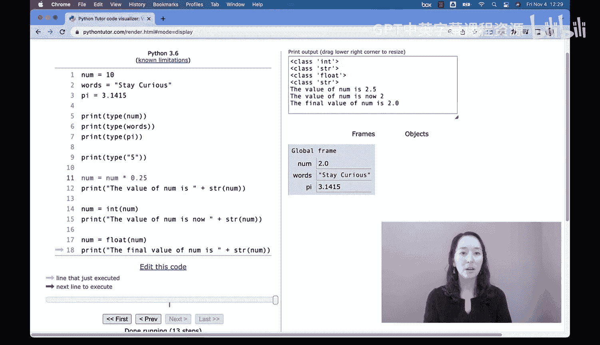

# 杜克大学《Python编程实践｜Practical Python： Start Your Programming Journey》中英字幕 p11 11_02_02_改变值的类型演示.zh_en -BV1tTmCBWEQD_p11-

Let's create some variables and see if we can use the type function to determine their data types。

 We'll use Python tutor for this， mainly because it lets us see the values stored in variables。

 So let's first make the variable called nu。And assign at the value 10。Next， let's try words。

And assign it， stay curious。Next， let's create the variable pi P and assign the value。3。1415。

 which are the first few values of the math constant number pi。

Let's see if we can use the T function to determine their data types。

 for now let's just focus on the variable called nu。Type。Phey。Nan。Pthey。

The general syntax format for the type function is to write the word type followed by parentheses and inside the parentheses is the variable or value whose type you are trying to determine the type function will then determine the type data of the variable or value that you specify here we have type Open parenthesesis nu the variable we want。

 We care about and close parenthesesis。 So the type function should tell me the data type of the variable nu。

 Let's run this code and see what happens。So before I click next。

 we can see that everything is blank， watch over here under frames as I click the next button。

Here we can confirm that the inger value of 10 was indeed stored into the variable nu。

Line two will create another variable called words， so as I hit next。

You'll see that we now have the variable words and its value is stay curious。

Just the same as we execute each line of code。 you can see each variable well created with the corresponding value being assigned to it。

 Line 3 will be the next line of code that we execute。 So hit next。

The variable pi will be created and the value 3。1415 will be assigned to pi。

The last line of code is all that's left to execute。

 Let's see what type of nu is now that the last line will execute。H that's weird。

 It appears that we have finished running the program because we can see the sliders at the end。

 But what happened with type， Was't it the code supposed to tell us the data type for none。Well。

 technically， the code did， but we didn't do anything with the result。

 like print the result to the outbox。It's like we took the result of type numb and just threw it away。

 we can't see the type of the variable。To see the determination the type function came to。

 we'll need to print the result to the upper box using the print function。

 so let's go back and edit the code。So I'm going to go down to where we had typeyum and instead have print。

Prenheses。I enclosed what I wrote down earlier inside the print function now once the type function determines Ns data type。

 the print function will take over and print the result to the output box for us to see。

 let's run this code one more time to see the difference。

Well you know what will happen for the first three lines of code。

 so let's click through really quickly and until we reach the last line。

 since that is the only part of the program that has changed。All right。

 Now notice that this has the green arrow saying that we last executed line 3 that assigned pi 2，3。

1415。 and the red arrow points to the next line to execute that we're about to run。

So when we run this， we should see the print Al box over here will show us the type of nu。

And look at that， it says class int。 What does that mean， Remember。

 class is another way of saying data type， and int is short for integer。

 so we can conclude the nus data type is an integer。

 Let's try other examples as well Back to editing the code。

So let's go to the bottom of the code and add in printing the type of our other two variables。Print。

Type。Pie， clothes， parentheses。Okay， let's see what happens with our new code。

 but while I want to show you what happens each time I click the next for the new code。

 I don't want to do it for all of the code that hasn't changed。

 so instead I'll simply click on the line I want to see execute it。Notice when I click on line 5。

 it turns red。 There's also a little red bar on the slider to indicate when the red line will be next in line to execute。

 Notice what happens when I hit next。It skipped straight to the red bar and execute all of the code that's above line 5。

 See how the green arrow shows that line 3 was last executed。

 and the red arrow means the next line to execute is line 5。 The code that's red。

 Line 4 is ignored since theres no code to execute in that line。

Marking a line of code as red is called setting a break point。 Essentially。

 we set a break point in line 5。 breakrepoint is a really neat trick you can use if you want to immediately skip to a certain line of code and don't want to keep clicking the next button。

Now let's work our way through the remaining lines of code。

 Ns data type this integer as we've seen before， so I hit next。

You can see int is printed in the alpha box。The data type for words is STR。

 which is short for string by printing the type for words， string should appear in the output box。

 so keep watching this while I hit the next button。As you can see， STR was indeed printed。Lastly。

 the data type of pi is float， which is a decimal number by executing this last line of code floatly printed in the output box。

 so take a look at the box while I hit the next button。

And now that we've executed the last line of code， floatat is printed in the upper box。

 you can also use the type function for values， not just variables。

 so let's go back to editing the code and I'll show you what I mean。

So I'm going to add a line at their bottom。And print。The type。

Of5 parentheesis parenthey to close my type and print function。

So let's find out the type of this value when the value is5 enclosed in quotes。

 let's run the code but skip to the end used in the last button since all we did was add that line。

Well， look at that Class S T R was the last line printed to the output box。

 It seems the value 5 enclosed in quotes is a type string since S R is short for string。

 This makes sense since anything enclosed in quotes is interpreted as a string in Python。

Let's move on to type casting or data type conversion as it's also known。

 S we type the following expression。If you recall， N had the integer 10 assigned to it in line 1 of my code when line 11 was executed。

Num now has the float value 2。5。 We never told Python we wanted N to be a float variable。

 Python did this automatically using implicit type casting。

 This is also an example of converting from an integer to a float。

 which does not result in the loss of data。What if we wanted the print value of nu into the alpha box。

 we can use the print statement。Print parenthees， quote， the value of。None is。Concatenate with。No。

Close parenthe。Let's run this code and skip to the end。Oh， well you look at that。

 we got an error message。Type error must be S T R， not float。

 Why't take a moment and pause this video to see if you can detect where the error is in the code。

Don't worry， I'm not going anywhere。Did you find it Well。

 let's take a closer look at what the Arab message is saying。Type error。

Tells us there's an issue with one of our data types。Must be S R， not float。

Python likes to use STR as an abbreviation for strength。By reading this error message。

 we can guess a float data type somewhere in the code needs to be converted to a string for the code to work。

If you look at the code and you can see how Python tutor nicely highlighted the line of code that is likely causing the error。

 it seems to be the last line。And there it is right there when using string concatenation。

 both opera must be of type string， so the last line of code to be valid。

 we need to explicitly typecast nu into a string data type， let's do that now。SDR parentheesis。

Prethesy。Let's run the code one more time to see how things go now。Last button。And look at that。

 Now it works。 Sose we wanted to print the integer version of nu when it's 2。5。 First。

 we should use explicit type casting to convert numb into an integer。Nan。Is assigned。En。那。

Let's also print the new value of No so we can see it。Make sure to typecast。

And let's hit the last button。嗯嗯嗯。You can see that numb is known an integer containing the value of 2。

 essentially numbm went from a float 2。5 to an integer。

 so he wanted to convert numb into a float once more。

How can we use explicit type casting to do just that？Of course。

 feel free to pause the video if you want to think about it before we move on。So let's edit the code。

Nne as a signed float。Nan。So remember， with explicit type casting。

 we specify the desired data type in this case aflo。

 followed by parentheses inside the parentheses is the variable we wish to convert in this case N now let's print noM also。

Final value。Of none is。And remember， weve got to convert numb to a string。

For string contaminatcateation。So let's execute to figure out what the final value of nu is。

 remember you can always pause the video if you need more time to think。So let's hit the last button。

Open this up so we can see it all。So let's find out what's going to happen。

 but first let's set a breakpoint online line 1 so we can quickly run through all of code right before it。

And there is the corresponding red tick mark。Okay， let's get started。

 so none right now is the value 10， which is what it was and line 1。

 and now we're about to multiply by 0。25， so watch the 10 over here and you'll see how it updates when I hit the next button。

Notice now it's 2。5， so when we print online line 12。It prints out the value of numb is 2。5。

 so we have our implicit type casting that converted numb， which was an int originally to a float。

So now let's do an explicit type casting， converting them， which is 2。5 to an int。

So notice now it is just the value too。So again， let's just print it out so we can see it。

Now it says the value of nu is now2。So it's an integer。

And now let's convert numb back into a float using explicit type casting。

Notice how NM's final value was 2。0 and not 2。5 like it was earlier。

 this is because we lose information when we convert from a float to an integer like we did in line 14。

In this case， we lost everything after the decimal point， which is the 0。5 of 2。5。

 Once you lose this information， you don't get that information back。

 it's gone even if you convert numb back into a float like we did on line 17。

 you just don't get it back。The loss of information is not necessarily a problem。

 Sometimes we want to lose this information and only keep the whole number and throw out the rest。

 if that was not our intention。 we could always edit our code to modify the part causing an error in our calculations。

Keep this in mind when you find yourself writing code， typecasting is extremely useful。

 and this will become evident as you continue in your programming journey。

