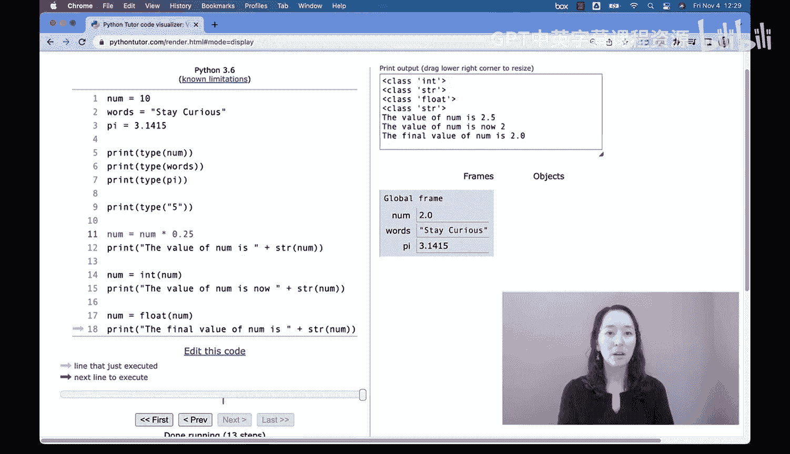

# Python编程实践：使用type函数确定数据类型


在本节课中，我们将学习如何使用Python中的`type`函数来确定变量的数据类型。

## 创建变量并使用type函数

首先，我们需要创建一些变量并使用`type`函数来确定它们的数据类型。

```python
nu = 10
words = "stay curious"
pi = 3.1415
```

接下来，我们可以使用`type`函数来确定这些变量的数据类型。

```python
print(type(nu))
print(type(words))
print(type(pi))
```

## type函数的语法

`type`函数的语法格式是：`type(变量或值)`。

例如，要确定变量`nu`的数据类型，我们可以使用以下代码：

```python
print(type(nu))
```

## 运行代码并查看结果

运行上述代码后，我们可以看到以下结果：

```
<class 'int'>
<class 'str'>
<class 'float'>
```

这表明变量`nu`的数据类型是整数（`int`），变量`words`的数据类型是字符串（`str`），变量`pi`的数据类型是浮点数（`float`）。

## 类型转换

Python还支持类型转换，也称为类型强制转换。

例如，我们可以将整数`nu`转换为浮点数：

```python
nu_float = float(nu)
print(nu_float)
```

运行上述代码后，我们可以看到以下结果：

```
10.0
```

这表明变量`nu_float`的数据类型是浮点数（`float`），其值为10.0。

## 总结



在本节课中，我们一起学习了如何使用Python中的`type`函数来确定变量的数据类型，以及如何进行类型转换。希望这些知识能够帮助你更好地理解Python编程。