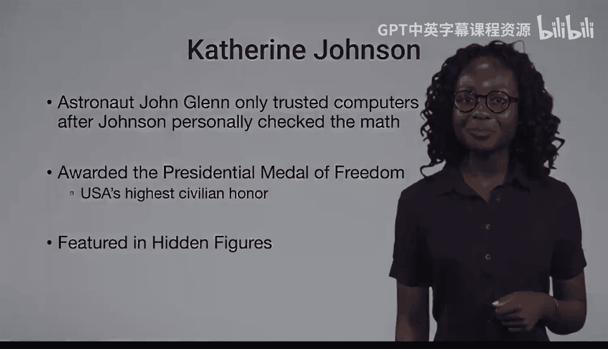

# 杜克大学《Python编程实践｜Practical Python： Start Your Programming Journey》中英字幕 p12 12_02_04_浮点数-计算机中的十进制数.zh_en -BV1tTmCBWEQD_p12-

We have been using flow data types for some time now。

 but let's take a few minutes to go into more detail on what Ex floats are and how they work in Python。

Thus far， we know that a float is any number with the decimal point in python。

The term float is short for floating point number。In this course。

 we may interchange float and floating point number to refer to a decimal number。

Let's look at the different components that make up a floatlo。

Here we have an example float value of negative 3。495，a floating point number has three parts。

The first part is a sign associated with the number that is stored in your computer memory。

 along with the number itself。In this example。The sign is for a negative number。

If the number is positive， Python will omit the sign from your view。

But the sign for positive number is still present in your computer memory。

Then we have the decimal point。Finally， the mentia is all the digits that compose the number itself。

In this example， the menta is 3， four，9， and5。This is how floating point numbers have always been represented up to this point in the course。

But in Python， behind all the code。Your floating point numbers are represented using scientific notation。

This is how floating and point numbers are stored in your computer。With scientific notation。

 you have the sign to tell you if the number is positive or negative。You have the mentia。

 which are all the digits that compose the number itself。

The base which will always be 10 since the numbers we use consists of the digits 0 through9。

That is we can use a combination of 10 unique digits being 0 through9 to represent any number。Lastly。

 we have the exponent， which tells us where to place the decimal point。

These two representations of a floating point number are equivalent。

They are just different ways to write the same number。Like in classical math。

 you can shift a decimal point around using Python expressions。This will also change the value。

Here you can see the decimal point shifted one space to the right。

Notice how the exponent value also changed in the scientific notation。

It changed from negative 3 to negative 2。Once again， the decimal point moved to the right。

And the exponent in the scientific notation also changed to reflect this。

And this is how floats came to be called the way they are。

The decimal point can float around the mentesa by just changing the exponent。

Flo and point numbers are powerful data types that can store huge numbers。

One example of a large number is 1。79E308。I won't go on to read the whole number。

This number can be represented in scientific notation as 1。79 times 10 to the power of 308。Likewise。

 floats can store extremely small numbers。2。22 e negative 308 is an example of one such small number。

Using scientific notation， this number can be represented as 2。

22 times 10 to the power of negative 308。The largest flow value Python supports is positive infinity。

Or I enough for short。Let's look at an example。Var is a float I F。

Notice how INF is a strength explicitly type cast to a float。

This is because the value infinity is a special value in Python。

In fact to store this value into a variable， you need to write it as a string。

And explicitly type cast it to af float。It is important to note that infinity。

 as it is known in Python is not an infinite number of digits。

 but rather the concept of positive infinity as it is known in classical math。

Once you assign infinity to a variable， just like we did with Var。

That variable will contain a value larger than any other float value in Python。

It is the largest flow value Python can support。If INF is hard to remember。

 you can also write the whole word infinity。There are many ways to write code to produce a desired result。

 it is okay to have a preference In this case， you can write INF or infinity either works pick your favorite。

The smallest value that Python supports is negative infinity。Let's take a look at an example。

Far is a sine float negative INF。Like the previous example。

 negative infinity is a special value in Python。To assign negative infinity to a variable。

 you would need to write the string negative INF and type cast it to a float。

And just like the previous example， if negative INF is hard to remember。

 you can also write negative infinity。Although floating point numbers are compelling data types。

 they're far from perfect， therefore you will want to keep some limitations in mind when working with floats。

Flot and point numbers can be extremely large or extremely small， but the number of digits is finite。

Therefore， if your number is too large or too small。

 you will either receive an error message or your number will be converted into positive or negative infinity。

Also， floating point numbers are not always correct。They're susceptible to round and errors。

Python floats are accurate until around the 15， 16th or 17th digits。

The digit depends on the number itself。After that， they cannot be fully trusted。

Browund and errors would not present much of an issue unless you're coding advanced mathematical expressions that require extreme precision。

To that end， let's look at some examples of rounding errors。In classical math，2 divided by 3 is 0。66。

Where the sixes continue to infinity？There is no end to the sixes。

Why does this pose a problem in Python？Well， we know that Python does not support an infinite number of digits。

 so what is the result of  two divided by 3 in Python？At zero， followed by the decimal point。

 followed by 16 copies of the number6。So not counting the zeros in front of the number。

Python rounds off an infinite number of sixes into just 16 of them。Thatwe。

 Python approximates the solution to 2 divided by 3。Since it can not store the complete solution。

You may have also noticed that since we cannot represent an infinite number of sixes。

Then it would have been more accurate to round of the last digit to a7。Python is not perfect。

What about 100。2 plus 100。4？Intuitively， this should be 200。6。But what is it in Python？100。

2 plus 100。4 in Python is 200。6。Followed by many zeros and a two at the variant。

If we count a number of digits， you will see that the two is the 17th digits。

Somehow all the trailing zeros were rounded off to the number two。It doesn't make much sense。

 does it？This is another example of around an error in which floats are susceptible。

Fortunately for us， the 17th digits is a significantly small enough error to not be an issue in most but not all programs。

These errors may not always occur。But they happen frequently enough that you should be aware of them。

Let's look at another place where rounding issues may present themselves。

And that would be when converting from strength to float and vice versa。As a quick refresher。

 we have float parentheses and inside the parentheses， we have the string。5。0。

This evaluates the flow value of 5。0。So essentially the string 5。

0 was converted into the flow value 5。0。We can convert the value back to a string by writing STR parentheses。

 and inside the parentheses we write the flow value 5。0。This evaluates to the string5。0。

 S instead I have a string composed of a0， a decimal point，16 copies of the number three。

And two copies of the number9 at the end。Converting this long string to a float will produce approximately the same value as a float data type。

Not counting any leading zeros， we can see that the main difference is that the last digit。

 or in this case， the 16th digit is rounded up to a4 instead of 399。In this example。

 the number was rounded correctly。But an issue may present itself if you expect an exact number translation。

Instead of the rounded number。Let's go back to the zero， a decimal point。

 16 copies of the number three and two copies of the number nine at the end。

Instead of this being a string， it is now a float that we are trying to convert to a string。

By explicitly typecasting this flow value to a string。

We get a string representing the same approximate value。

But the 16th digit is rounded up to be a 4 instead of the 3，9，9。Once more。

This number was rounded correctly before the number was converted to a string。

But issues may arise if you were expected an exact conversion where your intention was for there to be no rounding at all。

Despite the limitations， floats are still very powerful data types from which you can benefit greatly。

It may not appear so， but floating point data types have improved significantly over the years。

In the 1950s and '60s， the United States of America or the USA as it is also new。

Wanted to send a person to space。But to do so， they needed to overcome one big problem。

The problem was that computers were prone to malfunction and blackouts。

 so they could not be trusted with the calculations needed for space travel。

The USA needed a brilliant mathematician who could manually solve complex mathematical equations with extreme precision。

In comes Katherine Johnson， who is a black female mathematician。

She gained a lot of recognition for how accurately she was able to solve these complex mathematical equations by hand。

Her calculations were critical to the success of the space missions。

When computer started doing calculations， she would cross reference the results of the computer with her calculations to determine if the computer was correct or not。

Each time there was a difference in the resulting in analysis。

 it turned out that the computer was always in the rank。When NASA。

 the US government agency responsible for space exploration。

 first started using computers to do calculations for rockets。

Astronaut John Glenn was wary of computers。He specifically asked Catherine Johnson to check all the calculations before he flew。

And his flight to orbit the moon was very successful。

Catherine Johnson's immense contributions to space travel were downplayed for many years due to racial and gender biases。

But her hard work was eventually recognized by the public。

She was even awarded the presidential Mad of Freedom。

The highest honor a civilian can earn in the United States of America。

She was also featured in the book Hidden Figures， which was later made into a movie。

I hope you enjoyed learning more about floats and keep its limitations in mind。

As you use them moving forward。

