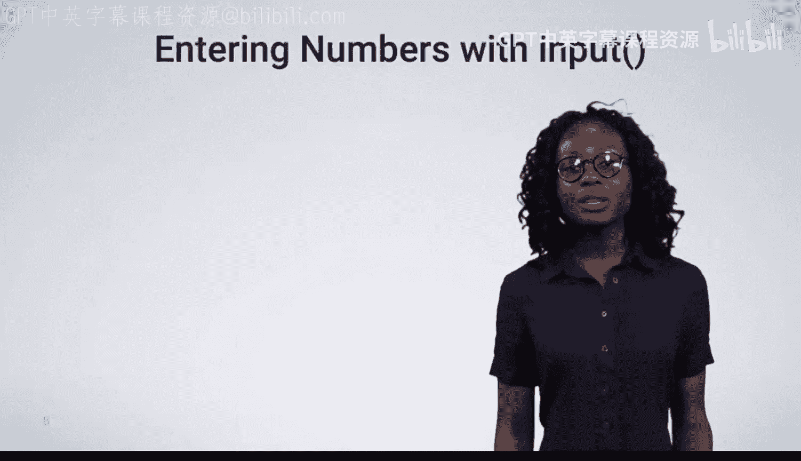

# Python编程实践：交互式程序设计


在本节课中，我们将学习如何使Python程序具有交互性，即让程序能够根据用户输入产生不同的结果。

## 1. 程序的交互性

为了使程序具有交互性，即程序能够产生不同的有意义的结果，你需要让程序接收输入。如果没有输入，程序每次运行时都会执行相同的事情。但并非完全如此。有方法可以让程序生成随机结果，但你还没有学习到这一点。

## 2. 获取简单数据的方法

以下是获取简单数据到程序中的几种方法：

### 2.1 使用Python输入函数

当你运行程序时，输入函数允许你输入可以与代码一起使用的数据。每次运行程序时，如果你想的话，都可以输入不同的内容。

如何知道何时输入数据？你需要提供一个将在控制台显示的短语。这样你就可以知道是时候输入输入了。这个短语提示用户输入。

我说的用户是什么意思？大多数程序都是为了某人使用或运行程序而设计的。那个人被称为用户。程序应该设计得易于用户运行。

当使用输入函数时，你的代码提供了一个提示来解释用户需要输入什么。

输入函数将你输入的值转换为字符串数据类型。这个过程也称为读取用户输入。由于用户正在使用或运行程序，因此当提示输入时，用户会进行输入。

一旦程序读取输入，程序就可以在程序中使用该值。

### 2.2 输入函数的语法

由于输入提供了值，因此最好将此值存储到变量中。变量名位于赋值运算符的左侧，因为你正在将该值分配给该变量。输入函数位于赋值运算符的右侧，其名称为input，后跟括号和括号内的字符串提示。

提示是当执行输入函数时用户将看到的。编写描述性提示是一个好习惯，这样用户就不会猜测他们应该输入什么。

### 2.3 示例

以下是一个名为name的变量的示例。该变量将分配给赋值运算符右侧的表达式的结果。



```python
name = input("What is your name?")
```

当运行此代码时，程序会在终端显示提示“请输入你的名字？”。用户可以输入他们的名字，然后按Enter键。程序将把用户输入的名字存储在变量name中。

## 3. 处理数字输入

如何将数字输入到程序中以便对其进行计算？

所有输入都作为字符串读入程序。如果你输入一个整数，那么这个整数将以字符串的形式输入，但你可以使用类型转换将该字符串转换为整数。同样，如果你想输入一个浮点数作为输入，那么浮点数将以字符串的形式输入，但你可以使用类型转换将该字符串转换为浮点值。

### 3.1 类型转换

让我们看一个例子。假设你想为你和一群朋友购买几张电影票。

以下是一行代码，询问你想购买多少张票。无论你输入什么，变量tickets都将被分配一个字符串值。如果该值是整数，则可以使用int函数将该整数的字符串版本转换为实际的整数。

```python
tickets = input("How many tickets do you want to purchase?")
tickets_int = int(tickets)
```

当运行此代码时，程序会提示用户“你想购买多少张票？”。用户可以输入数字，例如4。程序将把用户输入的数字存储在变量tickets中。然后，程序尝试将字符串“4”转换为整数。

### 3.2 计算票价

现在，让我们通过添加三行代码来扩展此示例，以便您可以计算四张票的总价。

```python
price = float(input("What is the price of one ticket?"))
amount = tickets_int * price
print(f"The cost of {tickets_int} tickets is ${amount:.2f}.")
```

当运行此代码时，程序会提示用户输入每张票的价格。用户可以输入价格，例如10.50。程序将把用户输入的价格存储在变量price中。然后，程序将计算四张票的总价，并将其存储在变量amount中。

### 3.3 打印格式化

默认情况下，Python在打印浮点值时只打印非零数字，并且至少有一位数字在小数点右边。可以使用打印格式化来指定要打印的小数点右边数字的位数。

## 4. 错误输入处理

当用户输入错误的数据时会发生什么？

例如，程序询问用户“你想购买多少张票？”用户输入单词“for”。这并不清楚地表明用户想要输入什么类型的数据。程序将把单词“for”存储在变量tickets中。当执行下一行代码时，程序尝试将字符串“for”转换为整数，这将不会工作。

为了解决这个问题，我们可以给用户提供更好的消息，例如在输入函数提示中添加一个示例，这样他们就知道程序想要什么类型的数据。

## 5. 总结


在本节课中，我们一起学习了如何使Python程序具有交互性，以及如何处理用户输入。记住，所有值都作为字符串读入，如果这些字符串代表数字，则如果要对它们进行计算，则需要将它们转换为数字类型。希望你喜欢这个视频！