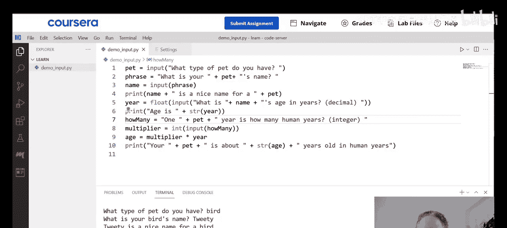
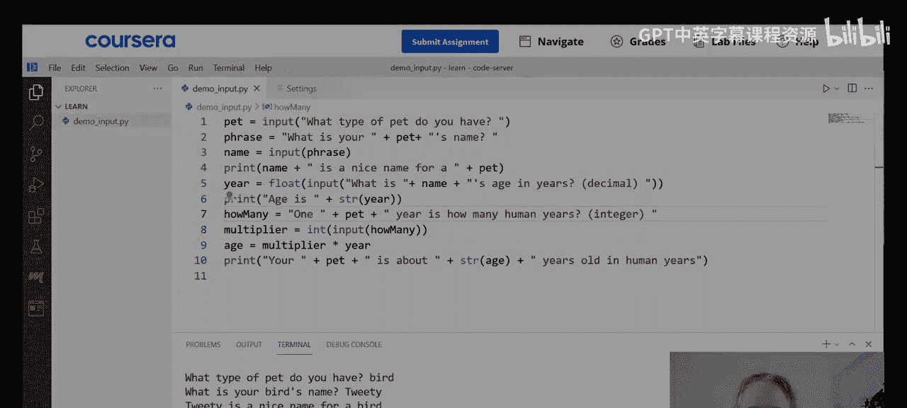

# 杜克大学《Python编程实践｜Practical Python： Start Your Programming Journey》中英字幕 p14 14_02_02_在VS Code中实现程序交互性演示.zh_en -BV1tTmCBWEQD_p14-

Let's do an example in the coding environment so you can see how the input function works in practice。

As I walk through the code， I'm also going to show you common mistakes we've seen when people are first learning how to code and also how to fix them。

When I get to those mistakes， I'll make sure to pause and explain the mistake and how to fix it。

So first， let's start with the file， you can see here。

 I've named the file demo underscore input because this is a demo on the input。

And what I'm going to do first is type in some code that ask what type of pet you have。

And then what is your pet's name？So for the type of pet， we need a variable name。

 I'm just going to use PE。Is signed？And we're going to use the input and put some parentheses there。

 and then we need a prompt for the input function。So let's say。What。Type of pet。Do you have。

What type of pet do you have question mark？Okay， so that prompt is going to ask the user for what type of pet。

 and then they're going to type in the type and that's going to be stored in the variable PE。

We also want to get the name of the pet and we're going to do that in two lines。

So we're going to create a variable for the prompt， I'm going to call that phrase。

Gets and we just put a string here。What is your。I can't type what is your pet's name， question mark？

And then we're going to store the name in the variable name， so name gets the input。Of。

And then we have phrase。Phrase has our prompt already in it。

 so that's just what we did in the first line。We're putting that in two lines by having phrase a variable and then name equals input phrase。

We also need to print something， so how about we print。What the name is， let's say we print。Name。

Plus。Is a nice。Nei。Okay， let's run this code and see what happens。To run it。

 we're going to click the arrow here。And then we need to click down here。So that it takes the input。

 so what type of pet do you have？Cat。What's your pet's name？Myra Sue。Myra Sue is a nice name。

Now you can see we have some problems with spacing we need to fix。So。

The first one is what type of pet do you have in that question mark and the wordca are right up against each other。

 so if we go back to line1 where it says what type of pet do you have。

 let's add a blank right after that question mark。We have the same problem online。Two。

 what is your pet's name is right up against Myra Suu。

 so let's add a blank after that question mark on Online2 in the code。

And then we haveS is is runningSe is running up against the word is。

 so right before the word is in line4， let's add a blank before the word is。Okay。

 let's try that again。We run it again， we get what type of pet do you have， cats？

Myra Sue for the name。Myrau is a nice name。That worked great。

Now instead of saying what is your pet's name， it would be nice if it said whatever pet the person types in。

 like if I type in cat， it should say what is your cat's name and if I type in dog it should say what is your dog's name。

 so let's look at line two。We're going to change the variable phrase so where it says， what is your？

And we'll put a quote here。Plus。Pet is a variable name， so we can concatenate PE with that。

And then we need to put a quote here。 So now we have。

Prase is three strings being concateated together， what is your， the value of Pat？SName。Okay。

 I think that'll work， let's run it and see。We'll run it again， what kind of pets do you have。

 we have a cat。What's your cat's name， Myra Sue？Myra Suux is a nice name。

 so here it asks you what's your cat's name， not what's your pet's name， but what's your cat's name。

So that works great， we could try a different animal， so if we run it again， we could say。

What type of pet do you have？We have a dog。What's your dog's name， Baron？Baon is a nice name。

 so it asks for dog's name， that's great。Now let's look at line four。

It would also be nice to add the type of pet， so it says that it's a nice name for a cat or a nice name for a dog。

 depending on what type of pet that they type in， so let's fix line four。So it says it's a nice name。

For a。And put a space there plus。Pet。Okay， let's try that。If we run this。

 we get what type of pet you have。We'll go back to cats， what's your cat's name？Myra Suu。

Myrau is a nice name for a cat， so that worked really well。 Let's run it with another example。

Let's try a bird。What type of pet do you have， a bird？What's your bird's name， feathers？

Feaers is a nice name for a bird， so that worked well。

We now want to try to calculate how old your pet is in human years。 you may have heard the saying。

That one year for a dog is equivalent to about seven years in human life。

 so if your dog is two years old， then your dog acts like a 14 year old human。So first。

 let's just write code to read in the age of the pet as a float and print that。

So we want to read the agent as a number so we can use that number to calculate how old the pet is in human years。

 so let's add in the following。First， let's go to the end of line four and hit return。

We need a variable name for the age and years， I'm going to put a year。🤢，I gets。

And then we want to get some inputs， so we'll use that。And we want to ask。

What is their pet's name in years， so let's say what。Let's try this again。What is。We can just say。

The name of the pet here， so plus name。Names。Years， sorry， age in years， age in years。Question mark。

 and let's put a blank there。And then so that will ask what is the name input for what is the name's age in years now we want to read that into a float so let's put float around the whole thing。

 that input， so let's say floats。Los parentheses here and it's around the whole thing so we've got to put a right print in all the way at the end。

 so that will say what is named age in years and we're input so the user is going to type something in。

 it comes in as a string and we convert it to a float。

And then we should print it out so we can see what it is， so let's print that out。

We'll just have a print statement that says。嗯。Age， let's use capital age is。Plus。Age， there we go。

So let's run that so we can also see the age of the animal。So if we run this。

 we get what type of pet do you have？Let's say cats。What's your cat's name， Myra Sue？

Myra Sue's a nice name， what's Myra Sue's age in years， let's say she is eight。Oh， we got an error。

It says name， error， name age is not defined。And the error is on line six， so again。

 where it says file， the line that starts with the word file。If you scroll over。

 you'll see it says line 6， that's where the error is， it also prints out line6。The print statement。

 and then it has name error， So if we look at line six。Age。And if you look at our code。

 you'll see that。Age， we never defined age， so the computer doesn't know what age is。

 so lets that should be year。That should be year， we just typed the wrong variable name。

Age isn't even a variable。So let's put ages year and let's run it again。We run this。

 we get what type of pet do you have？cats。Myra Sue is the name。Myras age is eight and it says， oh。

 we got another error type error can only concatenate string， not a float to a string。

Still on line six， it says， so year is of type float so we need to convert year to a string。

 so let's add STR in front of year or basically around year with parentheses。So now ages is a string。

 and then year which is a float， we're going to convert to a string so we can add two strings together。

Let's try and run this again。We get。Let's run it， click on the arrow， what type of pet do you have。

 a cat？嗯。We're getting some kind of error here， hold on a second。Let me start this over。

 sometimes it happens。All right， so let me run it again。What type of pet do you have？The cat。

What is your cat's name？Myra Suu。Myra sus age in years is eight。And that worked。

 it says the age is 8。0。Let's run another example。Let's run it on。

Let's say what type of pet do you have a bird？Bird's name is Feaths。What is feather's age in years。

 let's say three？Po5。And it says age is 3。5， so that's good。Now。

 in order to calculate how old a pet is in human years。

 our code is going to need to ask the user how many years does their pet age in one human year？

And then we can use that number to calculate how old pet is in human years。

So let's add the following code。 Now， the prompt for the user is going to be pretty long。

 So I'm going to assign the prompt to a variable first。 Let's call that variable。

Let's see right here on line7， let's call that variable how many。

And that is going to get assigned to a string。One space。Plus。Pet。Plus。So it's like one pet years。

 how many human years， and the pet is going to be the pet that they type in， so one pet。

 and then we need a string。year。Let's add a space here。

Year is how many human years question mark and let's also add a space here。

So that is going to be just the prompt that we're going to use。

Let's use input to get that value in and we'll assign it to a variable called multiplier。

Let' we're typing in the wrong place， sometimes it happens。A multiultipplliier。

Is going to get the input of。How many？That's the phrase that we just typed， so it'll say。

One pet years。 How many human years we're going to get that input。 Now that is a multiplier。

 So we're going to want that to be an integer。 So I'm going to put int around。Input。And how many。

And then once we have the multiplier， we can multiply that times the age of the pet。

And so let's call that。Age is going to equal multiplier。

Multipliier times the number of years old that the pet is。And then we can print out the results。

 So let's say we'll print。So we want to print like your pad is about this many years old in human ears。

 so that would start with the string yourre。It capital。Your。Plus the pet， the type of pet they have。

Plus。Is about。呃。Ill put a space there。Plus， we have the age so we're can use the variable age。Plus。

 years old in human years。Years old in。Human ears。Okay。

So we have your pet is about this age years old in human years。Ah that's a mouthful。

 so let's run it and see what happens。We'll run it here。And come down here。

 what type of pet do you have， let's say a bird？What's your bird's name， feathers？

What is feather's age in years？We have 3。5。And it says age is 3。5， one bird years。

 how many human years， I think it's about 10。So I'm going to put in 10。Oh， we got a type air。

Can only concatenate a string， not afloat to string。And it tells us， again。

 look for the line that starts with the word file that says on line 10， so if we look at line 10。

 we have yours as a string， pets a string is about as a string。Age is aloat。 so age here。

 So we need to make this variable age a string。We need to convert it to a string so that we can catnate it with other strings to build that long phrase we're printing out。

So I'm going to add。Priheses there， so your pet is about， let's try this again。

 we're just going to run it again and see if that fixed it。What type of pet do you have， bird？

Name is Fes。Feaer's age in years is 3。5。One bird years， how many human years， 10？

Your bird is about 35 years old in human years， and I see we have one type it we need to fix。

 we need to put a space right before the word years old。We can add that here。Okay， so I think that。

Fixes it， but let's just run it to make sure。We'll run it， let's try a dog this time。

 maybe what type of pet do you have？The dog。What's your dog's name， about Chica？

What is Chika's engineers， maybe four？And one dog years， how many human years that's seven。

Your dog is about 28 years old in human years。Okay。

 now let's think about how we could help the user a little bit better， so for example。

 suppose a user does this， let's run it one more time。And it says， what type of pet do you have？

We have a dog。What's your dog's name， Chica？What's she age and years what if I type？The word for。Ah。

 we get an error。So how does the user know what to type in？We didn't say to type in a number。

 we just said what is Chika's age in years， so it would probably be helpful if we were to add a hint to the user for that so let's go to that line where it asks for the age。

What is？Names engineers， that's on line five。And we want them to type in a decimbel number。

 so what we could do is at the end of line five right before the quote we could add parentheses。

Not float because they won't know what that is， but decimal。

That way the user knows to type in a decimal number。And so if we run it again。One more time， we say。

What type of pet do you have， a dog？Dog's name is Chiica。Ch is age in years。

 we need to add a blank there， but it says decimal。 So now I know to type a decimal number。

 so I could say。So what is Chika's age in years tells us to type in a decimbel number so we could save。

F point。One， even。And then it sell us ages 4。1， one dog years， how many human years？

Let's say seven and your dog's is about 28。69999 years old in human years。

Now we do need to add a blank right after that parentheses for decimal。

And we could also where it says one dog years， how many human years we could also add。

Integer here just so they know to type an integer。This is all about helping the user so they know what to enter in and they're less likely to type in the wrong thing。

All right， so let's run it one more time。This is looking good。What type of pet do you have。

 let's say I have a cat。What's your cat's name， I have a cat named Mo。Mo's a nice name。

 what's Mo's age in years， 15？Pot2。One cat years， how many human years， I think that's about eight。

So it says your cat is 121。6 years old in human years。 Wow。

 that's pretty old and let's run it one more time。This time we'll try a bird。

 what type of pet do you have， a bird？What's your bird's name， Twey？Onces Twey's age。

 let's say the our bird Twey is three。One bird years， how many human years， 10？

And your bird's about 30 years old。So that worked  well， so that's our example with input in VS code。

