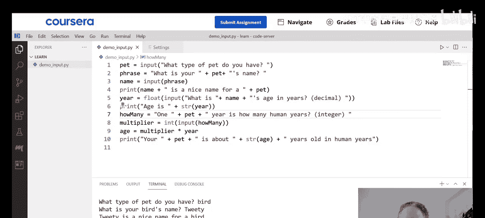
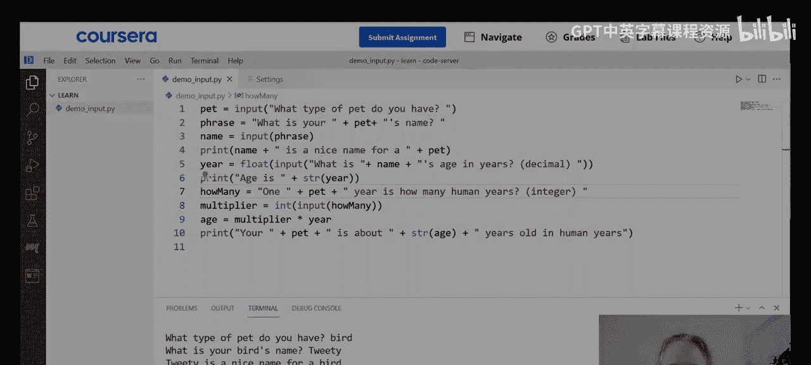

# 杜克大学《Python编程实践》：使用VS Code实现程序交互性演示


在本节课中，我们将学习如何在VS Code中实现程序交互性，并通过一个示例来演示如何使用`input()`函数获取用户输入。

## 1. 创建示例文件

首先，我们需要创建一个名为`demo_input.py`的Python文件，用于演示如何使用`input()`函数。

```python
# demo_input.py
```

## 2. 获取宠物类型和名称

接下来，我们将编写代码来获取用户输入的宠物类型和名称。

```python
# 获取宠物类型
pet_type = input("What type of pet do you have? ")

# 获取宠物名称
pet_name = input("What is your pet's name? ")
```

## 3. 打印宠物信息

现在，我们将打印出宠物的类型和名称。

```python
# 打印宠物信息
print(f"{pet_name} is a nice name for a {pet_type}.")
```

## 4. 修复间距问题

在运行代码后，我们会发现存在一些间距问题。我们需要在相应的位置添加空格来修复这些问题。

```python
# 修复间距问题
print(f"{pet_name} is a nice name for a {pet_type}.")
```

## 5. 动态生成宠物名称提示

为了使程序更加灵活，我们可以将宠物类型和名称提示合并为一个变量，并动态生成宠物名称提示。

```python
# 动态生成宠物名称提示
prompt = f"What is your {pet_type}'s name? "
pet_name = input(prompt)
print(f"{pet_name} is a nice name for a {pet_type}.")
```

## 6. 计算宠物年龄

接下来，我们将学习如何使用`input()`函数获取宠物年龄，并计算其在人类年龄中的对应值。

```python
# 获取宠物年龄
pet_age = float(input("What is your pet's age in years? "))

# 计算人类年龄
human_age = pet_age * 7
print(f"Your pet is about {human_age} years old in human years.")
```

## 7. 添加用户提示

为了帮助用户正确输入数据，我们可以在提示信息中添加相应的说明。

```python
# 添加用户提示
print("What type of pet do you have? (e.g., cat, dog, bird)")
pet_type = input()

print("What is your pet's name? ")
pet_name = input()

print("What is your pet's age in years? (e.g., 3.5)")
pet_age = float(input())

human_age = pet_age * 7
print(f"Your pet is about {human_age} years old in human years.")
```

## 总结





本节课中，我们一起学习了如何在VS Code中使用`input()`函数获取用户输入，并实现程序交互性。通过一个示例，我们演示了如何获取宠物类型、名称和年龄，并计算其在人类年龄中的对应值。希望这些内容能够帮助你更好地理解Python编程实践。