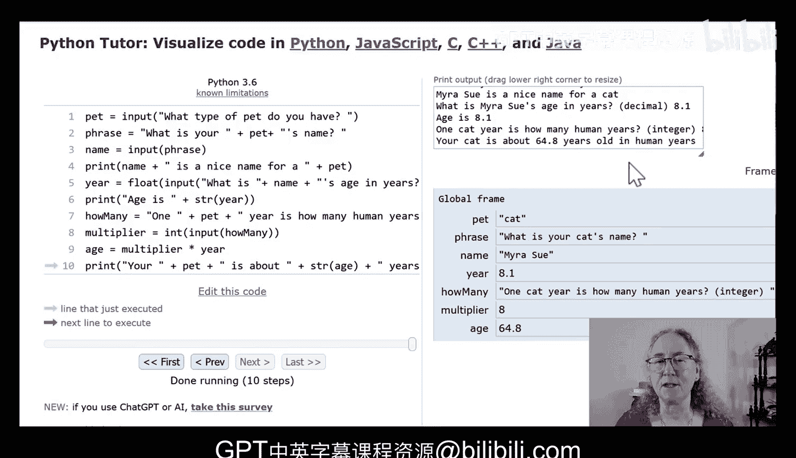

# 杜克大学《Python编程实践｜Practical Python： Start Your Programming Journey》中英字幕 p15 15_02_03_在Python Tutor中实现程序交互性演示.zh_en -BV1tTmCBWEQD_p15-

Let's also see how this code runs in Python Tutor with Python Tutor。

 the input is done a little differently and we'll be able to see the values of all the variables so I'm going to cut and paste this code。

Let me just grab it。And copy it。There's a copy。And then I've got Python Tutor here。

And I'll need to go down in where it says， editit this code。I can this is just default code。

 I'm just going to paste over。There's our code。Okay。

And then what we're going to do now is visualize execution so it will run our code。There it goes。

It's just notice it says the next line to execute is right here。So。You can see down below， it says。

 what type of pet do you have？So it's a little different and we need to type in。

 let's say we have a cat。And then when we click submitit。

It shows over here on the frame it has the PE and its value， so you can see cat is the value of PE。

 so that first line has completed and the variable PE was created and it got a value and you can see the value it's right there。

The next time we're about to run， we're going to click next and phrase is going to get that value and you can see。

Phrase has the value， what is your cat's name？I also just want to show you at the top up here。

 it's also printing the output， but you have to type in the input too。

 so it's a little confusing but。U here it says print output， what type of pet do you have。

 you can see that too。Alright， so now we're about to execute line3 and it's going to ask you the input question。

 what is your cat's name， You can see that， and I'm going to type in。My cat's name is Myra Sue。

And if I submit that。You can see over here the result of line3 is now there's a variable name that has the value myra。

And we're about to execute line four， so if we click next， you can see line four has printed up here。

 Myrau is a nice name for a cat。Now we're about to execute line5。

 we've got another input it says what is Myrau's age in years， let's say it's 8。1。

And if I submit that。You can see now year has a value and it's 8。1。So year is a new variable。

We're getting ready to execute line six next， which is a print statement。

 so we just click next and we'll see in the box up there ages 8。1。Next， it says how many？

Its going to be assigned that long phrase， so if we click next。

 you can see how many is one cat years， how many human years integer。

Just reminding us to type an integer。So let's say one cat year is eight。Human years。

 if we click submitmit。We can now see multiplier has been added as a new variable that has the value 8。

And then line nine says a is multiplier times year and if we click next。

 you'll see age has been added over here and as another new variable and it has the value 64。

8 and then finally we will click one more time and we'll print。Your cat is about 64。

8 years old in human years。So the input looks a little bit different。

 you see the little box over here to give your input， so that's just a little bit different。

 but what's nice about Python Tutor is you can see all the variables and their values once they've been created。

And you can see the output right above that。So now that you know how to get input into your programs。

 you know how to get in strings and integers and decimal numbers。

Your programs can be different every time you run them。

 Just remember that if you want to do calculations on numbers from input。

 you'll need to convert them to numbers and if you want to combine numbers with strings for printing。

 the numbers must be converted into strings first。So I hope you enjoyed going through this demo on inputs together。

