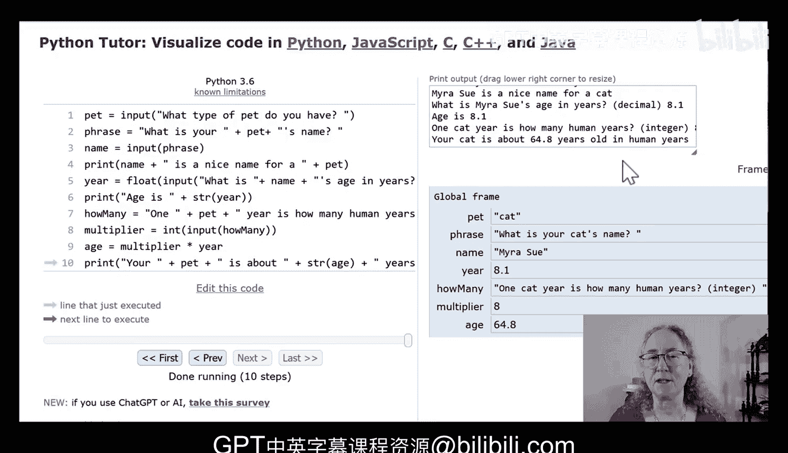

# Python编程实践：使用Python Tutor实现程序交互性演示


在本节课中，我们将学习如何在Python Tutor中实现程序交互性演示，通过实际操作来理解Python程序的执行过程。

## 1. 准备工作

首先，确保你已经安装了Python Tutor。Python Tutor是一个交互式在线工具，可以可视化Python代码的执行过程。

## 2. 代码准备

以下是一个简单的Python程序，我们将使用Python Tutor来演示其执行过程：

```python
pet = input("What type of pet do you have? ")
name = input("What is your {}'s name? ".format(pet))
age = float(input("What is {}'s age in years? ".format(name)))
multiplier = int(input("How many human years does one cat year equal? "))
age_in_human_years = multiplier * age
print("Your {} is about {} years old in human years.".format(name, age_in_human_years))
```

## 3. 在Python Tutor中运行代码

1. 将上述代码复制到Python Tutor的编辑器中。
2. 点击“Run”按钮，程序开始执行。

## 4. 观察程序执行过程

1. 当程序提示输入宠物类型时，输入“cat”并按回车键。
2. 程序会显示变量`pet`的值为`cat`，表示宠物类型已确定。
3. 接下来，程序会提示输入宠物的名字。输入“Myra Sue”并按回车键。
4. 程序会显示变量`name`的值为`Myra Sue`，表示宠物名字已确定。
5. 然后，程序会提示输入宠物的年龄。输入`8.1`并按回车键。
6. 程序会显示变量`age`的值为`8.1`，表示宠物年龄已确定。
7. 接下来，程序会提示输入每只猫年等于多少人类年。输入`8`并按回车键。
8. 程序会显示变量`multiplier`的值为`8`，表示每只猫年等于8个人类年。
9. 然后，程序会计算宠物在人类年龄下的年龄，并显示变量`age_in_human_years`的值。
10. 最后，程序会输出宠物的年龄。

## 5. 总结




本节课中，我们学习了如何在Python Tutor中实现程序交互性演示。通过实际操作，我们了解了Python程序的执行过程，以及如何获取用户输入并对其进行处理。希望这个教程能帮助你更好地理解Python编程。