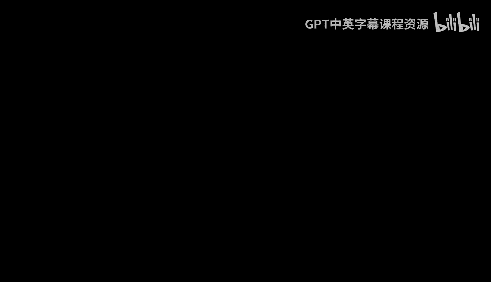
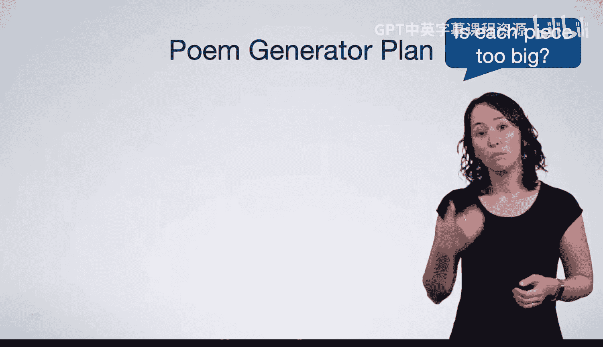

# 杜克大学《Python编程实践｜Practical Python： Start Your Programming Journey》中英字幕 p16 16_02_01_如何编写程序-设计与规划.zh_en -BV1tTmCBWEQD_p16-

嗯。Now that we've gone through more than a week's worth of material。

 let's step back and think about how to approach writing a program After all。

 while diving right into writing code for your project can be a good approach and seem like the fastest way to reach our goal。

 It's not always the case。 you may find yourself lost or wandering around in circles。

 Sometimes it's better to have a plan。 so that you can see the forest for the trees。

 and know how to navigate to your destination。😊，Of course， to help you see why a plan is a good idea。

 we've made this video super concrete by talking about how to approach the next lap。

 which is about writing code that will write a poem for you。😊，But this is more than just code。

 thoughll write the same thing over and over again。 Instead。

 we've added some requirements so your poem could be different every time you run it。

And so that we can test your program automatically to see if it fulfills a small set of specifications。

 So first， your program is going to need to have four user inputs。

 The first three inputs need to be of type string。 and the last input needs to be of type int。😊。

Second， the poem is at least three lines long。Third。

 all the string inputs need to appear at least once in your poem， otherwise。

What's the point of having three inputs。Finally， using the input of type int in one of the lines of the poem。

 one of the string inputs must appear that many times。So， for example。

 if the string inputs were Kristen， cat and Miaow and the int input was 5。

 The poem generator could generate a poem that says my name is Kristen。 I have a cat。 It says Miaow。

 Miao， Miao， Mio， Miao， Miaow。Notice the last line has the string Miow appearing five times。 Now。

 at this point， you might feel that that looks like a lot of things to keep track of。 It's okay。

 That's why this video is about how to write a program。

 Let's step back and talk about the different steps to writing a program so you can break things down into smaller steps。

Here are the steps to writing a program design。Plan。Implement。Verify debug。However。

 this flow of steps。Isn't quite right。 Instead， these steps are more like activities。

Activities that are interconnected， where one can flow to another。Sure。

 going from one activity to another may be more or less common。

But it is the case that at any point in time， you may transition from one activity to another。

Or be doing a little bit of multiple activities at the same time。😊，And that's okay。

 We are teaching you these activities as a helpful framework to help you think about the process of writing a program so that you don't get lost。

😊，Think of these activities as us giving you a map。 You are welcome to take whatever path you want。😊。

But the map will at least help you figure out where you are currently and what direction will likely be the most useful next step。

So with that， let's start with learning about the design activity。

 This activity is where you should probably start when writing a program。😊。

Designing is where you get to dream big and brainstorm what you want your program to do。

This activity is also when you ask whether the program should do something and why to start with。

 you can just write out a first attempt of what you want the program to do and worry about the details of writing out the code later。

😊，Right now is the time to think about what you want to happen and not how it will happen。

So for the poem generation lab， the program could first ask for a first name， let's use。

The name of the first computer programmer， Augusta Atta King。

 the countess of Lovelace or Addda Lovelace。 So her first name was Augusta。😊。

The next prompt could ask for a middle name， which in this case is Addda。And for the last string。

 the program asks for a last name。 So in this case， king。Finally， for the int。

 the program says to give it any number without saying anything else。

 So let's just give the program the integer for。😊，The poem the program generates would then say。

Augusta at a king， Augusta， Augusta， Augusta， Augusta。Atda atda， atda at。King， king， king king。

Notice how the program prints out the full name first。

 and then the other lines print out each part of the name four times because of the number four input。

Now that we have this first idea， it's time to step back and ask。Is this。A good idea。Of course。

 that should get you to wonder， what does。😊，Good idea， even me。

To understand whether a design is any good， you need to ask a few questions。

What are you trying to make。In this case， you are trying to write a program that generates a poem。

 and that seems rather obvious， right？Let's go deeper。Why are you writing this program。

 What is the goal。An easy answer to this question is because we told you to。

You are taking this course because you want to learn about computer science and programming is an important part of that。

So we are having you learn to program in Python。However， if you look beyond that。

 what could be a potential reason to write a program like this。

What goal could you try to achieve with this program that isn't just getting a good grade。

Given how we design this lab， you don't technically have to have the program generate a poem If you don't want to。

 The program is really just supposed to generate text。In my case。

 I'm going to say that the goal of my poem generator is to make someone smile。

 a small little thing that might make them even laugh。😊。

Notice that this goal can be achieved without a program。

I'm choosing to write a program to achieve this goal。Now that it decided on my goal。

 here's another question to ask。Who is the program for。And since that question is。Kind of vague。

 You could ask who can easily use the program versus not。What are the impacts of this program？

And now。You might be wondering。Why should I care about this， It's just a program。

But that's not the point we are trying to make。You are the designer of your program。

 so you get to choose how your program impacts others because the impact your program makes on others is the impact you are making。

So if you go back and look at the inputs of the original idea， what do you see？

Who is the program for。The first thing I see is that the program will work just fine for those with three parts to their name。

However， what about all the people that don't have exactly three parts to their name。

Do you know anyone without a middle name。Moreover， what exactly is a first middle versus last name？

Where does the name you usually respond to go。What about your family name。

 Not all cultures are in the same in the order names go in。

Anyone who doesn't fit the exact expectations around this program will struggle to answer these three questions and the job of the ones writing the program is to ask if that is okay。

And if that struggle is not， how does the design need to change？ So this is no longer a problem。

And by the way， isn't it great that I realized this before writing any code。

 If I had written a bunch of code first， it would be a lot more work to change the design。😊。

So in my case， I see this as a problem。 I need to fix because my goal is to make someone smile。😊。

Making all those that do not have three parts to their name unhappy because they can't answer the prompts does not help me achieve my goal。

And my goal will also help me figure out how to fix the design。

 because there are many ways I could try and solve this problem。 That's the usefulness of a goal。

So given the problems I saw and my goal， here is my new design。

Instead of asking someone for their first name， the program just asks for the user's name。

It's up to the user to decide what that means。 But since the prompt is so open。

 they can decide if the prompt means their first last given， surname or something else entirely。

I could potentially have gone even further and had the prompt say， how would you like to be called。

Next， the program asks for an animal。 I like cats， so I'll say cat。Then a color。

 This course is from Duke University。 So let's say blue， that's Duke's school color。And finally。

 the program keeps the original question for an integer input and just asks for a number。

 The poem that comes out then says。😊，Hello， Kristen， nice to meet you。😊。

Do you think a blue cat is possible。It'd be awesome， if they were。Blue cat。 blue cat。 blue cat。

Notice how the program still fulfills the requirements of the poem generator La。

The program uses all of the input strings at least once。 The poem is at least three lines。

 and the poem has at least one line with one of the strings repeated three times。

 which is the intesure the user inputted。Also， I've written a rather silly little poem that hopefully made someone smile。

😊，So both the lab and my goals are achieved。Okay， let's summarize the design activity and make the summary concrete with the program I've been talking about。

The design activity is the chance to dream big about what to make without being restricted by what is possible。

As you work on your design， there are a few questions you should answer。What are you making。

In my case， I decided to design a program that will generate a personalized， silly poem。

Why are you writing the program？I want to write the program because I want to try and make someone smile。

Who is this program for， Well， my first thought would be。Anyone。But is the program really for anyone？

Technically， my design actually assumes that the user has a name。

But names are a lot more complicated than you think。

There are cultures where people don't have actual names the way most people think of them。

My design also assumes that the user can read English。

Is this a problem I can actually fix in my design。Maybe。Is this problem worth fixing。

I might decide the problem isn't。 and that's okay。What's important is that I'm considering my designs trade offs and acknowledging that they exist。

 After all， without checking， how will I know that my program is fulfilling my goals。

And if I think about it even further， my design assumes if the user knows at least one animal。

A color。 And a number。Few， that was a lot。And it was only one activity among five when it comes to programming。

 but don't worry。I will spend less time on all of the other activities。

 This is just the beginning of your journey to learning how to program。

 and it takes time to learn it all。😊，Let's go more briefly through the others。

 starting with planning your program。So what is planning？

Planning is figuring out how you will implement your design。

The most common approach is dividing up the design into different pieces。A piece in this case。

 is a smaller part of the entire design that is not so dependent on another part。

 such that this piece isn't worth breaking into two pieces。 So， for example。

 if I have an entire program。You may start by breaking the program into two pieces。

 Then you should look at each piece and ask yourself。Is this piece too big。

Do you have an idea of how you'd write the code for this piece。

Or do you need to break this piece into smaller pieces so you feel like each piece is manageable。

If the answer is yes， the piece is too big， then you figure out how to break up that piece into smaller pieces。

But。That's all theoretical。 Let's be more concrete。For my poem generator design。

 what are the pieces in my plan？

The first piece is collecting the user input。Remember。

 the program needs to get three strings in one integer。

The second part is printing out the poem itself。So now we ask ourselves， is each piece too big？Well。

 for the first piece， that requires using the input function for each piece of input the program needs。

So。I can just write in my plan a note saying to use the input function and put the returning values in four different variables。

 And when I say right in my plan， I mean actually writing this out somewhere。

 not just holding it in my head。Notice the note has the actual variables I will use。 name， animal。

 color and number。 This way， I have an idea of the inputs and can refer to them later in the plan。

Now， the second piece， this one。It's too big。Even though this piece is just printing。

 there is some complex stuff in here。I need to figure out how to print out all four lines of my poem。

And some of those lines don't necessarily seem straightforward when first looking at them。

So let's plan out each line of the poem。The first line， at least， is hopefully straightforward。

That line just prints Ho， using the name the user provided。 so I can just write that down。

The next line is a little more complicated because it requires using two of the string inputs。

 but I don't think this line needs breaking up any more than just writing a note to print the question using the color and animal variables。

The third line is the same， regardless of the inputs。 So that's straightforward to plan for。

The last line is where the program prints color and animal as many times as the number the user gave the program。

That one is the most complicated。 So if you have to pause and ask yourself。

 how would I write this code。This is why it's important to plan before writing the code。

 And since I don't want to give the answer away。I'll just add a note that says to use concatenation and string multiplication。

So after all that planning， what do we do with your plan？ Well。

 I recommend taking all of that and putting the plan as comments in the actual code file。😊。

I could even plant directly in the code file as comments if I wanted。

Though that might make you just want to write the code， which is not the point of this activity。

Your goal is to write out your plan without worrying about how exactly you will write the code。

So writing things out in another file on paper might be better。Okay， now， generally。

 the next step is implementation。 The implementation step is where you will write Python code to create your design using the plan you came up with。

 But I'm actually going to skip this one entirely。 I can't give all the answers away。 After all。😊。

Instead， in the next video， we'll continue discussing the last two activities for writing a program。

