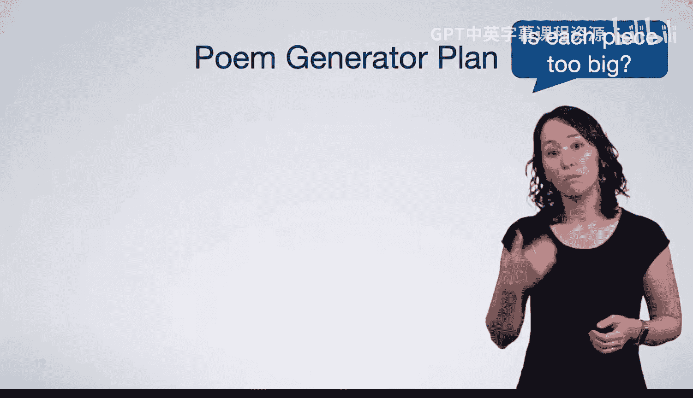

# Python编程实践：如何编写程序 - 设计与规划

在本节课中，我们将学习如何设计一个程序，并了解编写程序的基本步骤。

## 设计活动

设计活动是编写程序的第一步，它允许你发挥想象力，思考你想要程序做什么。

### 设计问题

在设计程序时，你需要回答以下问题：

* **你想要制作什么？** 在本例中，我们想要制作一个生成诗歌的程序。
* **你为什么要编写这个程序？** 我们想要编写这个程序是为了尝试让某人微笑。
* **这个程序是为谁设计的？** 这个程序是为任何可以轻松使用它的人设计的。
* **这个程序会产生什么影响？** 这个程序可能会让用户感到开心。

### 设计示例

以下是一个生成诗歌的程序的设计示例：

1. **收集用户输入**：程序需要获取三个字符串和一个整数。
2. **打印诗歌**：程序需要打印出至少三行的诗歌，其中至少有一行包含用户输入的字符串重复三次。

## 规划活动

规划活动是确定如何实现设计的过程。

### 规划步骤

1. **将设计分解成不同的部分**：将设计分解成更小的部分，每个部分都是独立的，不依赖于其他部分。
2. **为每个部分编写代码**：为每个部分编写代码，并确保它们可以独立运行。
3. **将代码组合在一起**：将所有代码组合在一起，形成一个完整的程序。

### 规划示例

以下是一个生成诗歌程序的规划示例：

1. **收集用户输入**：使用`input()`函数获取三个字符串和一个整数。
2. **打印诗歌**：
    * 打印第一行，包含用户输入的名字。
    * 打印第二行，包含用户输入的颜色和动物。
    * 打印第三行，包含用户输入的动物重复三次。

## 总结

本节课中，我们学习了如何设计一个程序，并了解了编写程序的基本步骤。在下一节课中，我们将学习如何实现和测试程序。