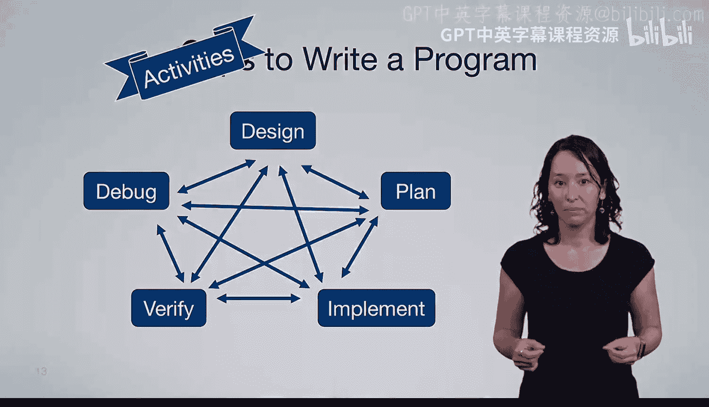

# 杜克大学《Python编程实践｜Practical Python： Start Your Programming Journey》中英字幕 p17 17_02_02_如何编写程序-验证与调试.zh_en -BV1tTmCBWEQD_p17-

So in the first video about how to write a program， we talked about the design and plan activities。

 We are leaving implementation as an exercise for you because that is translating your plan into actual code。

😊，Instead， in this video， we will discuss their verify and debug activities。

We'll start with verification。So the verify activity is often after you've at least implemented the first version of your program。

😊，The main question is。Is the program doing what it should？But what does what it should even mean。

Given what you've learned so far， there are two main ways to think about verifying your program。

First is considering your plan from the planning activity。

Does the program do what the plan said the program should do。

You can check this by giving your program inputs and confirming that the program prints correctly。So。

 for example， you would give the program the inputs from the design and confirm that the poem is correct。

Then you would also give the program some other inputs and confirm that the poem that comes out is as it should be。

The other way to verify your program is based on your intentions when you were in the design activity。

Focusing on the question of why you made the program to begin with。So in my case。

 my goal was to make someone smile。Which means。If you think about it。

 my goal was also not to make someone frown。So。Which one do you do first。Well。😮，It depends。

There can be many reasons you would do one over the other。Which is easier to verify。

If you find something wrong， which one is easier to change， it's really up to you。

And this is one of the reasons why I said these were more activities than steps。

 They are all connected to each other and do not necessarily go in order。

If you verified your design first， then you may have to go back to the design activity to fix things。

 And in fact， after you did the initial design， it might have made sense to go straight to the verify activity。

Because it would be a lot easier to change the design right after creating the design than after planning and implementing it。

However， in our case， let's talk about verifying the plan first since that is more straightforward。

 by giving you some examples。To verify your plan， look at your original design and come up with some possible inputs。

 So first， as I mentioned before， you can give your program the original input and confirm it prints out the correct poem。

Then you can give the program some other inputs like。

 let's give my program the name of some of our other instructors like Yessenia， dogg， white， and two。

So the program gives us a poem that says， Ho， Yesenia， nice to meet you。

 Do you think a white dog is possible。😊，It'd be awesome if they were white dog， white dog。😊。

Or we can give the program the inputs， Susan， fish， purple， and4。To get Ho， Susan， nice to meet you。

 Do you think a purple fish is possible。😊，It'd be awesome if they were purple fish， purple fish。

 purple fish， purple fish。😊，And you can go on and give the program some other inputs and confirm。

Now let's talk about verifying the design。There are a couple of approaches you can take。First。

 you can ask other people to use the program and watch their reactions。

Another is creating what are called personas。 These are descriptions of a person。

 And you write enough detail as if it was a character profile of a story。For example。

You could create a persona named Grace Hopper who represents you female users from the military with very analytical minds。

 Then you ask how this person would use the program。 Would the program work for them。

What would they input， Would that input work。Finally。

 after watching people use your program and thinking about what your different personas would experience using the program。

 you can ask yourself， does the program achieve your goals， which in my case is to make them smile。

 which also means not making them unhappy。Okay， now for the last activity， debugging。

Let's say you went through the verification process and discovered something wrong with your code。

Also known as a buck。What do you do。Well， for starters， where did you find the bug。

If you found the bug while verifying the plan， that means you tried different inputs。

 You found some inputs that didn't work。 You should write those down。

Then for each pair of inputs and outputs， you should start at the top of your program and slowly go through the program line by line。

Looking for when the code does not do what it should。There could be many reasons why that happens。

 For example， the bug could be because one of your variables has the wrong value。

Or the code thats executing is wrong。Or the wrong thing is getting printed。On the other hand。

If you found the bug while verifying the design， that means you now have a list of ways the program did not work based on what a user would do。

 This list can then be a source of information as you ask questions。 Like。

 why did the program not work。Was it the program's fault or did the user have a different expectation than intended。

Could you change the program to better communicate what should happen so that your users' expectations are more aligned with the program？

Or perhaps their expectation was reasonable。 And so the program should change。

 How do you change your design， plan or implementation to make things better。😊。

That's a lot of different things to consider when debugging， and don't worry。

 you can always come back to this video when you need help to remember。So， my goodness。

 that was so much。 It took two videos。 Let's recap the whole thing。😊。

There are five primary activities when writing a program。

 and often every activity is connected to every other activity。😊，Theres some order。

 but you may find yourself hopping around rather than going in order。First was the design activity。

 which is where you dream big figuring out your goal for the program and who the program is for。

This activity helps you figure out what your program should be due， given your goal。

But don't worry too much about what the code should look like。

Planning is when you think about what your code will do， but you are not actually writing the code。

 This activity is where you take your design and figure out the different pieces of your program and sometimes break pieces into smaller chunks in case one piece is too big for you to easily figure out what you need to do。

It's when you get to the third activity where you are implementing anything and actually writing code。

 though remember， you aren't necessarily going in strict order here。

The fourth activity was verification。Here is where you check if your program is doing what it should。

And that included defining what should do， even meant。Often。

 it means taking your implementation and verifying that the program follows your plan or is fulfilling the goal you had when you were designing your program。

Finally， there's the debugging activity and how to approach fixing your code based on whether you found an issue when you were verifying the plan or the design。

And with that， I hope you found this video useful and have a better idea of how to approach writing your program。

 and while for the smaller programs that we will be having you write。

 you may feel like you don't need all of these activities or you spend very little time on them。😊。

And that's okay。Just keep these activities in mind because eventually you will find that a program is too big to easily write without proper planning。

 and it's important to step back and work your way through each activity to help you make sure you are writing the program that you want to create。

😊。

