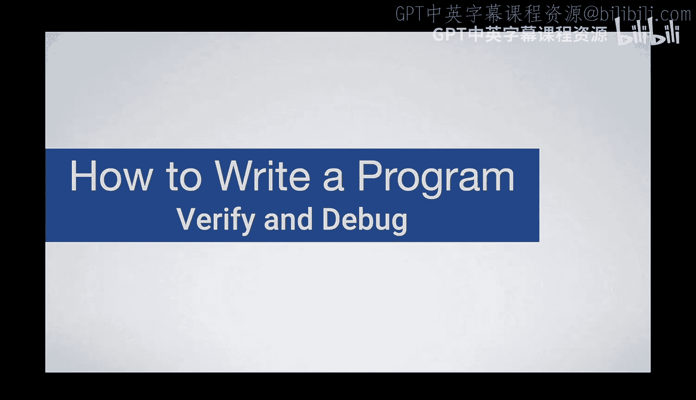
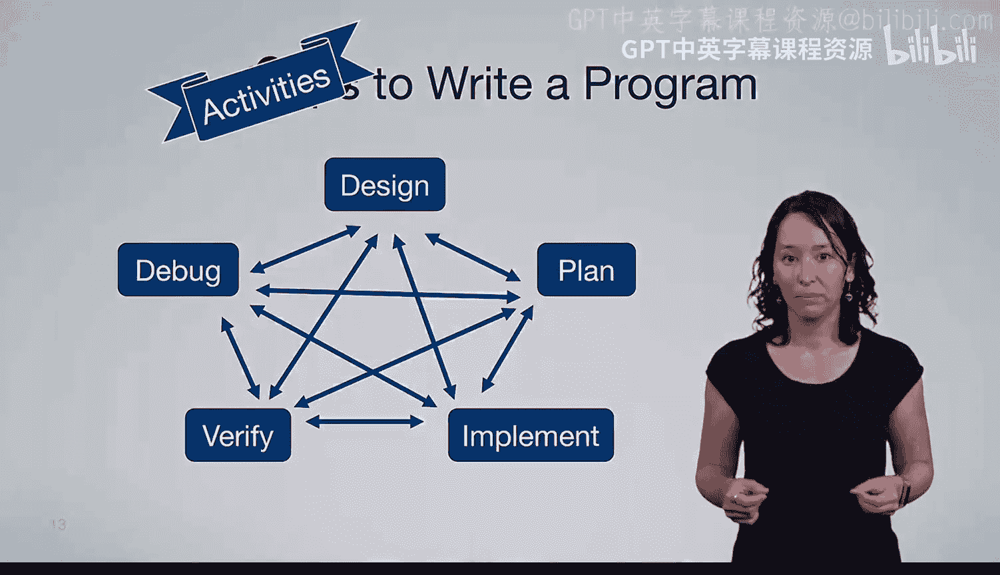

# Python编程实践：17：如何编写程序 - 验证与调试 🐛

在本节课中，我们将学习编写程序流程中的最后两个关键活动：**验证**与**调试**。我们将探讨如何检查程序是否按预期工作，以及当发现问题时如何有效地修复它们。

---

## 验证活动

上一节我们讨论了程序的设计与规划。本节中，我们来看看如何验证你的程序。验证活动通常在你至少完成了程序的第一版实现后进行。其核心问题是：**程序是否在做它应该做的事？**

根据目前所学，主要有两种方式来验证你的程序。

**第一种方式是依据规划活动中的计划。**
检查程序是否执行了计划中规定的任务。你可以通过向程序提供输入并确认其输出是否正确来完成验证。

以下是验证计划的具体步骤：
1.  使用设计阶段设定的原始输入，确认程序能输出正确的诗歌。
2.  为程序提供其他一些输入，并确认生成的诗歌符合预期。

**第二种方式是依据设计活动中的初衷。**
聚焦于你最初创建程序的目的。例如，我的目标是**让人微笑**，这也意味着**不让人皱眉**。

那么，应该先进行哪种验证？这取决于具体情况。哪种验证更容易执行？如果发现问题，哪种情况更容易修改？这完全由你决定。这也说明了这些活动更像是相互关联的环节，而非严格的线性步骤。如果你先验证设计，可能就需要返回设计活动进行修改。事实上，在完成初步设计后，直接进入验证活动可能是合理的，因为此时修改设计比在规划和实现之后修改要容易得多。

不过，我们先从更直接的**验证计划**开始，并举例说明。

为了验证你的计划，请参考原始设计，并提供一些可能的输入。
*   首先，如前所述，为程序提供原始输入，确认它打印出正确的诗歌。
*   然后，提供其他输入，例如我们其他讲师的名字：`Yessenia`, `dog`, `white`, `2`。程序会生成一首诗：“Ho, Yessenia, nice to meet you. Do you think a white dog is possible? It'd be awesome if they were white dog, white dog.”
*   再提供输入：`Susan`, `fish`, `purple`, `4`。得到：“Ho, Susan, nice to meet you. Do you think a purple fish is possible? It'd be awesome if they were purple fish, purple fish, purple fish, purple fish.”
*   你可以继续提供其他输入进行确认。

---

## 验证设计

现在，让我们谈谈验证设计。你可以采用以下几种方法。

**首先，可以邀请他人使用你的程序，并观察他们的反应。**

**另一种方法是创建“用户画像”。**
这些是对虚拟用户的详细描述，就像故事中的人物设定。例如，你可以创建一个名为“Grace Hopper”的画像，代表来自军队、思维非常严谨的女性用户。然后思考：这个人会如何使用程序？程序能为他工作吗？他会输入什么？这些输入有效吗？

最后，在观察了真人使用并思考了不同用户画像的使用体验后，你可以问自己：**程序是否达到了你的目标？** 在我的案例中，目标是让人微笑，这也意味着不能让他们不开心。

---

## 调试活动

假设你在验证过程中发现了代码中的问题，也就是所谓的 **Bug**。你该怎么办？

首先，需要明确是在哪里发现的Bug。

**如果你在验证计划时发现了Bug**，这意味着你尝试了不同的输入，并发现某些输入无法正常工作。你应该把这些情况记录下来。

然后，针对每一组有问题的输入和输出，你应该从程序顶部开始，逐行仔细检查代码，寻找代码行为与预期不符的地方。发生这种情况的原因可能有很多。
*   例如，Bug可能是因为某个变量的值错误。
*   或者执行的代码逻辑有误。
*   也可能是打印了错误的内容。

**另一方面，如果你在验证设计时发现了Bug**，这意味着你现在拥有一个列表，记录了程序在用户使用场景下未能正常工作的情况。这个列表可以作为你提问的信息来源。
*   例如，程序为什么没有工作？
*   是程序的错误，还是用户的期望与设计初衷不同？
*   你能否修改程序，以更好地传达应该发生什么，从而使用户的期望更符合程序行为？
*   或者，也许用户的期望是合理的，因此程序应该做出改变。你该如何修改设计、计划或实现来改善情况？

调试时要考虑的事情很多，别担心，当你需要帮助回忆时，可以随时回看这个视频。

---

## 总结回顾

关于如何编写程序，我们用了两个视频来讲解，内容非常丰富。现在让我们整体回顾一下。

编写程序主要包含五个核心活动，这些活动通常相互关联。虽然存在一定的顺序，但你可能会发现自己是在来回跳跃，而非严格按顺序进行。

1.  **设计活动**：这是你大胆构想的地方，确定程序的目标和面向的用户。这个活动帮助你根据目标理清程序应该做什么，但不必过于担心代码的具体样子。
2.  **规划活动**：这是你思考代码将做什么的时候，但并非实际编写代码。在此活动中，你将设计转化为程序的不同组成部分，有时会将大块任务分解成更小的部分，以便于理清思路。
3.  **实现活动**：这是你真正开始编写代码、实现功能的阶段。但请记住，你并不一定严格遵循上述顺序。
4.  **验证活动**：在这里，你检查程序是否在做它应该做的事。这包括定义“应该做什么”的含义。通常，这意味着拿着你的实现，去验证程序是否遵循了你的计划，或者是否实现了你在设计阶段设定的目标。
5.  **调试活动**：根据你是在验证计划还是验证设计时发现问题，来学习如何修复代码。

希望本视频对你有用，并让你对如何着手编写程序有了更清晰的认识。对于我们将要让你编写的小型程序，你可能会觉得不需要所有这些活动，或者在每个活动上花费的时间很少。这没关系。

只需将这些活动记在心里，因为最终你会发现，如果没有适当的规划，有些程序会变得过于庞大而难以轻松编写。适时退一步，按照这些活动逐步推进，将有助于确保你编写出真正想要创建的程序。