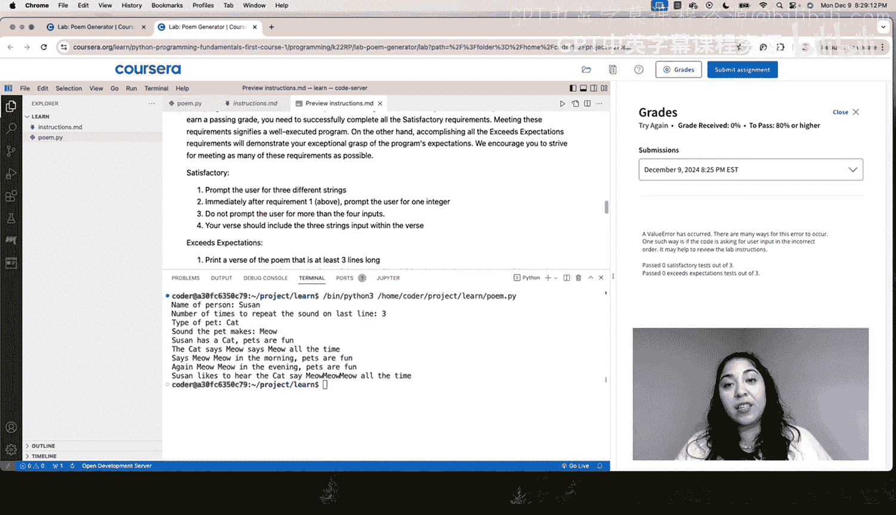

# 杜克大学《Python编程实践｜Practical Python： Start Your Programming Journey》中英字幕 p18 18_02_03_当自动评分器得分为0时该怎么做演示.zh_en -BV1tTmCBWEQD_p18-

You are about to work on your very first graded lab building a poem generator program。 Now。

 before continuing with this video， I recommend you pause this video。

 Go ahead and read the lab instructions to the poem generator lab。

 Then come back to watch this video for a guide on how to submit your program to the autogrator and what to do if you were to receive a score of 0 once you do some minute。

😊，Okay。Are you ready， let's go。Okay， so here is my code。

 you can see on the screen for the P generator lab。

 a lot of this code I have hidden from view because I want to give you an opportunity to solve this lab on your own。

So I'm only partially showing you my code。Now when it comes to writing code。

 it's always good practice for you to consistently run the program to check if it's working as you're building the program。

 don't wait until the very end to run your code。And for sure， before you submit to the autograr。

 you should run your code just just check if it's working。Let's go ahead and do that。

I'm just going to go ahead and run this code。It's going to say the name of a person and it's asking me what the name of a person is。

 I'm just going to go ahead and type my name。Type of pet。

 I'm going to say dog because I do have dogs。The sound iswoof，ofof。What's the date。

 I'm just going to go ahead and say 129。On the number of types。

 times to repeat the sound on the last line of my poem， I'm going to say for。Oh。

 and it looks like we've got a type error。So you can see that here specifically saying I have a type error can't multiply sequence by non end of type string。

It looks like it's hinting that I might be on  line 7。Okay， so at this point。

 it would be good for you to go ahead and look at your code， inspect it。

 and see if you can find where the error is and go ahead and try to remove it and then run your code again and see if the error is gone。

But for the sake of this video， I'm just going to go ahead and submit this to the autoiggrator and see what happens。

 But before I submit to the autogrator， I want to make one thing clear。

There it is possible for there to be multiple errors in the coat。

And the autogrator will only show you one error at a time。

So the error that the autogrator may show us may not necessarily be the type error。

 The autogrator may be addressing us another error entirely。

 It's only going to show us one error at a time。 That doesn't mean that the autogrator doesn't know there isn't。

 There is a type error in our code。 It just means that it's focusing on something else at the moment。

So let's go ahead and submit this to the autograr and see what happens。

 I'm going to have my name written， and I'm acknowledging that this code is my own work。

So I'm going to go ahead and click View grades。😊，And then just wait a few minutes while this code is ran through the auto grader。

 you can see it's just going to take a few minutes to do that。And while that's going。

 I'm going to go ahead and show you something cool。 If you right click on the terminal。

You are presented with this menu of options。 If you were to click clear。

It'll actually clear the screen so when you run your code again。You can see that here。

 it'll run this coat on a clean terminal so you don't have the previous runs showing。

 So you can see the other greater feedback is now available。

So it's saying that we received a score of0， which is fine。 That's not bad。

 A score of0 is just an opportunity to improve your coat。

And here it's saying that we need to receive a score of 80 in order to pass this grade La。

 so we don't need to receive a perfect score， just a score of 80。

And then you're presented with a personalized message from the autoiggrator。

 This is basically the autogrator telling you， hey， this is what I think you。

 this is ways I think you can improve your code。In this in our case。

 the auto gradetor saying that the code is asking for more user input than necessary。

So basically it's saying you're asking， you're using input too many times。

 the code is asking for more user input than necessary。

Sometimes this personalized message may be hard to understand。

 especially if you very needs of programming。 So it's a good idea to read these personalized messages multiple times until you have a better understanding of what the auto grader is trying to tell you。

And at the very end， it'll tell you how many satisfactory tests you've passed。

 in this case there are three satisfactory tests and it looks like we haven't passed any so far。

And there are three exceeds expectations tests， and we haven't passed any so far。

So notice how this error message isn't necessarily addressing the type error we were receiving earlier。

 let me go ahead and enter my the information we had earlier so we can see that type error again。

So so this type error is not what the auto grader is addressing。

 the auto grader is addressing a different error message。Now that's perfectly fine。

 so let's go ahead and try to resolve the error that the autogradeder is addressing。

The auto grader is basically saying were asking for too much user input。 Now， you might be wondering。

 why， hold on。 how am I， I don't understand， why am I asking for too much user input。

 This code looks correct to me。If that's the case， then what you need to do is go back to the lab instructions。

 always go back to the lab instructions if things are not clear as to what the autotor is trying to tell you。

So you can see the lab instructions are here in the learn folder。

 you can just right click on the instructions file and click open Preview and it'll show up over here。

😊，You can see the instructions to this lab are present here。

If you scroll near the bottom of this file， you will see a section called checklist of requirements。

 This is basically everything that the autoig gridtor is looking for。Satisfactory。

Its basically everything that's undersatisfactory is going to be all the items that your code needs to have in order to pass this graded lab in order to receive a score of 80 basically。

So you need to have all of these。And then exceeds expectations。

You don't necessarily have to have these items present in the code in order to pass this grade lab。

 but you won't receive a perfect score unless you have them， exceeds expectations。

 it basically demonstrates that you've mastered the material。

 and this will allow you to get a perfect score of 100 if you have all of them。

So by looking at the satisfactory， let's look at the first one， the first required one。

 it saysPro the user for three different strings。That was basically like three different words。

 like prompt the user to enter three different words or something。

And it says immediately after requirement one above， this is requirement one。

 so immediately after requirement one。😊，Prompt the user for one integer。So basically。

 prompting easier for three strings is be it could be a single word， it could be more than one word。

 doesn't really matter as long as there are strings。And then after that。

 ask the user to enter a number， right， basically an integer。Okay。

So these together requirements one and two， that's three different strings。

 plus the number that's four calls to the input function。If I look at my code。

 I can see that I have one， two， three， four。F inputs。

So you can see why the auto gridr is saying that you are asking for more user input than necessary。

So I did basically have too many， so that's like one， two， that's three strings， a date and a number。

 so let me just go ahead and delete the date。I'm just going to delete the date， I don't need it。

So I'm just going to go ahead and say。The the person， the pet， the sound， and then the number。

So let me go ahead and run this code and remember， it's always a good idea to run your code before submitting to the auto grader。

Oh， and let me clear this first。 let's clear this so we can have a nice clean terminal。

 So we'll type in Susan this time。She has a cat。The cat goes Miow。 How you spell meow。Mang。

And the number of times let's go with three。Oh， so we're still getting the type error and that's fine。

 and it seems to be hinting at it being in line six， possibly。So at this point。

 if you haven't run your code in a while， I mean， we just did， so it's a good idea to run the code。😊。

At this point， you should probably be going in and trying to remove the error from you know。

 based off of this error message and the hints that this error message is trying to give you。

If you still can't figure out where the error is and you're still struggling to find it。

 go ahead and submit to the autograr as the autograr may give you additional hints as to where the error might be。

So let's go ahead and do that。So I'm going to go ahead and submit this code to the autogrator and see what the autogrator tells us。

Now I'm going to go ahead and skip to when the outgraator has given us its formal feedback。

So you don't have to wait。All right， it looks like the autograr feedback is finally here。So finally。

 the autograder was able to detect that we had a type error。 Notice how our score is still 0。

 We haven't actually improved our score， but the personalized error message from the autograder is different。

 This actually is a good thing。 It means we're making progress。

 So although our score hasn't improved。 The fact that we're seeing a different error message from the autograr means that the previous error message we were seeing。

 which was too many calls to input。 is no longer there。 Basically， we fixed that error。

 So the autograder was able to essentially say， oh my gosh。

 you don't you have the correct number of inputs。 Let me move on to the next error that was in the code。

 And in that case， it just happened to be the type error we've been seeing all this time。

 So we've made progress。 This is actually a good thing。😊。

So let's go ahead and look at the personalized message says a type error has occurred。

There are many ways for this error to occur。It may help to verify the codes using the correct data types with each operator used。

 again， if you can't understand the utter greater feedback message in the first time you read it。

 it may help to read it a few times。 A type error has occurred。 Thats actuallyly what we see here。

There are many ways for this error to occur。It may help to verify the code is using the correct data types or the correct data types or we're looking at data types with each operator use。

 so operators and data types， these are the things we should be focusing on。Now。

 I should give you a disclaimer。The autogrator may not know exactly what is wrong with the code。

 It can only guess what could be wrong with the code。

 So it's going to give you hints as to what it believes might be causing the type error。

 But the autogrator will not know with certainty What is actually wrong with the code。

 So it could be that it may not even have to do with data types and operators。

 But the autogrator thinking it probably this。 So why don't you go ahead and check this first。

You can see we didn't pass any satisfactory and we didn't pass any exceeds， and that's okay。

 We'll get those eventually。So looking at the code here。

One of the operators we're using is a multiplication operator， sound is a word。

 It's the sound that the pet makes， and number string is supposed to be a number。

 so it'll be string times a number。 The only problem is that number string is actually a string data type because that's what input does。

 It gives you a string data type。So in order to convert this number。

 which is currently a string data type， we need to convert it into an integer。

So I'm just going to put it in an int。 So this string data type will now be an integer。

 and now I'll be able to do string times int because before it used to be string times string。

 which Python does not allow。 Now it's going to be string times int。

So this number is now an integer rather than a string。Before submitting to the autograr。

 let's go ahead and run this locally。Running it ourselves。Let me okay， so as I run this。

 I'm going to go ahead and type in Yesenia。Dog。Wop。F tons。Ah。

 and it looks like we actually got our poem to generate。

 we actually didn't get a type error this time， this is awesome， okay， the poem actually generated。

So let me go ahead， since this looks correct， let me go ahead and submit this to the autograr and see what happens。

Vi grades， now I'm going to go ahead and jump to the point where the autoiggraator finishes running。

😊，All right， and it looks like we actually got all correct。

We pass all our satisfactory tests and all our exceeds expectations tests。

 And it looks like we received a perfect score of 100。 This is awesome。😊，Now。

 so technically the code is correct now， but but before we ended it。

 I do want to bring your attention to one other very common error you might be receiving。

Suppose I take this input， right， which is the the the number of times to repeat the sound of in my poem on the last line。

 and I move it to line 3。 So it's the second time I ask the user for input。

What happens when I do this？Well， if you recall from。The lab instructions。

 the lab instructions say to ask the user for three strings。

 and only after you ask the user for three strings， then ask the user for a number。

 an introger to be exact。But here I'm violating that rule because I'm saying I'm asking for a string。

 I'm asking for an integer， then a string， then a string。 I'm not following the lab instructions。

But when I run this code， let me go ahead and clear this so we can have a nice clean terminal and then I'll run this。

When I run this code， I'm going to follow the instructions I gave myself inside of input。 You know。

 all these beautiful instructions I wrote。 So I'm going to say the name of a person， Susan。😊。

Number of times， let's say three。Type of pet。 I'll say， cat sound。Miao。

And then it'll generate a beautiful poem based off of the instructions I myself wrote and I myself am reading as the user。

😊，But what happens when I submit to the autograr， let's find out。Submit this code to the auto grader。

And let's skip to when the other creator gives us our feedback。All right。

 it looks like the auto grader saying that a value error has occurred。

Interesting because when we ran this code， we didn't get a value error。 So what happened， Let's read。

 Let's reought a greater feedback message to see what happened。A value error has occurred。

 There are many ways for this error to occur。One such way is if the code is asking for user input in the incorrect order。

 so in the wrong order。It may help to review the lab instructions。

 Look like we didn't pass any satisfactory or any of the exceeds。Okay， and n score is zero， okay。

So this is what happened。The auto grader will not be reading your instructions right。

 I won't read this。 The auto grader is going to be following the instructions in your lab。

So the lab says it to expect three strings and then an integer。

 So that's exactly what the autograr will feed your program when it runs your program。

 It will follow the lab instructions。 It will not follow your own personal instructions。

 It will only follow the lab instructions。So what happens is that the auto greeter gave it a word for person。

 person received a word。It gave a word for number string。

 not a number because it wasn't reading these instructions。 It was reading the lab instructions。

 The lab instructions being like three inputs， three string inputs。

So the first three variables received words。And the last variable， which is sound， received a number。

Because the auto gradetor following lab instructions。 So what happens。Is this word？Right。

 let's say it's a type of pet， a dog。We tried to convert dog into an integer。

 and that is where the value error occurred。 You cannot convert a word into an integer。So。

When you are working in any assignment， it's always important to make sure that you're reading these instructions。

 especially the input statements。Because that is how the autogrator will interact with your program。

 the autogrator will only will strictly follow the lab instructions。

 not the instructions your code presents。 is going to strictly follow what the lab says it should do。

Now， debugging can be frustrating。 very important skill to have and ends to build for that matter。

 When you are writing this code， it's always a good idea to run your code many times on your own。

 Also known as running it locally。 just constantly be running the code or running the code to make sure that it's working as intended。

Especially before submitting to the auto grader。But suppose you do submit to the autograr and you receive a score of zero。

 don't panic， remember this is just an opportunity to improve your code。So when that does happen。

 here are a few things you should look for。

Check， are there any extra inputs that I'm asking that the lab instruction says I shouldn't。

 The lab instructions should be pretty clear as to how many times you can ask the user for input and what kind of input to ask from the user。

 So check are there too many inputs。You can check is the input in the correct order。

 remember for this example it was three strings in then number。

 make sure that that's the exact order you're asking for the user to give their input。

Are you using the right types and operators， if you're not using the correct data types with the correct operators。

 you might get a type error。Does the code actually match the lab instructions so you might have accidentally violated the lab instructions in you know making the program your own。

 which we definitely recommend that you do by all means we love for you to customize the program to something that you're actually interested in just make sure that you follow that checklist for requirements and that everything the checklist has is present in your program。

And if there any other errors， make sure to read the auto grader feedback message the autograr tries to point you in the correct direction。

 So if the auto grader saying here hey here is an opportunity to improve your code this might be wrong with your code Just read the instructions。

 maybe read it multiple times to help you make sense of it。

 generally the auto grader can be pretty good， it's a pretty good tool to point you in the right direction so。

Try to run the code on your own， this will get you familiar with Python error messages the best and help build a lot of independence when it comes to being able to debug the code on your own and then use the autograr as a tool you know when you're stuck or to help you validate whether the code is actually know following all the live instructions or not。

So the autograr is there to help you， it there to help verify if the code is actually correct。Now。

 above all， keep at it， keep programming， keep， you know。

 having fun with debugging and building that really important skill set and you know， you know。

 have fun with it。