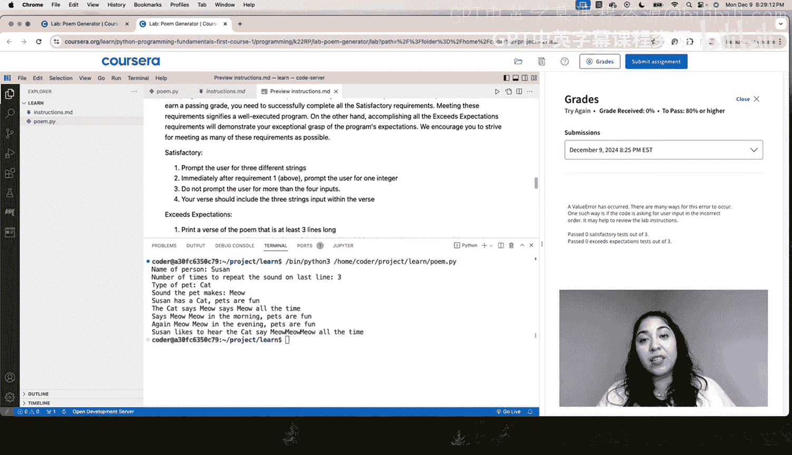

# Python编程实践：18：当自动评分器得分为0时该怎么做


## 概述
在本节课中，我们将学习如何提交程序到自动评分器，以及当首次提交后获得0分时，应如何分析和调试代码。我们将通过一个诗歌生成器程序的例子，演示从错误代码到最终获得满分的过程。

---

## 代码提交与初步运行

在开始编写第一个评分实验——诗歌生成器程序之前，建议先暂停视频，仔细阅读实验说明。阅读完毕后，再观看本视频，了解如何提交程序到自动评分器，以及当获得0分时该如何处理。

以下是为演示准备的代码。出于教学目的，部分代码已被隐藏，以便大家有机会独立完成实验。

```python
# 部分代码已隐藏
person = input("What is the name of a person? ")
pet = input("Type of pet: ")
sound = input("The sound: ")
date = input("What's the date? ")
number_string = input("On the number of times to repeat the sound: ")
```

编写代码时，持续运行程序以检查其是否正常工作是一个好习惯。不应等到最后才运行代码。在提交给自动评分器之前，务必先自行运行检查。

现在运行这段代码。程序会询问人名、宠物类型、声音、日期和重复次数。输入相应信息后，我们遇到了一个类型错误（TypeError），提示“不能将序列乘以非整数类型的字符串”。错误可能指向第7行。

此时，你应该检查代码，尝试找出并修复错误，然后再次运行。但为了演示，我们将直接提交这段代码到自动评分器，看看会发生什么。

---

## 首次提交与评分器反馈

提交代码并等待几分钟后，自动评分器给出了反馈：我们得了0分。这很正常，0分只是一个改进代码的机会。本实验需要80分才能通过。

评分器还提供了一条个性化信息：“代码请求了超出必要的用户输入”。这意味着我们调用了太多次 `input()` 函数。有时这些信息可能难以理解，建议多读几遍。

反馈末尾显示，我们通过了0个“满意”测试和0个“超出预期”测试。请注意，评分器指出的错误（输入过多）并非我们之前遇到的类型错误。这是因为自动评分器一次只显示一个错误，它可能正在处理代码中的另一个问题。

---

## 分析错误与查阅实验说明

既然自动评分器提示输入过多，我们需要检查原因。如果不明白，最佳做法是返回实验说明查看具体要求。

在实验说明文件的底部，有一个“要求清单”部分。“满意”级别列出了通过实验（获得80分）必须满足的所有条件。第一个要求是“提示用户输入三个不同的字符串”，紧接着的第二个要求是“提示用户输入一个整数”。

这意味着总共需要调用四次 `input()` 函数：三次用于字符串，一次用于整数。回顾我们的代码，我们调用了五次 `input()`（三次字符串、一次日期、一次整数），确实多了一次。因此，我们需要删除对日期的请求。

修改后，代码只询问人名、宠物类型、声音和重复次数。

---

## 修复第一个错误并再次提交

修改代码后，再次运行。我们输入“Susan”、“cat”、“Meow”和“3”。然而，程序仍然报类型错误，这次可能指向第6行。

如果根据错误信息仍无法定位问题，可以再次提交给自动评分器，它可能会提供新的线索。

提交后，我们发现分数仍是0，但个性化反馈信息变了！现在它提示“发生了类型错误”。这是一个好迹象，说明我们成功修复了“输入过多”的错误，评分器开始检查下一个问题了。

反馈建议：“验证代码是否为每个使用的运算符使用了正确的数据类型”。这提示我们应该关注运算符和数据类型。

---

## 理解并修复类型错误

在我们的代码中，使用了一个乘法运算符：`sound * number_string`。`sound` 是一个字符串（宠物发出的声音），而 `number_string` 本应是一个数字。问题在于，`input()` 函数返回的始终是字符串类型。因此，`number_string` 实际上是一个字符串。

我们需要将 `number_string` 从字符串转换为整数，才能进行字符串与整数的乘法运算。Python不允许字符串与字符串相乘。

修改方法如下：
```python
number = int(number_string)  # 将字符串转换为整数
# 然后使用 sound * number
```

修复后，再次在本地运行程序。输入“Yesenia”、“Dog”、“Woof”和“4”。这次，诗歌成功生成了，没有出现类型错误。

---

## 最终提交与获得满分

确认代码运行正确后，我们将其提交给自动评分器。最终，我们通过了所有“满意”和“超出预期”测试，获得了100分的满分。

---

## 一个常见的顺序错误

在结束前，我们来看一个常见的错误。假设我们将请求“重复次数”的 `input()` 调用移到了代码前面（例如第3行），违反了实验说明中“先三个字符串，后一个整数”的顺序要求。

当我们在本地按照自己编写的提示运行时，程序可能正常工作。但自动评分器只会严格按照实验说明来提供输入：它会给前三个变量提供字符串，给第四个变量（此时是`sound`）提供一个数字。

当代码尝试将这个数字（比如“3”）赋值给 `pet` 变量，并后续可能进行不合适的操作（如尝试转换为整数）时，就会引发值错误（ValueError）。自动评分器的反馈会提示“输入顺序不正确”。

这强调了严格遵守实验说明中输入顺序的重要性。自动评分器只遵循实验说明，不会读取你代码中的提示信息。

---

## 调试策略总结

调试可能令人沮丧，但它是一项非常重要的技能。在编写代码时，应养成多次在本地运行的习惯，尤其是在提交给自动评分器之前。



如果你提交后得了0分，请不要慌张，这只是一个改进的机会。可以按照以下步骤检查：

1.  **检查输入数量**：是否请求了实验说明规定之外的额外输入？
2.  **检查输入顺序**：输入请求的顺序是否与实验说明完全一致？
3.  **检查类型与运算符**：是否对正确的数据类型使用了正确的运算符？（例如，字符串与整数相乘）
4.  **核对实验要求**：你的代码是否满足了“要求清单”中的所有条件？在个性化程序时，请确保核心要求不变。
5.  **仔细阅读反馈**：认真阅读自动评分器的反馈信息，它通常会指出可能的问题方向。

多在自己的环境中运行代码，能帮助你熟悉Python的错误信息，并建立独立调试的能力。将自动评分器视为一个工具：在你卡住时提供帮助，或用于验证代码是否符合实验要求。

最重要的是，保持练习，享受编程和调试的过程，逐步构建起这项关键的技能。

---

## 总结
本节课中，我们一起学习了如何向自动评分器提交代码，并逐步分析了当获得0分时的完整调试流程。我们从识别“输入过多”错误开始，通过查阅实验说明修正它，然后处理了“类型错误”，最终获得了满分。我们还探讨了输入顺序错误这一常见问题，并总结了一套实用的调试策略。记住，调试是编程的核心部分，每一次错误都是学习和进步的机会。