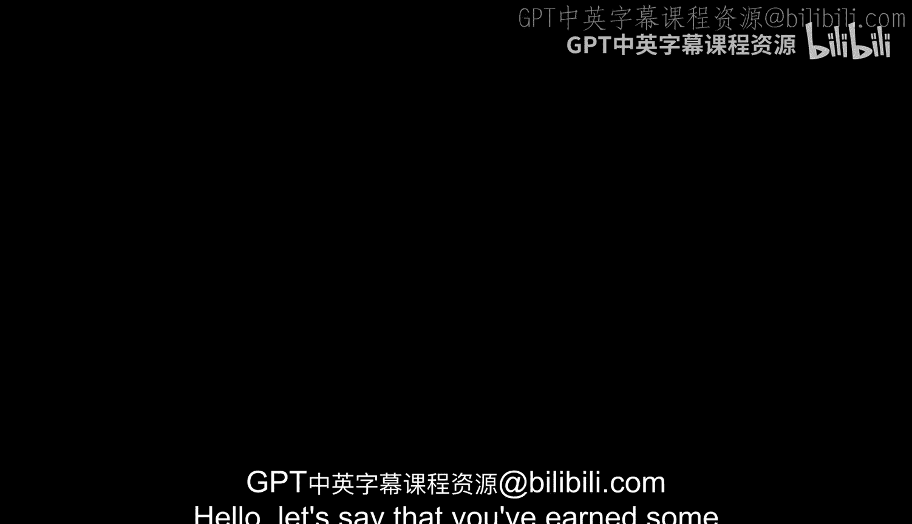
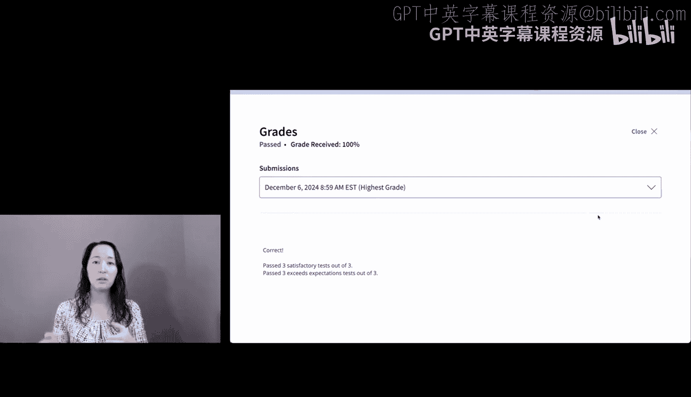

# 杜克大学《Python编程实践｜Practical Python： Start Your Programming Journey》中英字幕 p19 19_02_04_当自动评分器得分部分扣除时该怎么做演示.zh_en -BV1tTmCBWEQD_p19-

Ho， let's say that you have earned some points in the lab。 But you have less than what you want。

 What do you do。 Well， there are a few places you can look to figure out your next steps。

 The autogrator messages and the lab checklist of require。

They are the best place to start in this video， I will show you what to look for in both using the poem generator lab as an example。

 So if you haven't read that lab， you should go read it so you know what it requires。

Here is my poem generator La coat。You'll see the code is not all visible because I can't give you the solution。

Instead， the part you can see is just printing out lines1 through four。

 and the part you can't see is the code that creates these particular variables and makes the strings for them。

However， I've added some comments to help you understand what's going on。

 and we're going to run it so you can see everything。 so here we go。Run Python code。

 And let's answer the questions。 So what is your name， Kristen， tell me an animal cat。

 How about a color。 Blue。 Give me number 3。So as you can see， after we've answered our four inputs。

 it generates us a little poem。 Hello， Kristen， nice to meet you。 Do you like blue。

 Do you think a blue cat is possible， It'd be awesome if they were real。 Blue cat， blue cat。

 blue cat。😊，So as you can see， the first line has Kristen， nice to meet you， Do you like blue。

 which is inputs one and three， Do you think bluecat is possible， that is input2 and3 cat and blue。

And then this third line does include any inputs。 While this last line says blue cat three times。

 which is the number that we inputted in these last part。Now， if I submit this autogrator。

 I will get full credit。 However， this demo is about what do you do when you only have some of the points。

 but not all the points that you want。 So let's say that the code actually prints while we're making each of these variables and it accidentally doesn't print that first line。

 We can make that actually happen by just contenting this out。

So now the code doesn't have that first line printed。So we can run the code to confirm。

So what is your name？Briston cat。Breroom。The number 3。 So notice that it is now only three lines。

 and it doesn't print that first line of Hello， Kristen， Nice to meet you。 Do you like blue。

So let's submit this to the autograr， submit assignment。Sign the honor code， submit it。

And then it's going to start thinking and let's click on view grades so we can see what it's doing so while we wait。

 this is one of those moments where you might want to skip ahead a little bit in the video because we're just going to sit here and wait to see how long this takes。

😊，And there we have it， and that is pretty tiny font for you all。

So' see if I can zoom in just a little bit。There we go。ButLet's see。

So we can see that it says try again。 grade received 53 per cent pass。 You need 80 per or higher。

 So in this moment， you may be super tempted to go right back to your code and try to get it to work。

 I want you to pause in this moment and look to see if the auto grader has any useful information for you。

 It is your first place to check how to fix your code when the autograr doesn't give you the score you want。

😊，So right down here， I know it's subtle。 That's why I zoomed in。

 The auto gridd is giving you some help。 The code should use the first string entered by the user in the poem's verse。

So。Now we know that we need to focus on making sure that that first string input is printed。

 which makes sense because that's the line that I commented out and it's the only place that first input is used。

However， before you run off again， notice the rest of this message。

 past two satisfactory tests out of three， past two exceeds expectation tests out of3。

 So now you may be confused。 The code passed 4 out of6 tests， but you got 53%。

While you get credit for passing all of those tests。

 you need to make sure to pass all of the satisfactory tests to get over to 80%。

Those tests are checking for the fundamental learning objectives of the lab。

 so we just need to pass one more satisfactory test to pass the lab。

Let's fix our color by putting back that first line。Close。

Let's resets that zoom level so a little easier to see。Let's put this back。However， let's run this。

Again。But let's say that that fix， for some reason， made this last line disappear。

Let's run this so you can see what changed run Python file。Wsten。Att blue。3。

 and now it is three lines long。 We have the first input Kristen back in there。

 but we don't have that last line that before was repeating blueca as many times as we gave it at number。

So let's run submit to assignment。Sign the honor code， submit few grades。

 and this time we'll zoom in while we're waiting。So you all can see that as it comes in。

And there we have it， we passed， past grade， received 87% so remember。At this point。

 you could be done。 You do not have to hit that perfect 00 per score if you'd rather just move on。

 The fact you passed shows that you understand all of the learning objectives of this lab。 However。

 if you want to make for 100%。 Now is the time to make sure you once again。

 read those auto greaterr messages。So in the poem， there should be a line that repeats one of the three input values the number of times specified by the last input value。

 We can see here we passed three satisfactory tests out of three and past one exceed expectations test out of three。

So let's say you read this message from the autograr and you don't understand what it means。

 So this is where you want to go now to the instructions of the lab and look at that checklist。

Let's close this， reset that。 So it's a little bit easier for us to see。

Click on Preview instructions。And here is the checklist of requirements。

 I already scroll down for you all。And since we know that we passed all the satisfactory tests。

 we can skip this first list and go straight to exceed its expectations。

 So let's read each one until we can find the one that is talking about this repeating strings thing。

 So print a verse of the poem that is at least three lines long。 Well。

 we know that when we print our poem。 It is already three lines long。 So that's not it。

 Use string concatenation to print lines of the verse with additional words that are not part of the user input。

 We know we already do that because we definitely have a poem that doesn't just use the input strings。

 It's got other words in it。😊，One of the string inputs should appear on at least three different lines。

 prettytty sure that happens， but I'm not actually quite sure。 So something to note。

 but once again doesn't have to do anything with repeating numbers。 So let's go to the next one。

 Your verse should include one of the input strings that is repeated number times where number is the insert your input。

 There we go。 That's the one that we're missing。So at this point。

You would want to go back to your code and figure out how to make sure that requirement is being fulfilled。

In our case， we can just oncom the code， hit save。And let's run it just to make sure it's doing what we expect it to do。

 What is your name。Kristten cat。Blue， and let's give it a different number。 just So to confirm to。

 There we go。Hello， Kristen， nice to meet you。 Do you like blue。

 Do you think a blue catt is possible， if be awesome they are real， blue cat， bluecat。

 So there is right there， are words repeated。 however， a number of times。

 Let's submit the assignments。😊，Submit it， review grades。 zoom in for all。You will to see。

And there we have it， 100% fully passed。 In summary， when you're getting some of the points。

 but not all of them， make sure to pay attention to the autoator messages。

 and that includes both the message， as well as how many test you passed。You never know。

 You may be far closer to that 100 per cent than you think。

 And if the auto grader message isn't super helpful， then go to the labs checklist of requirements。

 Happy coding everyone。

