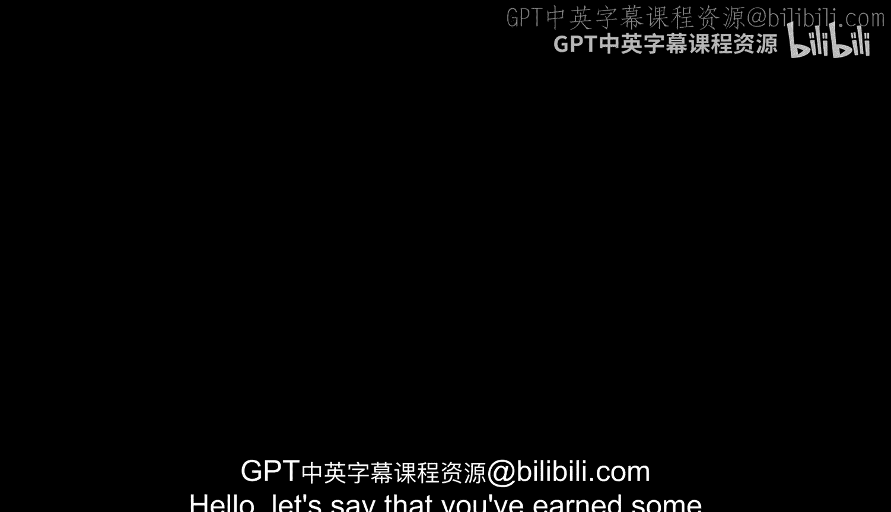
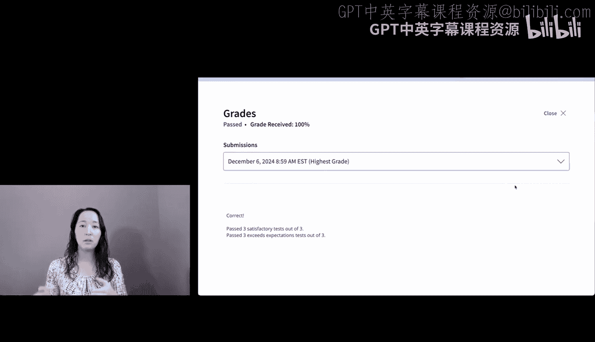

# Python编程实践：如何处理自动评分器得分扣除



在本节课中，我们将学习如何处理在自动评分器中得分扣除的情况。

## 1. 了解自动评分器信息

**以下是自动评分器信息：**

- 自动评分器消息和实验清单是了解下一步行动的最佳起点。

- 在本视频中，我将使用诗歌生成器实验作为示例，向您展示如何在两者中查找信息。

**代码示例：**

```python
# 诗歌生成器代码示例
# ...
```

**解释：**

- 代码中包含了一些注释，帮助您理解正在发生的事情。

- 我们将运行代码，以便您可以看到一切。

## 2. 分析得分扣除原因

**以下是得分扣除原因：**

- 如果您提交自动评分器后只获得部分分数，而不是您想要的全部分数，请按照以下步骤操作。

- 假设代码在创建每个变量时打印了while语句，但意外地没有打印第一行。

**代码示例：**

```python
# 修改后的代码示例
# ...
```

**解释：**

- 修改后的代码没有打印第一行。

- 我们可以运行代码以确认。

## 3. 查看自动评分器信息

**以下是自动评分器信息：**

- 在得分扣除后，您可能会想立即回到代码中尝试修复它。

- 然而，在这样做之前，请查看自动评分器是否有任何有用的信息。

**代码示例：**

```python
# 自动评分器信息示例
# ...
```

**解释：**

- 自动评分器提供了一些帮助信息。

- 我们需要确保打印出第一个字符串输入。

## 4. 查看实验清单要求

**以下是实验清单要求：**

- 如果您阅读自动评分器信息后不理解其含义，请查看实验说明和清单。

**代码示例：**

```python
# 实验清单要求示例
# ...
```

**解释：**

- 我们需要确保满足所有要求。

- 在本例中，我们需要确保重复字符串的要求得到满足。

## 5. 修复代码并重新提交

**以下是修复代码并重新提交的步骤：**

- 修改代码，确保满足所有要求。

- 重新提交代码，并查看得分。

**代码示例：**

```python
# 修复后的代码示例
# ...
```

**解释：**

- 修复后的代码满足所有要求。

- 我们可以提交代码并查看得分。

## 总结



本节课中，我们一起学习了如何处理自动评分器得分扣除的情况。通过查看自动评分器信息和实验清单要求，我们可以找到修复代码的方法，并最终获得满分。