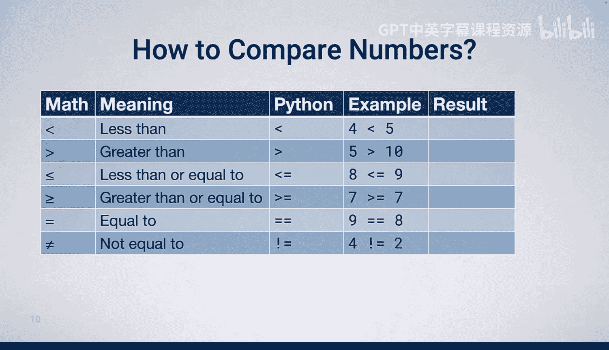
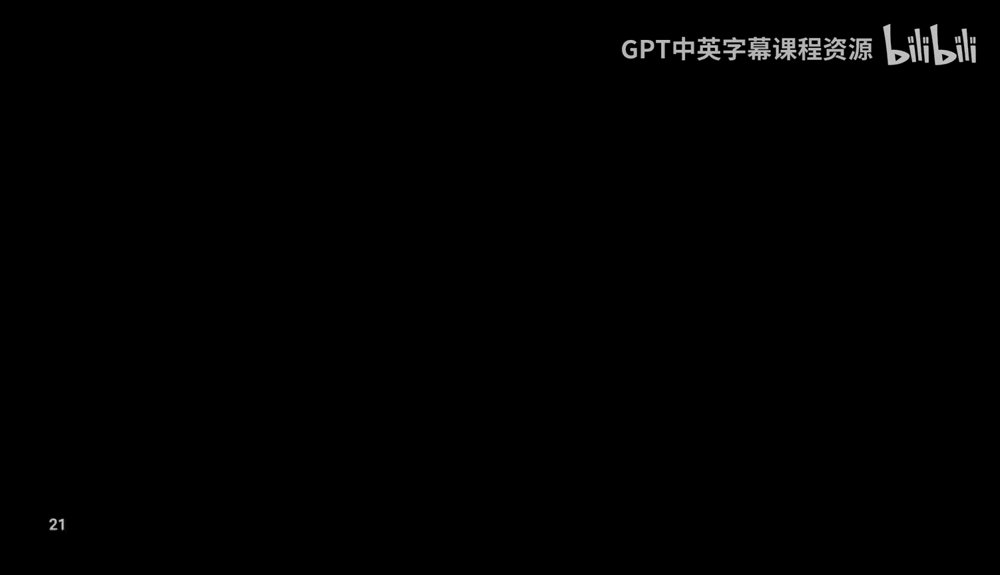

# 杜克大学《Python编程实践｜Practical Python： Start Your Programming Journey》中英字幕 p20 20_03_01_比较值-关系运算符.zh_en -BV1tTmCBWEQD_p20-

So far， we've only written code where every line is executed one by one。

 but what if you wanted to run code only some of the time， for example。

 what if you wanted code where if the user inputs a number that's 99 or smaller Python prints。

 that's a nice number。However， when it's 100 or bigger Python prints， that's a big number。

This is also known as conditionals， like if this， then that， which you likely use all the time。

 If it's cold， then I'll wear a coat。 If I need to choose between blue or red。

 then I'll choose blue because it's my favorite color。😊，So the first question is。

 how do we tell Python to compare numbers？ Well， in math。

 we are used to using the less than symbol to mean to check if the left side is less than the right side and the greater than symbol for checking if the left side is greater than the right side。

 and Python uses the exact same symbol to mean the same thing。😊，And in math。

 we add a line under each symbol to mean less than or equal to and greater than or equal to。However。

I don't know about you， but I don't know how to find those two symbols on my keyboard。

 And it would be a real hassle to find them in the emoji or a character drop down every time I needed them。

 In fact， they didn't necessarily even have easy access to the less than or greater than symbol on their keyboard back in the 60s。

So instead， those languages in Python had the equal sign right after the less than and greater than the symbols to add the or equal to part when comparing values。

But what about just simple， equal to。We are already using the equal symbol to mean assignment。

 where we assign a value to a variable。In Python， we use two equals signs。 Hopefully。

 you can see the pattern there。And last but not least。

 we also need to check if something is not equal to。

Which we do with an exclamation point and then an equal sign。Why the exclamation point， to be honest。

 it's because other languages before Python used it。

 and while it may seem unintuitive now and just something you'll need to memorize as you practice。

 you'll gain fluency， and it'll be easier to remember to use an exclamation point with an equal sign to mean not equal。

To use the operators， you put something on each side and it evaluates to be yes or no。 Or in Python。

 we'd call this true or false。 Let's lock through each one。

For the first row， you are checking if four is less than5， which evaluates two true。

The greater than a row is checking if 5 is greater than 10， which is false。 Next。

 we have the equal2 versions for whether 8 is less than or equal to 9。 Python evaluates it to true。😊。

And for our next example， checking if7 is greater than or equal to7， we have also true。

Almost at the end， if 9 is equal to 8， we have。False， and finally， for not equal to2 gives us true。

So there are the six ways to compare numbers， also known as relational operators。

 because they compare the relationship between two things。Besides just numbers on each side。

 you can also use variables， and they can be on one or both sides here at the variable X。

 it's assigned the float value 10。0， and then we check if it's greater than or equal to the integer 1。

 which evaluates2 true。Here is an example of using variables on both sides。

 A is assigned the integer value 10， and B is assigned The float value 1。0。 The last line checks。

 If A and B are equal to each other， which is false。

 Notice I used both ints and floats in the same comparison to show that Python treats floats and ins as just numbers when comparing them。

😊，So checking if the values5 and 5。0 are equal would return true。Speaking of types， though。

 what about other types we know of？Strings， so here are two perfectly valid lines in Python。😊。

Which one do you think will evaluate to true and which will evaluate to false。

 You can even pause the video to make a guess。 I can wait。😊，All right。

It's the first one where it checks if the string A is less than the string B。

 So your next question is probably why or how can you easily remember that。

 The way I remember it is that this is alphabetical or at least English alphabetical And to think of the letters as if they are on a number line。

😊，The A comes before B in the alphabet， and therefore， the string A is lesser than the string B。

As another example， Y is after B in the alphabet。 So the string Y is greater than the string B。 Now。

 here's a slightly different question。Which one of these is true。Again。

 pause the video and take a guess。 Learning research shows that you are more likely to remember if you actually take a guess rather than just wait for the answer。

😊，Otherwise， you could just rationalize that that answer is totally what you would have guessed if you actually had done the problem。

So I'll pause again and give you a second。So in this case。

 the upper case A is smaller than the lower case A。 Now， how do you remember this？Well。

 generally in the English language， uppercase letters are used at the beginning of words。

 such as the title of this video or the title of this slide。In fact。

 all of the uppercase letters come before all of the lowercase letters。

 So that means the string Z is actually less than the string A。So letters are all well and good。

 but most of the time， we want to compare strings that contain words， phrases and more。Well。

 it's just like if you are ordering these strings alphabetically will also be case sensitive。

Which means you start at the first letter and compare them if they are equal。

 you move on to the second letter of each string and so on。

Until you find a pair of letters that are not the same。

The comparison of the strings is then based on the first letters you find that are different。

 In this case， it's the I in trip and the A in trap。

So that means trap is less than trip because a comes before I in the alphabet。 So again。

 which of these lines will evaluate to true。 I'll give you a second。

 Go ahead and pause to try and figure it out。This one was a little tricky and that they are all true。

Cab and cat are the same until the third letter。 Both B and T are lowercase。

 So we don't have to worry about case sensitivity and just go alphabetically。

 And since B is before T in the alphabet。 cab is less than cat。

Apple and yon are clearly different from the first letter。 In this case， Y is an uppercase letter。

 and a is lowercase。 So we are taking into account the letterss case。

 which means uppercase Y comes before lowercase A， which means capital Y yon。

 is before lowercase A in Apple。For black and car， sometimes people that are just learning this stuff think the length of the string matters。

 But as you can see here， even though car is shorter， it is greater than black。

Black is less than car because the first letter in each string are different。

 B and C are both lowercase， and alphabetically， B comes before C。In contrast。

 the string T0 is less than the string T00， because the first two letters are the same。

 So when Python gets to the third letter and T0 has no such letter and T00 does。

 it compares nothing with a letter0， and since nothing is less than something。

 Python evaluates the string T0 as less than the string T00。Finally， we have our phrases。

 that is red and that is blue。The strings are the same until you get to the R in red and the B in blue。

 And since B comes before R in the alphabet， the string that is blue is less than that is R。

 Let's recap。In math， we are used to having an underlyingline or the or equal to part of the less than or greater than symbols。

 In Python， we still use the less than or greater than symbol， but put an equal sign right after it。

 for checking equality in math， you have a single equal sign。

 But Python already is using that for assignment。 So it requires two equal signs to check whether two things are equal。

😊，For not equal， where in math， it's the equal sign with a slash through it。

 Python has an exclamation point， followed by an equal sign。When it comes to comparing strings。

 we use case sensitive alphabetical order， so all upper case letters come before all lower case letters and anything that is earlier in the alphabet that are the same case is less than anything later in the alphabet。

