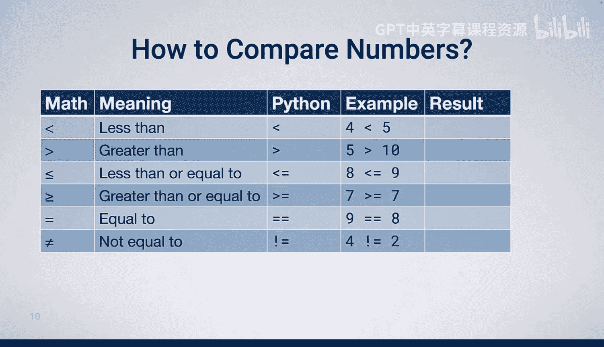

# Python编程实践：比较值-关系运算符


在本节课中，我们将学习如何在Python中使用关系运算符来比较值。

## 1. 条件语句

到目前为止，我们编写的代码都是逐行执行的。但有时，你可能只想在某些情况下执行代码。例如，你可能想根据用户输入的数字打印不同的信息。

```python
if 用户输入的数字 <= 99:
    打印("这是一个好数字。")
else:
    打印("这是一个大数字。")
```

这被称为条件语句，类似于“如果...那么...”，你可能在日常生活中经常用到。



## 2. 比较运算符

在数学中，我们习惯使用小于号（<）和大于号（>）来比较两个数的大小。Python也使用相同的符号来表示相同的意思。

```python
小于等于 <=
大于等于 >=
```

然而，这些符号可能难以在键盘上找到。因此，Python在比较运算符中使用等号（=）来添加“等于”部分。

- 等于 ==：使用两个等号表示两个值是否相等。
- 不等于 !=：使用感叹号（!）和等号（=）表示两个值是否不相等。

## 3. 使用运算符

使用比较运算符时，你需要在运算符的两边放置一个值，并评估结果为“是”或“否”。在Python中，我们称之为“真”或“假”。

```python
4 < 5  # 真或 True
5 > 10  # 假或 False
8 <= 9  # 真或 True
7 >= 7  # 真或 True
9 == 8  # 假或 False
9 != 2  # 真或 True
```

## 4. 比较变量

除了比较数字，你还可以使用变量进行比较。以下是一个示例：

```python
x = 10.0
if x >= 1:
    print("这是一个大数字。")
```

## 5. 比较字符串

在Python中，你可以使用比较运算符来比较字符串。比较字符串时，Python会使用大小写敏感的字母顺序。

```python
A < B  # A在字母表中排在B之前
Y > B  # Y在字母表中排在B之后
A < a  # 大写字母A排在小写字母a之前
Z < A  # 大写字母Z排在小写字母A之前
cab < cat  # cab在字母表中排在cat之前
Apple < yon  # yon在字母表中排在Apple之前
black < car  # black在字母表中排在car之前
T0 < T00  # T0在字母表中排在T00之前
that is blue < that is red  # that is blue在字母表中排在that is red之前
```

## 总结


本节课中，我们一起学习了如何在Python中使用关系运算符来比较值。这些运算符可以帮助你编写更复杂的程序，并根据不同的条件执行不同的操作。