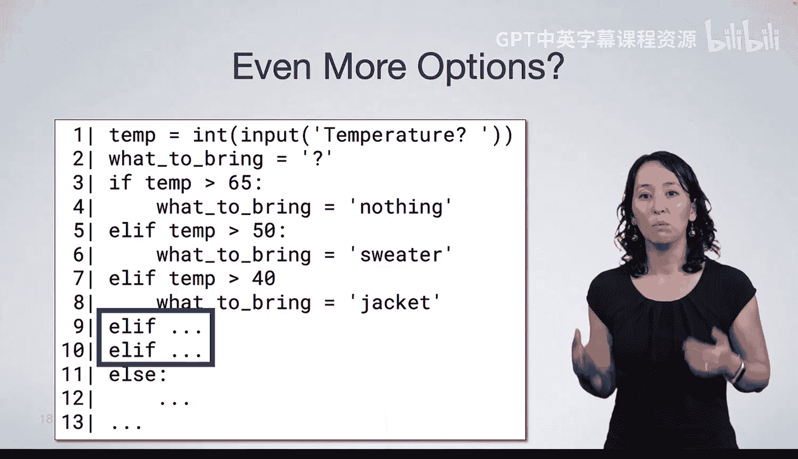

# 杜克大学《Python编程实践｜Practical Python： Start Your Programming Journey》中英字幕 p21 21_03_02_选择性执行-使用条件语句.zh_en -BV1tTmCBWEQD_p21-

So a conditional is like a conditional sentence。Which is something like， if this is true。

 then do that thing。The if this part is called a condition。And a then that part is called a result。

 So， for example， let's say I wanted to write some code though it help me figure out if I should bring something to stay warm when I leave my home。

😊，My first step would be to look up the weather report for the expected temperature。

I live in the southern United States， which means I'm not as good with the cold as I used to be。

 So it would have to be at least like  65 degrees Frenit before I'd walk out my door without bringing anything。

If I wrote this as a conditional sentence， it would be something like this。

 If the temperature is greater than 65， then bring nothing。And for those that use Celsius。

65 degrees Fahrenheit is about 18 degrees Celsius。In Python。

 that conditional sentence would turn into something like this。 First， on the line 1。

 Python calls the input function to ask the user to provide the temperature。In that same first line。

 it also converts it to an int。On line 2， we initialize the variable。

 what underscore to underscore bring。To a question mark。

 So we always have some value for that variable。Next， we have a new bit of code syntax。

 We've never shown you before， which is an if statement or a conditional statement that translates the conditional sentence into code。

 That code on line 3 checks to see if the temperature is greater than 65。😊，If it is on line 4。

 Python will reassign the value of the what to bring variable to the string nothing。Finally。

 we have the last line printing out what to bring。So let's go over the key parts of the if statement more slowly。

 The first line of the if statement starts on line 3。It always starts with the ifth keyword。

Right after the word is the condition。When the condition is true。

 the code that belongs to the if clause will execute。And finally。

 the colon at the end tells Python that it's reached the end of the if statement's condition。😊。

Line 4 is the result of the if statement or the block of code that will execute if the condition is true。

If the condition is false， line 4 will be skipped。The code that should be executed only when the condition is true must be indented under the if condition。

I recommend pressing the tab key on your keyboard to indent。Alternatively， you can use four spaces。

 which should be the default in your coding environment。

 This indenting marks all of that code as a single code block， which tells Python， the code lines。

 they're executed as a result of the if condition。 just like in a conditional sentence。😊。

And in this example， we only have one line of code， but you can have as many as you want。

 They just need to be indented。Let's go through some examples。 When the code runs。

 it starts at the top。The green arrow here shows you what line of code we are currently evaluating。

Like Python tutor， the green arrow will move as we go along。

The blue arrows will show you what lines were executed and will stay to show you the entire picture of what happened。

And since we now have if statements， this is important to notice because we can now control whether or not we execute certain lines of code。

 So when we run this line， we ask the user for the temperature。😊，Let's say the input 70 degrees。

 The input function returns the string 70 and hands it to the int function。

 which returns the integer 70。😊，Otherwise， later in the code。

 we'd be comparing a string to an integer。Then we move down to evaluate the next line。

This line initializes the value of what to bring to the string question mark。Next。

 we go to the line 3 and evaluate the condition in the if statement。In this case。

 it evaluates to true。70 is greater than 65。So we go to the code in the if statement to execute its code block。

 which in this case is line 4， where it reassigns the value of what to bring to the string nothing。

Finally， we reached the last line， which print the string。

 bring colon and the value of what to bring， which in this case is nothing。😊，Now。

 let's do another example for this time， a temperature where I know I shouldn't bring nothing。

 let's say。50 degrees。So that gets assigned to the value temp。

 And then we go to the next line and assign what to bring the string question mark。 Next。

 we go to line 3。 And this is the first thing that is different than the prior example。

This condition evaluates to false。 In this case， we do not execute the colored body that belongs to this。

 if statement and goes straight to line 5， which has the print statement。

Notice the blue arrow looks different。 We drew a line past line 4， showing we did not execute it。

 And instead point at line 5， which we do execute to print， bring colon question mark。

And why would it do that。It's because remember what to bring original value before the if statement was question mark。

 and since we didn't execute any code that changed the value， its value is still question mark。Now。

 I don't know about you， but I'd actually want the code to tell me what to bring besides a question mark。

So how about a conditional sentence like this。If the temperature is greater than 65。

 bring nothing else， bring a sweater。 So now I know that if the temperature is not greater than 65。

 I should bring a sweater。😊，That code would look like this。

 Notice we still have our if clause on line 3 and 4， like before。

But we've added some new stuff in lines 5 and 6。 Line 7 is the print statement like before。😊。

Line 5 has the key word else， and a colon。This tells Python that if the condition on line 3 is not true。

It should execute whatever code is indented after the else。

 Let's actually add a comment to that effect。A single line comment is something that starts with the hashtag symbol。

 or pound symbol。And has whatever text you want to describe what the code is doing。

This is useful to remind yourself what is going on。

 because code is not just for the computer to read。 It's for you to read。

 to understand what the computer is doing。Anything after the hashtag symbol is ignored by Python。

It doesn't try to execute it。Now， back to the else clause。

Notice that the key word L lines up with the if on line 3。

Liing up the indenting is important so that Python knows what else clause matches with that if clause。

As for what code blocks belong to the else clause， it should have everything indented under the El line。

 which in this case， is line 6。It assigns what to bring the string sweater。

So this entire if statement is from line 3 to line 6。 It has two clauses。

 One is the if clause with the if condition， and the other is the else clause。

 Now we have one more piece of syntax。 You need to learn about if statements。

 And I'll motivate it by first asking。😊，What could go wrong with this code。Well。

What if I need something warmer than a sweater。Maybe there are times I need a coat。

That might lead to a complex， conditional sentence like this。If the temperature is greater than 65。

 then bring nothing。Else， if it's greater than 50， bring a sweater。Else， bring a coat。

Another way to think of it is if the temperature is over 65。I don't need anything。Between 65 and 50。

 I need a sweater， and below 50， bring a coat。This translates to this， if statement。

Our if clause on lines 3 and 4 are still the same。Now we have a new clause starting on line 5 that lines up with the if and the else。

That clause starts with the key words spelled E， L， I，F， pronounced L， if。Which is short for else。

 if。The creators of Python really liked to abbreviate things while still retaining some meaning。

The way to think of L if is like it's the else of the if clause right before。

 and has an if condition as well。And the Python creators decided to just smash the two words together to get the key wordL if。

In this case， on line 5， the if condition checks to see if the temperature is above 50。If it is。

 Python will execute the code block that belongs to that L if clause。Which is， like usual。

 indent it under it。I've also updated my comment on line 7 to remind me that this else clause now would only execute if the temperature is 50 or below。

Here is the code before and after we added that L。 F clause。

 Notice that the line about the sweater is in the same place。😊。

But the L keyword has changed into an L if that checks if the temperature is over 50。

And there is a new else clause that is for bringing a coat。

So why is the sweater now an e clause when before it was an o， Well。

 let's look at the conditional sentence。 It starts with a condition for if it's over 65。

And the else result has another conditional sentence inside of it that checks if the temperature is over 50。

If we follow this pattern for each if statement， there will always be only one else class。

 which makes sense because if there was more than one。How do we know which one should be executed。

Therefore， Python only allows one Elf's clause2。In summary， Python's steps are。

 it starts at the first if clause， works its way through each condition until it finds one that's true and then ignores everything else。

Or if it can't find a true condition and there is an else clause， Python executes the else clause。

Let's go through some examples with the entire if statement。So Python executes the first line。

 and let's say I input 70 degrees。 The first line takes that input and converts it into an integer。

Then we execute line2 and assign what to bring to question mark。On line three。

 we check the condition and find that it is true。Temp is greater than 65。

So Python executes line 4 and assigns what to bring the string nothing。

 And then Python immediately skips the rest of the code for this if statement and goes to line 9。

 which prints bring nothing。Notice how long that last blue arrow is。 We skipped almost half the code。

But this is also the advantage of， if statements。 We have very fine tune control over what gets executed and how we want it to happen。

Next， let's say I input 60。We execute line 2， like usual。

 and move to line 3 and execute the first condition， which is now false。 So we skip line 4。

 which should only be executed If the condition it belongs to is true。

 and move on to the next clause。 In this case， the L of condition is true since 60 is greater than 50。

So we execute line 6 that belongs to this condition。And then again。

 skip the rest of the code and execute line 9 to print， bring a sweater。Last example。This time。

 I'll input 45， and we go until we get to the if statement。 The first condition is false。

 So we go to the next condition。The second condition is also false。 So， again。

 we skip the code belonging to this condition and move on to the line with the else clause。

 So Python has run out of conditions and didn't find a true condition。 So this condition is。

 in essence， true。 and Python executes that clause's code body of line 8。

 and then executes the next line outside of the if statement， which is line 9。

 which prints bring coat。😊，So let's highlight something important by asking a question。

What would happen if I take the first two conditions and swapped them。

I've highlighted what's changed in green， so it's easier to see。

What could go wrong because of this change。Is it O to do this。I'll give you a hint。It depends。

 Sometimes it's okay， and sometimes it's not。One way to figure it out is to use some example inputs。

 Let's use what we did before， but with this changed code。So we' 45 degrees。

 We know that it should print coat， and that looks fine。The two conditions were false。

 and the El clause was executed for 60 degrees。 We know it should print sweater。

 and that looks fine as well。The first condition， which has sweater as part of its claws。

 also executes just fine。For 70， we hit the first clause。 And that's true。 But， oh， no。

 we aren't supposed to bring anything If it's over 65。 That's too hot。What happened。Well。

 if you think about it， if the temperature is over 65， then it must also be over 50。

 That means the L clause that checks。 if the temperature is over 65。

 never executes Python will always check the top condition first。 And if that is true。

 it'll not bother looking at the rest。 So this is a case where order does matter。Also。

 as a side note， the comment for the else in this case is still valid。

Python will only execute the else clause if the temperature is less than or equal to 50。

 but that may not always be the case。 If the ordering here even made the else clause execute incorrectly。

 Python is not going to make sure your comment is still correct， it literally just ignores it。Okay。

So now that we've gone over all of that， I've got a question for you。

Is it possible to have even more options than just the three we had。

 given what we know about conditional sentences。Yes， we can have as many L F clauses as you want。

 For example， what if I wanted to consider something warmer than a sweater。

 but not as warm as a coat， like a jacket。😊，Say it's between 50 and 40 degrees。

I just add another L if statement after the check for greater than 50。

 But before the else clause and set what to bring to the string jacket。😊。

If I wanted even more options， well， if you follow the rule of starting with an Ilf clause and only at most one else clause at the end。

 we can add as many L， if clauses as we want。Notice though， that these do have to be L if clauses。

 there is only ever one if clause and one else clause。

So， let's recap。Here are the three generic versions of conditional statements that you've learned so far。

We have the simple if， with no other code。The if clause with an else clause。

And an if statement with three clauses， and if， Elith and else。

Notice what is similar about all of these。 The all start with if。And in Python。

 your conditional statements will always start with an if。

They will sometimes include an L if clause and can have as many L if clauses as you want。And also。

 only sometimes have an else clause。 And the else clause is always at the end。

 So notice I said it only sometimes has an else clause。

 That means there is actually one more general way to write a conditional statement。

You can write an if clause with an L if clause and no else clause。

 What that does is if none of the conditions are true， Python will not do anything by default。

 So if statements have one if clause 0 or many L if clauses and 0 or one else clause。 Now。

 go forth and have fun with if statements。

