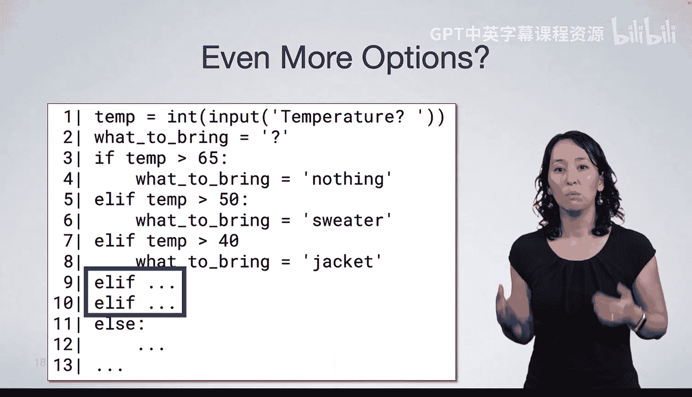

# Python编程实践：使用条件语句


在本节课中，我们将学习如何使用条件语句来控制代码的执行流程。

## 条件语句概述

条件语句类似于条件句，例如“如果这个条件为真，那么做这件事”。其中，“如果”部分称为条件，“那么”部分称为结果。

## 示例：判断是否需要带衣物保暖

假设我们想要编写一些代码来判断在离开家时是否需要带衣物保暖。首先，我们需要查看天气预报中的预期温度。

我住在美国南部，这意味着我不像以前那样能很好地应对寒冷。因此，在出门时，温度至少要达到65华氏度，我才不会带任何衣物。

如果我们将这个条件句写成代码，它可能看起来像这样：

```python
if 温度 > 65:
    带上什么 = "什么也不带"
```

## if语句的关键部分

1. **if语句的开始**：if语句的第一行始终以关键字`if`开头。
2. **条件**：紧跟在`if`关键字后面的部分称为条件。当条件为真时，将执行属于`if`子句的代码。
3. **结果**：if语句的最后一部分是结果，即当条件为真时将执行的代码块。
4. **缩进**：只有缩进在`if`条件下的代码才会被执行。

## 示例：判断是否需要带衣物保暖（续）

```python
温度 = int(input("请输入温度："))
带上什么 = "?"
if 温度 > 65:
    带上什么 = "什么也不带"
print("带上什么：" + 带上什么)
```

## else语句

如果条件为假，则可以执行`else`语句中的代码。

```python
if 温度 > 65:
    带上什么 = "什么也不带"
else:
    带上什么 = "带上毛衣"
print("带上什么：" + 带上什么)
```

## elif语句

可以使用`elif`语句来添加更多条件。

```python
if 温度 > 65:
    带上什么 = "什么也不带"
elif 温度 > 50:
    带上什么 = "带上毛衣"
else:
    带上什么 = "带上外套"
print("带上什么：" + 带上什么)
```



## 总结


本节课中，我们一起学习了如何使用条件语句来控制代码的执行流程。通过使用`if`、`elif`和`else`语句，我们可以根据不同的条件执行不同的代码块。