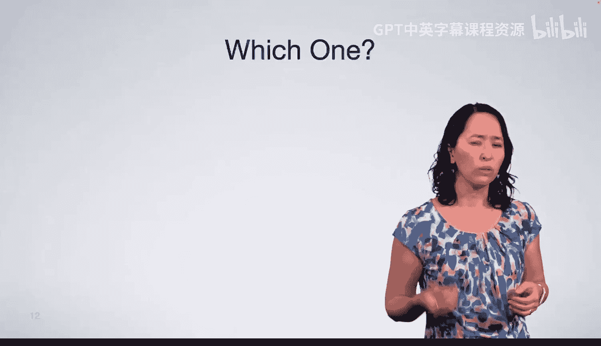

# Python编程实践：if-elif与if-if的区别


在本节课中，我们将学习if-elif与if-if语句的区别及其在Python编程中的应用。

## if-elif语句

if-elif语句允许我们根据多个条件执行不同的代码块。其基本结构如下：

```python
if condition1:
    # 执行代码块1
elif condition2:
    # 执行代码块2
else:
    # 执行代码块3
```

当Python执行此语句时，如果它遇到一个为真的条件，它将执行属于该条件的代码块，然后跳转到if语句之后。如果它没有遇到一个为真的条件，它将到达else子句并执行其代码。

**公式**：`if condition1: ... elif condition2: ... else: ...`

## if-if语句

if-if语句使用多个if语句来检查多个条件。其基本结构如下：

```python
if condition1:
    # 执行代码块1
if condition2:
    # 执行代码块2
# ...
```

当Python执行此语句时，它会检查每个if语句的条件。如果条件为真，它将执行相应的代码块。即使前面的if语句的条件为真，Python也会检查下一个if语句的条件，因为它们是独立的if语句。

**公式**：`if condition1: ... if condition2: ... # ...`

## 例子

以下是一个根据温度决定携带物品的例子：

```python
temperature = int(input("请输入温度："))

if temperature > 65:
    print("不需要携带任何物品")
elif temperature >= 50:
    print("携带毛衣")
else:
    print("携带外套")
```

我们可以使用if-if语句来实现相同的功能：

```python
temperature = int(input("请输入温度："))



if temperature > 65:
    print("不需要携带任何物品")
if temperature >= 50:
    print("携带毛衣")
else:
    print("携带外套")
```

## 总结


本节课中，我们一起学习了if-elif与if-if语句的区别及其在Python编程中的应用。虽然两种语句都可以实现相同的功能，但选择哪种语句取决于个人喜好和代码的可读性。重要的是确保代码能够正确地输出预期的结果。😊