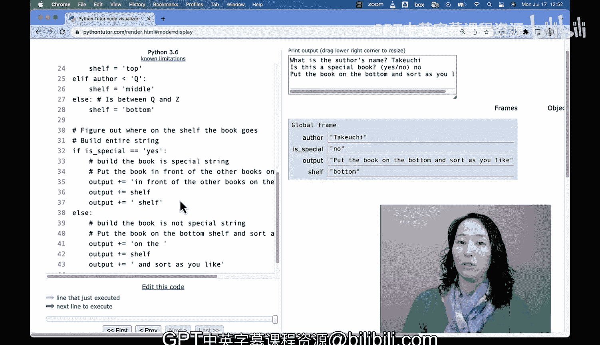

# 杜克大学《Python编程实践｜Practical Python： Start Your Programming Journey》中英字幕 p23 23_03_04_if语句演示.zh_en -BV1tTmCBWEQD_p23-

Hello and welcome。 Today， we are going to walk through writing al code using if statements。

 and we're going to do it in Python Tutor。 So it's easy for us to see the progression of the code as it gets evaluated and how we skip different lines based on the results of the if statements。

 So let's say you are going to organize a very nice， pretty video background。 For example。

 books on bookcase。 However， you also want to easily find your books。

 So this bookcase needs some organization that makes it straightforward for you to both find your books。

 but it's also pretty。 So let's say we're going to use author' name because that makes it a little easier for us to find things。

 And to make sure we are consistent in not having to think too hard that we're going to organize books in this way。

 We're going to write a program to tell us where each book goes。 First。

 we need to decide how we're going to organize our books。 So let's say you have three bookshel。

 And my first thought is to split the books across shelves by author。 So let's write。😊。

Write that down before we forget。Organize， whoop would help if I could spell right。

 organize books by author。Now， to make the bookshelf look nice will sorten some way that puts the special books in the front。

So let's write that down。Sort books on。Xiao。Put special books in front。

 So what code do we need to do this。 Well， when writing a program。

 there are multiple activities that you should do in this demo， I'll show you the design plan。

 implementplement， verify and debugging activities。 Let's start with the design activities。

 In this case， that means that we want to think through what our code's going to do。

 and we'll print it out based on certain inputs。 So let's write out some examples to help us think through what we want to happen。

😊，So let's say that our input is nooccal。Takkioji。And she's the author of Salem Moon。

 in case you didn't know one of my personal favorites when I was a kid。

 and it's not a special book because she has so many and I have quite a few of them。

So the output then should be put the book on the bottom shelf and sort。In some way。

 and so it's the bottom shelf because Takaucchi， I'm going to assume I haven't done the math yet that is she's going to be in the bottom because her last name starts the T。

So let's think about how we're going to sort the books inside the bookshelf。

It kind of depends on a few factors， like the book is part of a series。

 so whether I think theyll look nice if I want them together or not， and I'll just program for now。

 let's just say。We'll let the person choose whoever is running the program。So， as you like。

 let's just say that。Let's do another input。So another input could be。Pride and prejudice by Jane。

Austin。And to me， this one is a special book because I go back to it a lot。Special。Buck。The output。

Should be something like put the book in front of the other books on the top shelf。

 I just realized I'm in to typo。 I'm just going to go back and fix that real quick。

 typoos happen all the time。And then let's do one more thing with our inputs。One more example， input。

Let's say we have a book by Mercedes。Lacky。And it's not a special book because I have so many of them。

 So the output in this case should be put the book on the middle shelf。And sort as you like。

 So a few things to notice。Here we talked about sorting and same with alquatakuucchi。

 sort as you like。 However， if we look at the output for the pride and prejudice。

 I actually don't mention whether or not to sort。 And that kind of makes sense if you think about it because it's a special book。

 And so I'm not really going to sort that book at all。😊。

So there are definitely differences in the outputs。

 but also we can kind of see that there's going to be some similarities。 So with that。

 let's now move on to the planning phase of our code。

 Now that we've kind of figured out what the design is going to look like。

 So these examples of help us think through what we want to do。 now we need to plan out our code。

 So when we look at things， we can clearly see that we are asking the user for two different things。

 So let's write and plan that out。 So ask user for authors name。

 and we're also going to ask the user if the book。😊。

Special noticeice I did not write asking the user for the book title because when we look at our examples we can already see that I don't ask for the book title every time and then on top of that we're not really caring about sorting except to tell the user go ahead and sort as you please。

 so the book title is not useful information for how we're going to decide what to return to the user and print out to them。

😊，So after I have the input for the user， I need to figure out what to output in response。

 And that is likely going to be in two parts。 So let's add notes for that。 Figure out what。Shelf。

The book goes on and also figure out。Where on the shelf the book goes。

 So notice what I've done so far。 I've done the design activity。

 which is one activity in the many activities you do when you're writing a program。

 and I have done the planning activity where I'm starting to plan out my code And technically。

 the next thing I could go to is the implement activity。 However。

 I think I'm going to step back and plan a little bit more of my code to help me think through what I want to do。

😊，So how about what we do is we look at these two lines。

 figure out what shelf the book is going on and figure out where on the shelf that book goes and break those down a little bit more to help us think through what to do。

 Looking at my examples here， I can see that there are some similarities and some differences between the outputs。

 And I think in this case， the way I'm going to do it。

 as I'm going to slowly build up a string and then print the string at the bottom for what it needs to be rather than like trying to figure out what the string has to be every single time。

 And so what that means in this case is I need a new line that reminds me of getting ready to do that。

 So let's do initialize the output string here。😊，So now when I look at my examples。

 I can see that I have bottom shelf here。 top shelves over here， middle shelf is over here。

 so that's clearly like going to mean in different parts of the string。

 but since right now I just need to figure out what am I going to do right here about figure out what the shelf that goes on so I think I'm going to add a note to myself that just says something along the lines of put which。

Shelf。The book。Goes on in the variable shelf because I'm definitely going to not build the string under the figure out what shelf the book goes on。

 So in this case， I'm just going to say， put where it goes in a variable。

 So then when I get to this line down here， figure out where on the shelf the book goes。

 I can assume that I have a variable called shelf that already tells me what shelf is going to be there。

 So at that point inside these iftis。That are probably going to need here。

 Let's just say that I'm going to build the entire string right here。 So build entire string。

 Now it's time to code。 And so all our stuff at the top lines is one through 9。

 That's just a reminders to ourselves， as well as our examples。

 9 11 is our first line that we're going to add some code。 So ask user  for author' name。

 So that is going to be the。😊，Input function， author equals input parenthesesis。What is the authors？

Name。So notice a few things， I used double quotes around this string because I wanted to use the single quote here for author's name。

On top of that， I add a little bit of white space here to make sure that when it printed out。

 the user is not starting to type right at that question mark。

 and we gave it a little bit of white space or a little bit of breathing room。So next up。

 we're going to ask the user if the book is special， so again， let's do something like is。😊。

Special equals input。Is this a special book and notice again that I am going to use single quotes in this case。

 and I'm adding a bit of parentheses here to remind the author to please give me a yes or a no。

Full string rather than saying just wire and a single letter。

And since I did not have a single quote inside， like a apostrophe。

 I am using single quotes on the outside to create my string。

 So that's all we have to do to ask the users for the input that we care about。

So those are the code lines already done。 Allright， so now it's time to initialize the output string。

 so in this case， output equals two single quotes would help if I could spell output correctly because that would be helpful for later in the code。

😊，But however， does it have to be an empty string？If we look up here， here's my output。

 put the book on the middle shelf。This output is put the book in front of the other books。

 and this one is put the book on the bottom shelf。 So for every single one of my output examples。

 I have put the book。 So why not just have the output start out with put the book。And。

That helps things so that we don't have to copy paste that multiple places。

Now it's time to figure out what shelf the book goes on。

So we have our handy down two comments to remind ourselves what we're going to do and let's pause and also ask ourselves we have three shelves。

 we need to divide the books across those shelves， we're going to assume that our authors are evenly distributed across the alphabet and so checking really quick。

 how do we divide the alphabet into thirds， it is where the top books would be A through J。

 the middle books would be I through P and the bottom books。Would be Q through Z。

So I'm writing that there in that comment to remind myself what I'm doing。

 and now let's also remember how do you check where in the alphabet a string is？If you recall before。

 you can actually use the less than and greater than symbols to check if a string is less than or greater than something。

 and it really is as if the alphabet is along a number line。

 so if we want to check if a string is between I and J。

 that's the equivalent of saying if the author is less than the string I。

Because anything before I must have started with A through J。

And this comment is going to remind us that all we have to do in this case is create a variable calledShe and assign it to the appropriate value。

So in this case， we have shelf equals top。Now remember how if statements work， we can have。

 we need to start with an if， we could have an L， and we can have as many L ifs in the middle。

And in this case， right now， we have things set up so that if author is less than I。

 then the shelf equals top。 And now we need to make sure that shelf is middle or shelf is the value bottom。

 whatever we need it to be。 So to have it be set to shelf is assigned middle。

 we need it to be between I and P。 And since if author is less than I is。Alsose。

 that must mean that it is。Between I and Z。So we need to split that up to at least tap the INP range in the Q and Z range。

 so let's do L if author is less than Q。So for the same reason as before， if it's not less than I。

It must be between I and Z。 But and if it is between I and Q， which is when。

We would get to this point in the if statement。 that must mean that it is between I and P。

 So that means that shelf in this case， equals middle。And since。If。

We have author less than I evaluates to false， and author less than Q evaluates to false。

 That must be the case that the author variable is between Q and Z。 So in this case。

 we don't need an E statement。 We can just say else She equals。But。🤢，However。

 since we need to remind ourselves what the he's going on。

 let's add a little comment right here saying is between Q and Z。Help if I could stop。There we go。

And that is all we need to figure out which shelf the book should go on。Okay。

 so before we go on to the next comment， we really should run our code just to check to see if the code works。

 noticeice that while there are these different activities for writing a program。

 we're not doing it have to do it in linear fashion。

 We can go straight to the verify activity before we are done with the implement activity。

 And that's one reason why I've been calling these activities rather than steps。

 We're not doing this in sequence， we jump around as necessary to make sure that our code is working。

 we really do need to run the code as often as we can， because as we're running our code。

 the more code you write between runs， the more code you have to check to try and figure out what's going on。

 If your code doesn't do what you're expecting it to do。 So let's try running this code。😊。

Visualize execution。Notice that the red arrow starts right at line 12 because that is where the code starts。

 all the other code up here， that's all comments， and so there's nothing to execute over there。

So author input what is the author's name， so let us go down here and actually enter the author's name。

 So of my all my comments， let's just do the first example that I had Taka Uci。

 let me just copy paste that。And hit submitit。😮，So now notice that we have just finished executing line 12。

 we're going to execute line 15 next， we've created our variable well over here and we have Takaucchi right there and also the output right there for what is going on so is this a special book in this case the answer is no and so we submit that。

And is special is no over here， we're now going to initialize our code output。So you can do next。

 output is put to the book， and if author is less than I， so is Taka Uchi less than I。

 what do you all think？No， it's not。 so now we're going to go to the next one LF author less than  Q is Takuchi less than Q。

No it's not so we go straight to the L statement， no it's the red arrow in this case went right past the L statement and right to the code inside of it because if these clauses are all false。

 the L statement must evaluate， so we hit shelf is assigned bottom and there we have it。

 shelf is assigned bottom。All right， let's execute again。

 but with different inputs to see if the code works for that， however， rather than hitting first。

 I got to hit the edit button。Scroll back down and hit。Visualize execution。

So I actually have access to our little input buttons again。

 so let's see this time let's input Austin。And in this case， we're going to say it is a special book。

 so yes。Submit。And now we are here， we're going to initialize the output。Put the book。And now Austin。

 is it less than I？Yes， it is， so here we have a red arrow about to execute the code inside of the if statement。

😊，So now shelf is top and we are done with the code because once you find one statement inside the if statement that's true。

 we skip to the code after， which in this case is just comments。

 which is why we don't see red error anymore。 All right， let's test it one more time。 Edit this code。

 Sc down， visualize execution。This time， we're going to try it with lacky。Submit。No。

 it is not a special book， and so we once again initialize output。Is the author less than I， No。

 it's not because it is lacky。 Is it less than Q。 Yes， it is。 So it goes inside。

 Shelf is assigned middle。 Shelf is middle。 Everything looks good so far。All right。

 so let's implement the last piece of our code。 So figure out where on the shelf the book goes。

So this is based on this input on line 15， where get， is this a special book yes or no。

 so the user is saying yes or no and putting it in the variable is special。

 so that means that down here we need to have an if statement based on the is special variable if is special equals yes。

 then we need to build the book。Is。Special straight。And if the user does not say yes。

 which means that this will evaluate too false， then that must be that they said no。

 So let's just put an L statement in there rather than actually check if it is no， build the book。

I is not special strain。All right。What should we say or what string should we build When is special equals。

 yes。So rather than type the whole thing out down here。

 let's just scroll up and copy paste what we wrote before。

 so here is the string for if things are special and we will just put it here for safekeeping and we already know that the output starts with put the book。

So let's start building that together output。Plus equals， it already has the put the book part。

So it has this part already。So we need the rest of this in front of the other books on the top shelf。

 so top shelf right here is where top is where we will get from the shelf variable so we want to take everything before and add it to the output。

So let's just copy paste that。And then we want to add in。The value shelf。And then we need to add in。

To actual wordhelf。All right， so in case you don't remember。

 plus equal sign means I want to concatet whatever is already in output and put this string afterwards and the same thing is happening for each of these lines。

So before we do anything else， let's run our code and see if it works。Oh， wait。 What happened。Error。

 scroll down to see error message in the visualization execution button， so we've hit an error。

 let's see what happened， scrolling down so it says syntax error unexpected EOF well parsing。

Brackt string bracket line 39。Errors are totally normal。

 Don't feel like your code must be horribly wrong。 if you see an error。 tyypos happen all the time。

In this case， make sure to read the error message carefully because there' is useful information in there even if sometimes it's really hard to parse。

 so syntax error tells us that this is likely something like a typo in a keyword or missing a colon or parentheesis or a single quote。

 something like that， it's not necessarily about your variables。

 it's more about the other pieces of Python like those special characters。😊。

Unexpected EOF EOF in Python stands for end of file。

 I know they could have written it all out for some reason， they don't。

EOF is a very common acronym people use。 So what this is saying is that while the computer was parsing through the Python code。

 it got to the bottom of the file before。It was expecting to。 Instead。

 it was expecting some kind of prehey or colon or some more code。

 and it got to the end of the fall when it wasn't supposed to。

 So it's telling you that you need to look around to try and figure out what was going on。

 And at least this line kind of gives you an idea where in this case。

 it's actually just the last line of the code。 but we can also see that this is useful information because it's telling us。

 oh， wait， this is an else clause。 And it's expecting to have code inside else clause and commentsts don't count。

So in this case， we now put some code in here before anything will compile。

 so let's put just output plus equal shelf there for now， we know that we're going to need it later。

 so as will just put it in now。 so now let's visualize the execution。See what happens。

 notice that Python Tutor sometimes likes to ask you to help others by explaining what you did。

 I'm not going to do that here but as I don't have the time。

 but you are welcome to do that when you're using Python Tutor， so close that。

And now let's test out our code。 So since Jane Austen's book is the only special example here。

 I'm going to write that in because this is the only code that we're doing。 So Austin submit。

 is this a special book。😊，Yes， submit。So let's walk through what's going on。 We initialize output。

 output， put the book if author is less than I， it is shelf is assigned to top。

 we skip the rest of that code， go down to if is special equals yes。

 which it is so we're going straight inside sign output plus equals in front so now notice output is now put updated to put the book in oh that's interesting。

 there's no whitespace there， we'll have to fix that front of the other books on the。Top the top。

 also missing white space there。Shelf missing whitespace。😮，And now we're to the bottom of the code。

 so two things to notice that we kind of are screwing up。

 we are missing some white space in our output string and also I wanted this to print out inside the print output box rather than just having it and the code and I've got my string。

 but it's not visible okay。😊，Let's edit the code。 We had two things we needed to fix。

 One is our white space issue。 So if I recall correctly put the book in front of the other books on the here is where we were missing a white space。

 but rather than putting it here， let's put it up here just because we know we're going to need it for the other string anyway and then for here we need to have a white space both before the top middle bottom。

 whatever it's going to be in this variable and after。

 so now we've added our white space and then the other thing we needed to fix was the fact that we're not actually printing anything to the output box so let's add that。

Print。Out。So less visual eyes code one more。Here we go， Austin submit。Yes， submit。

Now we have output put the book space at the end。Shelf is assigned top like before is special is yes。

 as we skip right into there。 So put the book in front。

 So now we have our lovely white space where we want it。

 And notice we have our white space right here， ready to go。😊，Top。Shelf， and then we are at line 42。

 we skipped the Alice entirely because we were executing the if statement part。And then print。

Put the book in front of the other books on the top shelf。 Per。 All right。

 let's do the non special books now。Okay， so let's copy down just like before just to make our lives easier。

Copy， scroll down。There's what we want。So we know that put the book on the put the book right there is the same already inside the output stream。

So then let's just grab everything else。So bottom we know is in the variable shelf because it could be bottom。

 middle or top。So let's put output plus equals。On the， remember the white space？

There we have our shelf and then let's copy in the rest once again。Class equals。

And sort as you like once again， remembering our white space。 so let's see if that is sufficient。

Visualize execution， let us instead say it is Takaucchi， so we copy that。Submit。And then we say no。

 it is not a special book， submit。I'll put the book。Llf alpha is less than Q。 No， it's not。

 So that means me。 We hit the L。 shelflf equals bottom。 shelflf is assigned to bottom。 I'm I sorry。

 If is special equals equals Yes， it does not， because it says no， So we go straight to the else。

I'll put add on thee。But put the book on thee。Bottom。And sort as you like。

 print it to the apple box and there it is， and we are done。

So that was an example of using an if statement with if elephant else。

 as well as if and else with multiple lines inside。

As well as showing you the different activities when it comes to writing a program we designed by writing out some examples。

 we planned our code by writing out some comments based on our examples， we implemented our comments。

 we verified that it was working， and we also did a little bit of debugging because we had a syntax error。

And notice how we jumped around between different things we implemented a little bit。

 then we verified， we implemented some more， then we verified， did a bit of debugging。

 then we implemented some more， then we verified。Did we have to do all of these activities， No。

 we potentially could have just gone straight into the coding and then just fine。

 And I'm sure there will be times when you will do the same thing。 However。

 notice how I kept going back to my comments to remember what would did I want to do。

 And that is one of the more useful aspects of at least pausing before you start writing code。😊。

To figure out what do you actually want to happen without getting bogged down in the details of what the code is going to end up looking like。

 And so now it's your turn。 How would you change this code to fit your needs。

 Maybe rather than sorting books you'd be using if statements to make other decisions like what to wear based on the temperature of the day or what to eat depending what meal it is。

 It is entirely up to do， And I hope you will enjoy using if statements in the future。😊。

