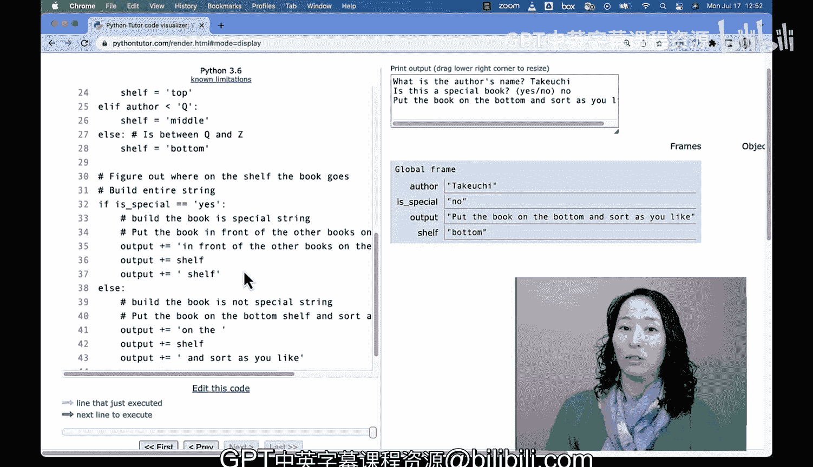

# Python编程实践：23：if语句演示 🐍


在本节课中，我们将学习如何使用 `if` 语句编写代码。我们将通过一个整理书籍的示例，在 Python Tutor 中逐步演示代码的执行过程，并观察如何根据 `if` 语句的结果跳过不同的代码行。

## 概述

我们将编写一个程序，根据作者姓名和书籍是否特殊，来决定一本书应该放在书架的哪个位置以及如何摆放。通过这个例子，我们将展示编写程序时涉及的几个核心活动：设计、规划、实现、验证和调试。

## 设计活动

首先，我们需要明确程序的目标。假设我们有一个三层的书架，我们希望：
1.  按作者姓氏的字母顺序将书分配到不同的层。
2.  将特殊书籍放在所在层的前面以美化书架。

为了理清思路，我们写下一些输入和期望输出的例子。

以下是几个输入输出示例：

*   **输入**：作者 `Takaucchi`，书籍 `Salem Moon`（非特殊书籍）。
    *   **输出**：将书放在底层，并按喜好排序。
*   **输入**：作者 `Jane Austen`，书籍 `Pride and Prejudice`（特殊书籍）。
    *   **输出**：将书放在顶层其他书籍的前面。
*   **输入**：作者 `Mercedes Lackey`（非特殊书籍）。
    *   **输出**：将书放在中层，并按喜好排序。

从这些例子中，我们注意到对于特殊书籍，输出中不包含“排序”的指示。

## 规划活动

上一节我们通过例子明确了程序的功能，本节中我们来规划代码的结构。

根据设计，我们需要从用户那里获取两类信息。以下是我们的计划步骤：

1.  **获取用户输入**：询问作者姓名，并询问书籍是否特殊。
2.  **确定输出内容**：这分为两部分：
    *   确定书籍放在哪一层。
    *   确定书籍在层内的具体位置（前面还是按序摆放）。
3.  **初始化输出字符串**：我们将逐步构建最终要显示的字符串。

为了更清晰地实现“确定输出内容”的步骤，我们进一步规划：
*   将书籍所属的层（如 `top`， `middle`， `bottom`）存储在一个变量中。
*   根据书籍是否特殊，构建完整的输出字符串。

## 实现活动：获取输入与初始化

现在，我们开始将规划转化为代码。首先实现获取用户输入和初始化。

```python
# 1. 获取用户输入
author = input("What is the author's name? ")
is_special = input("Is this a special book? (yes/no) ")

# 2. 初始化输出字符串
output = "Put the book"
```
我们使用 `input()` 函数获取用户输入。注意字符串内引号的使用和添加空格以提升可读性。输出字符串初始化为 `"Put the book"`，因为这是所有输出共有的部分。

## 实现活动：确定书架层

接下来，我们需要根据作者姓名决定书籍放在哪一层。我们按字母顺序将作者分为三组：
*   A-J：顶层
*   K-P：中层
*   Q-Z：底层

我们可以使用字符串比较来实现这个逻辑。

```python
# 3. 确定书籍放在哪一层
if author < 'I':
    shelf = 'top'
elif author < 'Q':
    shelf = 'middle'
else: # 介于 'Q' 和 'Z' 之间
    shelf = 'bottom'
```
这段代码使用了 `if`、`elif` 和 `else` 语句。字符串比较基于字母顺序。如果 `author < 'I'` 为真，说明作者姓氏以 A-H 开头，归为顶层。否则，检查 `author < 'Q'`，为真则归为中层。如果前两个条件都不满足，则执行 `else` 分支，归为底层。

## 验证与调试活动

在继续编写之前，我们应该运行现有代码以验证其正确性。我们可以在 Python Tutor 中测试不同的作者输入，观察 `shelf` 变量的赋值是否符合预期（例如，输入 `Takaucchi` 应得 `bottom`，输入 `Austen` 应得 `top`，输入 `Lackey` 应得 `middle`）。这是一个重要的习惯，有助于及早发现问题。

## 实现活动：构建最终输出

现在，我们根据书籍是否特殊来构建完整的输出字符串。

```python
# 4. 确定书籍在层内的位置并构建完整输出
if is_special == 'yes':
    output += " in front of the other books on the " + shelf + " shelf."
else:
    output += " on the " + shelf + " shelf and sort as you like."

# 5. 打印最终结果
print(output)
```
如果 `is_special` 等于 `'yes'`，我们添加特定字符串，并将之前确定的 `shelf` 变量值嵌入其中。否则，添加另一段字符串。最后，使用 `print()` 函数输出结果。

在构建字符串时，需要注意单词之间的空格，我们使用 `+ " " +` 或直接在字符串字面量中包含空格来确保输出格式正确。

## 总结




本节课中我们一起学习了 `if` 语句的实践应用。我们完成了一个书籍整理程序，它能够根据作者和书籍特殊性提供摆放建议。更重要的是，我们体验了编写程序的完整流程：从**设计**示例开始，然后**规划**代码步骤，接着**实现**代码，并不时地**验证**结果，在遇到语法错误时进行**调试**。记住，这些活动并非严格线性，你可以根据需要来回切换。现在，你可以尝试修改这个代码，用它来解决其他决策问题，例如根据天气决定穿衣，或者根据时间决定吃什么。