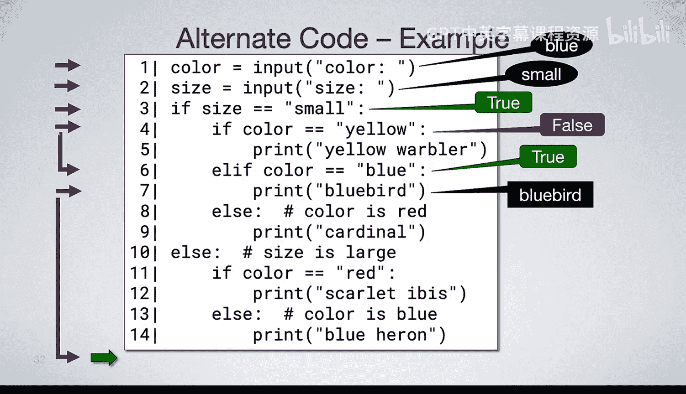

# 杜克大学《Python编程实践｜Practical Python： Start Your Programming Journey》中英字幕 p24 24_03_01_多因素决策-嵌套if与elif.zh_en -BV1tTmCBWEQD_p24-

Hello there。You now know how to implement simple decisions in Python by using if statements。

But many times making decisions is a lot more complicated。

There may be many decisions you have to make。Here is an example。

Suppose there is a game in which you are thinking about a specific type of bird。

 and your friend has to guess the bird。Your friend ask you questions about the bird's characteristics。

 and you respond with yes or no answers。One question might be， what color is the bird？

Another question might be the approximate size of the bird。Is the bird small， like a wren or large。

 like a flamingo。Another question might be whether the bird can fly or not。Most birds fly。

 but penguins are an example of birds that don't fly。After all your answers。

 your friend guesses what type of bird you are thinking about。

In order to write a program to implement this game， you will need to implement multiple decisions。

How do you write code for multiple decisions in Python。You've already learned about if statements。

Let's revisit the format for an if statement。The first line， the if condition。

 ask a question about a condition。I'm labeling this condition the name， condition 1。

 since there will be several conditions here in the if statement。

Condition 1 is some type of expression that evaluates to either true or false。

If condition1 evaluates the true。Then Python would next execute code blocklock 1。

What can code blocklock1 be？Coode blocklock 1 can be any type of valid Python code。

It could be one line of code or multiple lines of code。 Whatever is in code block 1。

 Remember that it must be indented using the tab key on your keyboard or some number of spaces。

We recommend using four spaces。The indentation is so it is clear that this is code that should be executed when condition1 is true。

Code block 1 could also be another if statement。If Cobl 1 is an if statement。

 then this code would be an example of nested if statements。What if condition1 is false？

If condition one is false。Then the I statement next checks the line with LF and condition 2 to see if condition 2 is true。

If condition2 evaluates the true。Then Python would next execute code block 2。Again。

 code block 2 can be any type of valid Python code。 It could be one line or many lines of code。

 but it must be indented。Coode block 2 could even be another， if statement。

If condition 1 and condition 2 are both falses， then the else clause of the if statement is executed。

Meaning， code blocklock 3 is executed。Code Block 3 must be intended to indicate it is the code block to execute for the elseLTS clause。

What can code Block 3 be？Code blocklock 3 can also be any type of valid Python code。

Even another if statement。Any or all of the code block sections here could be another if statement。

Remember。For the way， this， if statement is set up。Only one of code block 1， code block 2。

 and code block 3 will execute。The code block that execute is dependent on which condition is true。

The code block associated with the first true condition is the code block that executes。

And if all of the conditions are false， then the code block associated with the elsetz clause executes。

Let's see what this code would look like if we put an if statement in place of code block 1。Here。

 code block 1 has been replaced by an if statement shown on lines 2 through 5。

We now have a nested if statement。The nest if statement reads。If condition 1 A is true。

 then code block 1A is executed， and otherwise code block 1 B is executed。

The if statement on lines 2 through5 is nested inside the outer if statement that starts on line 1 and goes all the way to line 9。

Notice that the inner or nested if statement aligns2 through5。Is indented un additional for spaces。

Again， for indentation， you can pick how many spaces to use。

 but you need to be consistent and use the same number of spaces each time you in debt。

I like to use four spaces。Also， notice that code block 1 a on line 3 is indented inside the nested if。

I used four spaces。 That means that line 3 is indented。8 spaces total， Four spaces。

 because the nested if isn inted four spaces。And another four for indenting inside the nestiff。

The indentation is done， so it is clear that code block 1 a is executed whenever condition 1 a is evaluated is true。

Similarly， code block 1 B on line 5 is also indented8 spaces total。

 so it is clear that code block 1 B is executed whenever condition 1 A is false。

Note that code blocklock 1A could be replaced by any valid code。And could be replaced by another。

 if statement。Similarly， code block 1 B could be replaced by any valid code and could also be replaced by another if statement。

When would code block 1 A be executed。If condition 1 is true and condition 1 A is true。

Then code block 1A would be executed。When would Code blocklock 1 B be executed？Code block 1。

 B would be executed if condition 1 is true and condition 1 A is false。

The E clause would be taken in that case， and code block 1 B would be executed。

Let's revisit the bird game we mentioned earlier， and let's simplify it。

We'll create a game that has five bird types and will be identifiable by two characteristics。

 color and size。For color， we'll use three colors， red， blue or yellow。For size， we'll use two sizes。

 either small or large。Here we have five birds。Each bird has one of the three colors， red。

 blue or yellow。Their size is either small or large。For example。

The cardinal is the color red and is a small bird。The blue heron is a color blue and is a large bird。

Our assumptions for the game is there are only five types of birds。

There are only three different colors， red， blue or yellow。And there are only two different sizes。

 small and large。Let's look at code that will ask what color the bird is and the size of the bird。

And then the code can tell us what type of bird it is from those five birds。

Here is code to determine which type of bird it is。We asked the user for a color on line 1。

And expect the user to type in red， blue， or yellow。

We then asked them for the size of the bird on line， too。

 and expect the user to type in large or small。The remaining code on lines 3 through 14 is one big if statement to check the color first。

We will refer to the big if as the outer if statement。Let's look at that if statement in more detail。

The if statement is checking the color first。The color has to be one of three colors。On line 3。

 we check to see if the color is blue。If the color is not blue。Then on line 8。

 we check to see if the color is red。If the color is not blue or red。

Then this if statement has an else clause on line 13。At this point。

 the code assumes the color must be yellow。As the game has only those three colors。Only one of these。

 if， LF or else， should be true。Let's now see what happens for the color that is blue。

Suppose on line 3， we determine that the color is blue。

That means we have matched the color of the bird。But there are two birds in our game that are blue。

One small and one large。We now need to check the size of that blue bird to determine if it is small or large。

We execute a new if statement that checks the size of the bird。

This nested if statement on lines 4 through7 is indented to indicate it is the code to execute when line 3 is true。

We say this if statement is nested underline 3。When we execute the nest if statement。

 we will print either bluebird or blue heron。Depending on the bird size。

 and then we will have completed the outer if statement on lines 3 through 14。

Suppose the color is not blue， but instead， the color is red。The LF On line 8 will be true。

We now need to check the size of the red bird to determine if it is small or large。

We execute a new if statement on lines 9 through 12 to check the size of the red bird to determine if the bird is small and thus a cardinal。

Or large and is a scarlet Ibis。This if statement is nested under line 8 and only executed when line 3 is false and line 8 is true。

There is one more case。If the bird is not blue or red in color。

 then we assume the bird is yellow on line 13。In this case。

 we do not need to check the size as there's only one yellow bird in our game。

Let's now look at some examples of user input for this game。

Suppose the player types in blue for the color。And large for the size。On line 3。

 we see that blue is a match。 This means we will execute the if statement that is on lines 4 through 7。

On line 4， we see that size equals small is false。 So we go to the else clause for this inner if。

 which is on line 6。Notice we skipped line five。On line  seven， we print Blue heron。

What would be the next line of code executed？I'll pause for you to think about that。

Our outer if statement is big。 It covers lines 3 through 14。When we print Blue heron。

 we are done with the if statement。So our next line of code to execute is line 15。

 Whatever the code is that follows this if statement。Now。

Let's consider how different input would work。Suppose the player types in red for the color。

And small for the size。On line 3， we see that the color blue is not a match。

That means we will not execute the if statement on lines 4 through7。Instead。

The execution goes to the L if on line8 that is part of the if from line three。

The L of condition sees that red is a match for color。Next， execution goes to line 9。

 the nested if statement。On line 9， small is a match for the size。

The execution moves to line 10 and the program Prince Cardinal。

 which is the red small bird in our game。Where does execution go next？

We printed the bird and we are done with the if statement。

Execution goes to the line that follows the outer if statement， pass line 14。

 executing whatever code follows this if statement。Let's look at another example。

 Suppose the player types in yellow for the color。And small for the size of the bird。On line 3。

 we determine the color is not blue。That means we will not execute the nested if statement on lines 4 through 7。

Execution goes to line8， the LF for the if on line 3。On line 8， we see the color is not red。

That means we will not execute the nested if statement on lines 9 through 12。Instead。

 execution goes to line 13 and executes the else clause。

 because all the conditions in the outer if statement are false。Next， line 14 executes。

That results in printing the bird， yellow Warbler。Note that since there is only one yellow bird。

 we do not need to check the size of the bird。The outer， if statement is finished。

 The next line executed will be the code that follows line 14。So how can things go wrong。

 You should always think about this。Not necessarily for you to fix it。

 but so that you are aware of how your code will handle things it is not expecting。

What happens if the player does not follow the rules using our assumptions for colors and size。

What if the player types in green for color and then types in medium for size。

Maybe they're thinking about a green parrot。The program still runs。

 but since the player did not type in a valid color。The is statement will be falses， on line 3。

The LF will be falses， on line 8。And the execution will go to line 13 and execute the elses clause。

That results in printing yellow Warbler。The execution then goes to the next line of code after the F。

Wait， yellow Warbler is not the correct answer。If we want to allow for green parrots。

 we would have to update our code to add another E when checking colors to check if the color is green。

We won't show you how to do that， but you should think about how you would make that change。

At a minimum， our input on lines one and two should list out choices a user can enter。Now。

 let's think about the code some more。Is that code the only solution to our game？

Whenever we write code that involves nested if statements。

There could be different ways to write that code。Notice the code we wrote checks the color first。

And then， checks the size。For this game， we could have structured the code a different way。

We could have checked the size first and the color second。This code checks if the size is small。

And if it is not， then it assumes the size is large since there are only two sizes。On line 3。

 the code checks if the size is small。If that is true。

 there is a nested if statement on lines 4 through 9 that handles。

The three cases of color for birds that are small。If the size is not small。

 the code moves to the else clause on line 10， where we assume the size must be large。In that case。

 there' is a nested if on lines 11 to 14 to check for one of two colors。

 since there were only two large birds in our game。

Let's trace through one example with this alternate code with the if statement structured by checking the size first and then the color。

Assume the user types blue for the color and small for the size。

Line 3 is true since the size is small。The execution moves to the nested if statement on lines 4 through9。

Line 4 executes nexts and is false because the color is not yellow。

Line 6 execute snacks and is true because the color is blue。Line 7， Prince the bird， bluebird。

What happens next， we have finished executing the outer if statement on lines 3 through 14。

So execution moves to any code that follows line 14 after the entire if statement。

So changing the of statements to ask for the size first。 and then the color did not matter。

This code works fine for that example。You should trace through other possible user inputs。

 For example， besides values that fit our exemptions。

Does it behave the same for things that don't fit our assumptions？

Let's summarize nested if statements。The first thing to observe is that you can nest an if statement。

Inside an if L if or else as the code to execute when their condition is true。

You would do this if you had more than one decision to make。

If you have two major decisions to make where each decision would be represented by an if statement。

 you could start with either one first。The structure of the code is different depending on which decision you start with。

It may be helpful to lay out all the cases in a table before you start coding。

Then once you have your code。Be sure to check that all your cases are covered。Nesting。

 if statements will allow you to solve problems that have a lot of decisions to make。Happy coding。

