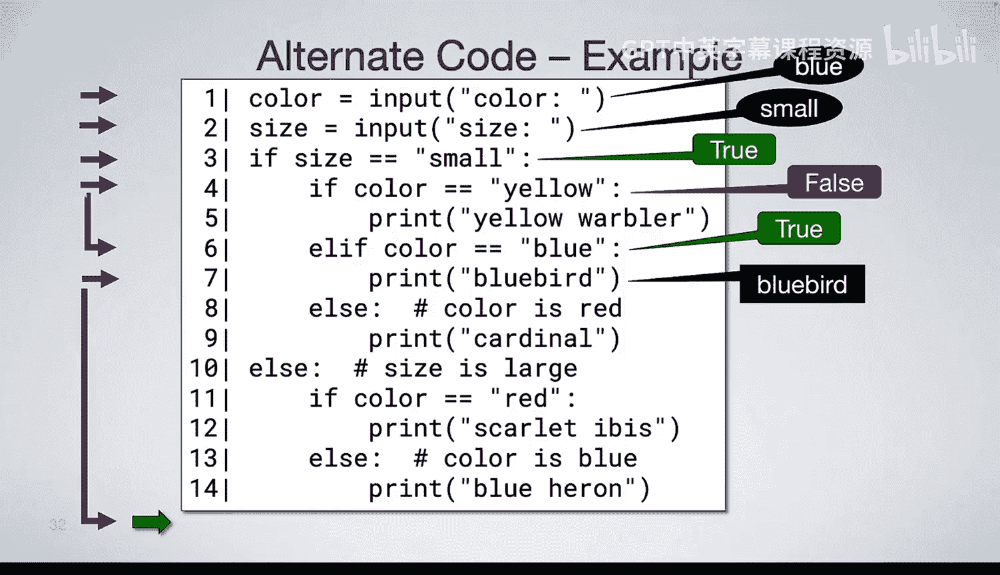

# Python编程实践：多因素决策与嵌套if语句


在本节课中，我们将学习如何使用嵌套if语句进行多因素决策。

## 嵌套if语句简介

嵌套if语句是指在一个if语句内部嵌套另一个if语句。这种结构允许我们在多个条件同时满足时执行不同的代码块。

**公式**：

```python
if condition1:
    # 代码块1
    if condition2:
        # 代码块2
    else:
        # 代码块3
else:
    # 代码块4
```

## 嵌套if语句示例

以下是一个使用嵌套if语句进行多因素决策的示例：

```python
color = input("请输入鸟的颜色（红、蓝、黄）：")
size = input("请输入鸟的大小（大、小）：")

if color == "蓝":
    if size == "大":
        print("蓝鹭")
    else:
        print("蓝鸟")
elif color == "红":
    if size == "小":
        print("红雀")
    else:
        print("红鹳")
else:
    print("黄鹂")
```

## 嵌套if语句的执行过程

1. 首先判断最外层的if条件是否为真。
2. 如果为真，则执行代码块1。
3. 如果代码块1中再次出现if条件，则进入嵌套if语句。
4. 重复步骤1-3，直到所有条件都判断完毕。
5. 执行对应的代码块。

## 嵌套if语句的注意事项

1. 嵌套if语句的缩进非常重要，否则代码将无法正常运行。
2. 嵌套if语句的执行顺序是从外层到内层。
3. 嵌套if语句可以解决多因素决策问题。



## 总结


本节课中，我们学习了嵌套if语句的概念、语法和执行过程。通过示例，我们了解了如何使用嵌套if语句进行多因素决策。希望这节课的内容能够帮助您更好地理解嵌套if语句。