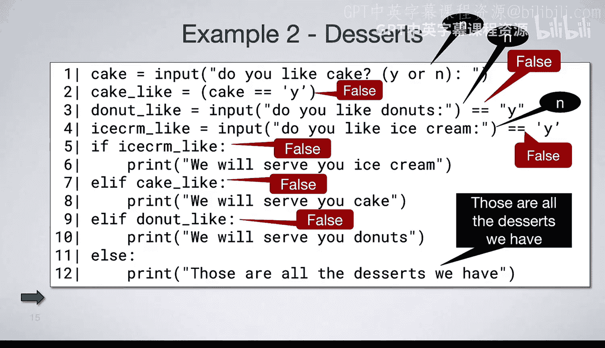

# 杜克大学《Python编程实践｜Practical Python： Start Your Programming Journey》中英字幕 p25 25_03_02_处理真或假-布尔值与变量.zh_en -BV1tTmCBWEQD_p25-

Playing cards is one of my favorite pastimes。 There are so many card games to play from playing a card game by yourself。

 like the game Solitaire to playing a card game with two or more people。😊。

We will use playing cards to illustrate an example of a new programming concept。

Sometimes you want to keep track of whether something is true or not。For example。

You may want to keep track of whether a friend of yours likes to play cards。

If they like to play cards， then you will want to invite them over to play cards。

 and you might want to tell them about events related to cards。

In order to keep track of whether something is true or not。We can use the values true and false。

These are called Boolean values， which is its own data type。The word bullion comes from George Bull。

 who invented an algebraic system of logic back in the 1800s。

A buion type has only two choices of values。 It's either true， or it is false。In Python。

 we write these as the words true and false。 Notice they are not strings。

 There are no quotes around them。Also notice they are capitalized。

That is just the way the creators of Python decided to make them。Since we have a new data type。

 that means we can have a Boolean variable that can be assigned one of two values。

 either true or false。The variable can also be assigned to a buoyant expression。

That means any expression that evaluates to true or false。Let's look at some examples。

In this first example， we have the variable named vegetarian。And it is assigned the value， true。

That means vegetarian is abuoan variable。We could check that。

We could print out the type for this variable。It would print out class bull。To indicate。

 vegetarian is a Boan variable。Bull is short for bullion。What about this code。What happens here？

We have a variable named moneyney for T。Followed by an assignment operator。

Everything to the right of the assignment operator is an expression。

We should evaluate the expression and assign its result to the variable， money for ticket。

We highlight that expression here。Amount greater than 10。That is a question。

Is the amount greater than 10？Suppose a amount has the value 20。Then amount greater than 10 is true。

At this point， the value true。Would be assigned to the variable money for ticket。

Let's now go back to our card example。We want to know if our friend plays cards or not。

We have written some Python code to ask them if they play cards and to store that information。

We start with a Booan variable named cards， underscore play。And have assigned it to faults to start。

You can see below that Car play value is false。Next， on line  too。

 we create a prompt to ask our friend if they play cards or not。And then on line three。

 the code uses the input function with our prompt to ask them if they play cards。

Suppose they type in why for yes。Then the code on line 3 creates the variable cards and stores the string Y in it。

On line 4， the code checks to see if they typed in Y， and they did。

 The comparison cards equals y is true。Execution then moves to line 5。

 where the code changes the value of cards play to true。No， if they had typed in。 no。

 then the code would not change the value of cards's play。As it is already false。

Let's expand this example to see how we might use the buoan variable cards play。

Here we have added lines 6 through 7。On line 6， we check to see if cards play has the value true。

It does。 So the if condition is true。And the execution moves to line 7。

And the print statement executes。We invite our friend to come play cards with us。

The if statement on line 6 through 9 is now complete。Execution moves to code that follows line9。

Let's add one more if statement on lines， 10 and 11。

The if condition on line 10 looks a little different than the if condition on line 6。On line 10。

 it says。If cards play。Remember， cards play is a Boolean variable。

A  bullolean variable by itself is a boolean expression， a very simple bullolean expression。

Python can just look up the value of cards' play and use that value for the if condition。

In this case， Car' place value is true。 so the condition on line 10 is true。

Execution moves to line 11。And the output is printed。 We tell our friend about a card tournament。

Then execution moves to the next line。Let's take a look at the difference between those two if conditions on line 6 and 10。

On line 6， we compare the value of cards play with the value true。If cards play is true。

 then we have true is equal to true。 and that is true。That might make a lot of sense to you。

 since the other， if conditions we have seen before， all had some type of comparison。

But buoyan variables are special。 They are already a buoyan value。On line 10。

 we just check the value of cardss play。 And if it's true， then the condition on line 10 is true。

You can write bullolean conditions either way。The way the code does it on line 6 or the way the code does it on line 10。

 they are equivalent。Best practice is to just use the variable as in line 10。 So from now on。

 we will just use the variable。Let's move on to another example。

Suppose we have three types of desserts。We have a lot of ice cream。We have a good amount of cake。

 but not as much cake as we have ice cream。We also have a few donuts。

You want to give your friend one of the desserts， a dessert they like。

Since you don't have a lot of each dessert。 You would like to give them a dessert they like that you have more of。

How do you organize the code to do this？You will first need to find out which of the three desserts they like by asking them。

Then you will need to figure out which dessert they like that you have the most of and give them that dessert。

Let's now look at some code that does this。First。We need to figure out which desserts they like。

The code does this on lines，1 through 4。On line 1， Python ask whether or not they like cake and saves their answer。

 a wire an in in the string variable cake。Suppose they type Y because they love cake。Next。

 execution moves to line 2。Here to the right of the equal sign。

 the value of the variable cake is compared to the string， y。They match this case。

Cake's value equal to Y is true。The value true is then stored in the Boolean variable， cake。

 underscored like。Execution moves to line  three。Compare line 3 to lines 1 and 2。

They do the same thing。 ask for a value and store it。But line 3 does it all in one line。

 So it uses one fewer variable。Let's look at line three in more detail to see the order things happen in evaluating it。

In particular， let's look at everything to the right of the assignment operator。

 This is one big expression that should evaluate to true or false。Inside this expression。

 there are two values that are compared with double equals。Let's look at the left one。

 It is the input function。The input function is evaluated first。 Let's suppose the user types in y。

You can think of it as replacing the whole input function with the value， why。

That leaves us with two values to compare。Does the string y equal the string Y， Yes， that is true。

The expression evaluates to true。 So true is the value assigned to the variable donut underscore like。

Line 4 works similarly。Let's step through that， also， in detail。First。

 notice everything to the right of the assignment operator。

Python needs to evaluate this expression to either true or false。To calculate this。

 Python needs to evaluate the input function first。Suppose the user types in in。

 they don't like ice cream。Then that is like replacing the input function with the string in。And now。

 Python can compare the string in and the string Y， they are not equal。 so that evaluates to faults。

The variable ice cream underscore like is then assign the value false。

We now know all the users's preferences for each dessert。Next。

 we want to determine which dessert to give them。We have the most of ice cream。

 so we check that first。On line 5， we check if the value ice cream like is true。It is not。

 it is false。So we go to the eph， where we check cake next。Our friend does like cake。

So we serve them cake。Note， we are now done with the if statement。

The if statement is one big if from line 5 to line 12。Since we are done with the if statement。

The next line to execute would be the first line after the if statement。

Let's run through another example。Here is the same code。

And let's start by seeing what a different friend likes。

Line 1 ask if they like cake and our friend does not like cake。So on line2。

 we set cake like to faults。On line 3， we see our friend does not like donuts。

So donut like is set to false。On line 4， we see our friend does not like ice cream。 So ice cream。

 like， is set to false。Let's see which dessert we give our friend。

They didn't like any of our choices。On line 5， we don't give them ice cream。And on line 7。

 in the Lph， we see we don't give them cake。And on line nine in the EF。We don't give them doughnus。

The execution goes to the elses on line 11。In on line 12， we tell them。

That is all the desserts we have。We are done with the if statement。

Execution moves to any code that follows line 12。That is our example to see how to use Boolean variables。

We store true or false values， and then we can refer to them。

Let's summarize what we have learned aboutbuoleance。A Boolean value can be true or false。

 that is the only possible values。With an assignment statement， always evaluate the expression first。

Here we have an assignment statement。What type of variable will money for ticket be。

We look at the expression to the right of the assignment operator。

That is a comparison that evaluates to either true or false。

So the variable money for ticket is going to be a Boolean variable。What else did we learn？

When the expression to evaluate is really long or complicated。

You have to break it down and figure out what to start with in the evaluation。

In order to figure out this particular expression。You need to figure out the result of the input function。

And in order to figure out the input function， you need to look up the value of the variable prompt。

Which is likely a string with the question to ask the user。Once you have prompt。

 then you can call the input function。Which gives you a string， the user types。

And then you can do the comparison。That gives you a boolean value to assign to the variable cake like。

So。That is our summary forbuoys。But。Before we go， I wanted to talk more about that deck of cards I showed you earlier。

I like to play cards a lot， but I also like to help promote women in computer science。

The deck of cards I showed you is a special deck of cards that I created with two other people。😊。

Each card in our deck features a notable woman in computing。

 so people can learn about 54 of the awesome women in computing。😊。

You can find out more about the cards at this website listed here。

There's also a second website I've listed that lets you play solitaire on line with our deck of cards。

 It is really fun。😊，I would like to highlight one of the women in our deck of cards。

 Shafi Goldwasser。She is a computer science professor at Massachusetts Institute of Technology in the United States。

 and she's also a professor of Maematics at the Wiseman Institute of Science in Israel。

She was one of the co inventors of probabilistic encryption。What is that？

Probabilistic encryption is important to make sure data can be securely encrypted。

If you're using the internet to log into a website。

 you want to make sure your personal information that you enter into the website is encrypted safely as it travels over the internet。

Probbabilistic encryption does that。She has done many other things in computer science。

 and for all of those， she was awarded the Tring Award。

 which is the highest award one can get in computer science。Shafi Goldwaser is amazing。 Thank you。

