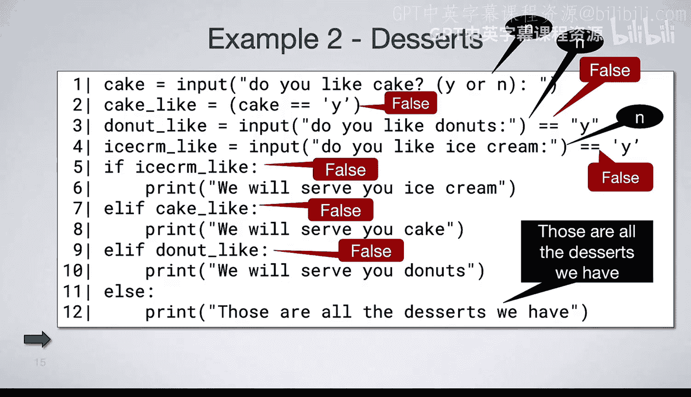

# Python编程实践：布尔值与变量


在本节课中，我们将学习布尔值和变量的概念，并通过一个玩牌的例子来加深理解。

## 布尔值

布尔值是Python中的一种特殊数据类型，它只有两个可能的值：**true**（真）和**false**（假）。布尔值通常用于表示某个条件是否成立。

**公式**：布尔值 = true 或 false

```python
# 布尔值示例
is_vegetarian = True
has_money = False
```

## 变量

变量是用于存储数据的容器。在Python中，我们可以使用变量来存储布尔值。

**公式**：变量 = 布尔值

```python
# 变量示例
cards_play = False
```

## 玩牌示例

假设我们有一个玩牌的例子，我们需要判断一个朋友是否喜欢玩牌。

```python
# 初始化布尔变量
cards_play = False



# 提示用户输入
user_input = input("你喜欢玩牌吗？(是/否): ")

# 判断用户输入并更新布尔变量
if user_input == "是":
    cards_play = True

# 根据布尔变量执行操作
if cards_play:
    print("欢迎加入我们玩牌！")
else:
    print("没关系，我们可以玩其他游戏。")
```

## 总结


本节课中，我们学习了布尔值和变量的概念，并通过一个玩牌的例子来加深理解。布尔值是Python中的一种特殊数据类型，它只有两个可能的值：true和false。变量是用于存储数据的容器，我们可以使用变量来存储布尔值。通过布尔值和变量，我们可以根据条件执行不同的操作。