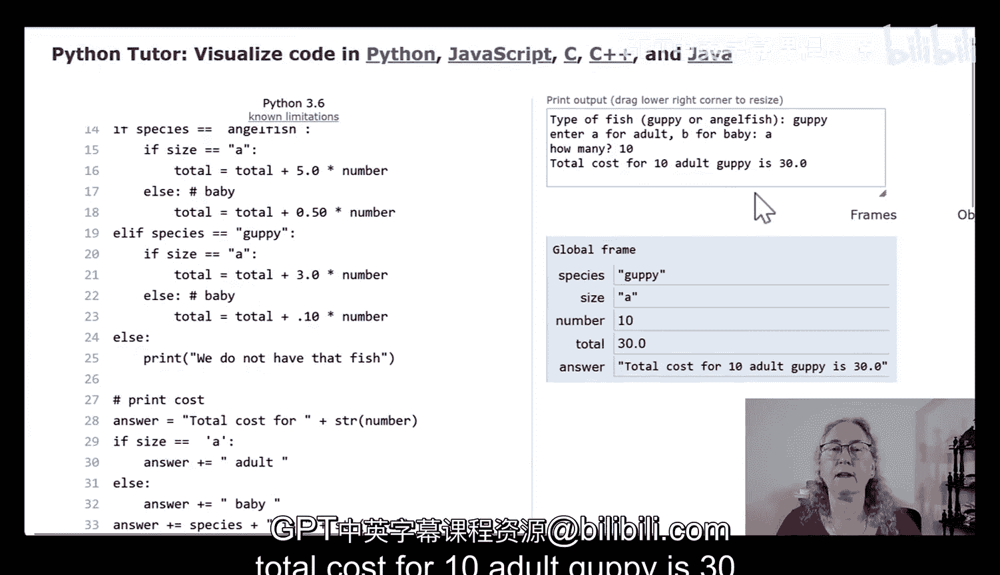

# 杜克大学《Python编程实践｜Practical Python： Start Your Programming Journey》中英字幕 p26 26_03_03_Python Tutor-嵌套if与elif及布尔变量演示.zh_en -BV1tTmCBWEQD_p26-

Suppose we have a fish tank and we need to buy some more fish， then we will head to the fish store。

We're going to write a program to calculate the total the fish will cost。Typically when you buy fish。

 you don't buy just one fish， so we will have some calculations to figure out the total cost。

We'll keep it simple and just focus on two types of fish。A guppy and an angel fish。

Now know that the plural of guppy is guuppies， but the plural of angelfish is angelfish。

 So for each fish， there's a different price for buying an adult fish versus buying a baby fish。

 So let's get started。 I'm going to be adding some comments at the top to indicate how much each fish cost and since I'm in the United States。

 I'm going to use dollars for currency， but you should feel free to use whatever currency you want and adjust the prices that makes sense for where you live。

So I'm going to add in some comments， I'm going to say this is the fish store。

And I'm just going to put some notes here， so what we're going to buy is adult。Angel。Fish。

And they are going to be5 each。And then we have。Baby， angel fish。Are very nice， 50 cents each。

That's 0。50。And then we have。Adults。Guppies？A three each。And baby guuppies。Are 10 cents each。

 they are really tiny。Okay，Let's think about how the program will work， we'll pick one type of fish。

 it might be an angel fish， or it might be a guppy。

And then the program needs to know what type of fish we want to buy， whether it's an adult fish。

 which are more expensive or a baby fish。And how many of that type we want to buy？

And then the program can calculate the total price and let us know by printing it。

So this program has a lot of parts to it， since it's more complicated。

 let's plan out our steps and write a comment for each of those steps。

 and then we can go back and fill in the code for each comment。So I see three main steps to do。

So I'm going to add in a comment here。We need to find out。And let me just。Put a space there。

 so we're going to find out type of fish and how many to purchase。That's the first thing we'll do。

And then we're going to calculate the cost。And then we'll print out the cost。Okay， so let's start。

By getting the input into the program， so we need to ask the user what type of fish they want to buy。

 do they want to buy a guuppy or angel fish。So back here where we put that comet on line 7。

 we need a variable， so let's say species。Gets some input。And our prompt is going to be。Type of fish。

And we'll put parentheses。Gupy or angelfish。And that's the end of the string。

 and that's the end of the input。So we'll ask the user what type of fish。

 and then that will be read into the variable called species。

Now it's going to be helpful to tell them the fish options so they know what they can type。

 so we're telling them to type guppy or angel fish。Next。

 let's ask them if the fish is an adult or a baby， so we'll have size as a variable。

And that's going to be input。And we'll ask them to type in and we could also take shortcut。

 so here we're going to take a shortcut。Enter a for adults。B for baby。

 so that makes it easier for the user。And then we'll in that string and in the input。O。So next。

 we need to know how many of these they want to buy， so let's ask them。So we'll say number。

Is going to get the input。We'll just ask them how many？And that's the string， we end the string。

 and we end the input。Now we're asking for a number。

 so we might want to convert that into an integer， so let's do that。 it's around the whole thing。

That looks good。Okay。So let's verify we did that correctly， we can go ahead and run the code。

We'll just visualize execution。And when we run it。We need to see the here we go。

And just move this down a little bit。We run it， we're going to click type fish。

 What type of fish is it asking for， so let's type angel fish down here， we have to click on it。

Angel fish and submit that。And you can see species has been assigned angelfish。

The next line says type A for adult or B for baby， so I'm going to type A for adult and submit that。

And you can see the size is a。And then the next line says how many down here I'm going to type in four。

And if I submit that， you can see number has the value for， so that seemed to work fine。

So now it's time to calculate the total cost， we're going to need a variable for the total cost。

 let's call that total and initialize the total to zero to start with since we don't know how many fish the user wants to buy yet。

And as we find out which fish and how many fish we can update the variable total to the amount the user will need to pay。

So let's update our code。 We have to click on editit this code。And where it says calculate cost。

We'll set total is assigned to 0。0。Now we need to figure out what type of fish the user wants to buy so we can figure out the costs for that fish。

 for example， if the fish is an adult angel fish， we know they cost $5 each and if they're a baby angel fish they cost 50 cents each。

 so we're going to need an if statement to check what type of fish and another if statement to see if they're an adult or a baby fish。

Those if statements are related as they have one meaning。

 if they are both true and a different meaning if the first one's true and the second one's false。

 so we're going to need to nest the ifs and make decisions based on the two if' conditional values。

Then we can calculate how much the fish cost。So let's type in some code here。

So we're going to say if。The species。Is equal。So we use double equals。To angel fish。Now。

We need to make a decision as to whether the angelfish is an adult or a baby fish。

 so this is where we nest the if so it applies to the angel fish。

So we're going to nest this and say if size is equal to a， then we know it's an adult。

So we know the total cost， the total cost is going to be。We're going to add to the total。

 it's going to be what the total was plus。5。0。Times the number of adults。Angel fish that we buy。Okay。

 so that's if it's an adult， if it's not an adult， we're going to have an else statement。

Because this is going to mean it's a baby， so I'll just put a little comment here that says it's a baby。

In this case。The total is going to be updated to be whatever it was， plus the cost of a baby fish。

 which is 0。50 times the number that we bought。For baby fish。Now。

So that should take care of angel fish。If the fish is not an angel fish。

 that means it could be a guppy， and we know adult guppies cost $3 each and baby guppies or 10 cents each。

 so since it's possible they might want to try to buy some other fish。

 I'm going to use an eF to check if it's a guppy。So right after this。For the species。

 we're going to come all the way over here and we're going to say LF。The species is equal to guppies。

Let's finish the string， and then put the。Cohen。So if it's a guppy， again。

 we have to check if it's an adult or a baby fish， so if the size is equal to a。

 so it's an adult guy。Then we know the total is going to be。嗯。Equal to total plus。They cost $3， a 3。

0 times number。And if it's not an adult。We're going to have it B。A baby。So this is a baby guppy。

In this case， the total。Is going to equal。The total plus。嗯。PointThey're 10 cents each。

 so 10 times the number that you want。Okay。So finally， just in case they type in a different fish。

 let's let them know that we don't have that type of fish。

 so we're going to hit return one more time and we need to scroll up a little bit。

So this is going to be an else here， so we have， if species is angel fish， if it's guppies， elsets。

 this will take care of everything else。We're going to add a print statement just to tell them。

That we do not have that type of fish， so we do not have that fish。Okay。

So we have just written one big if statement。That has three parts。

 The fish is either an angel fish or a guppy or some other fish。

So to see if the fish is an adult or a baby， we have nested if statements。

 and we check that for both guppy and angelfish。 We've also calculated the total cost。

 So now we need to print it out。 We would like to print out an informative message。

 We don't want to just print a number for the total。

 So we'd like to include with that the number of fish they bought。

 what type of fish and whether the fish were adults are babies。 That is a lot of information。

 So let's build a string with all that information and then print it out。

I'd like to say something like。Let's put this down。

And we want to put this under print cost right here。嗯。So let's do something like this。呃。Answer gets。

E。Total cost for six adult angel fishes。 and then the amount。 So let's build that string。

 so it would be。Total cost。4。Okay， and then plus。We want to know the number that we just bought。

 so that is the variable number。But that's an integer， so we're going to convert it to a string。

So this is like the total cost for six if it was six。嗯。

And then we need to check the size of the fish we don't know the size of the fish yet。

So let's figure out the size of the fish。So if we say let's do an if statement for that。

 so we need to figure out depending on the size， we know if it's a。

 we're going to write adults and if it's B， we're going to write baby， so we'll say if size equals a。

We know it's an adult。So we can say answer plus equals。Adult。And else， it's got to be a baby。

 well'll assume it's a baby answer。Plus equals。Baby。

So we're building this string that says total cost for say， like six adults， okay？

Is and we want to give the answer where actually adults or baby want to do the species。

 and then we want to say is that number， so we need to add a little bit more。

 so we're going to say answerops。Sometimes it jumps around like that。Answer。

We're going to keep adding to that string answer， we're building this long string。Species。

So it's going to be like baby guuppies or adult angelfish， so we have species。

 and then we're going to say is。And then we'll have the total costs， so plus the total。

 which is going to be a string， we have to convert that to a string。Total。

 so I think we have it all there now。 So all we did is just build a big string。

 So it might say total cost for six adult is what that cost is。 We have to print it out。

 So let's do that next print。Answer。Okay。Now let's run this code to see if it works。

We'll visualize execution。嗯。And let's see， it's asking us， what type of fish do we want to do。

 let's try angel fish。And we'll submit that。And it's going to ask us now for。Sorry。

Is it an adult or a baby， so let's type B for baby？and you can see over here。

 we've got species angel fish， size is B。And now it's waiting for。Let's see。

It's waiting for how many do we want to buy， so let's say we want to buy seven。And we'll submit that。

And you can see species is angelfish size B number seven。And。It hasn't printed anything yet。

 let's see we oh now we have to execute through our code Okay， so now we're here at total equals 0。0。

 we're about to execute that。 We have to come down here。

 we have a lot of code so sorry we're going to come down here and click next。

And now you can see at the top here we got total is 0。0， and then we click next again。

 we have to figure out is a species angelfish， it is it's size A， no else， it's a baby。

 so we see total is total， so here's where we're going to actually calculate it。

 the total it's going to be 50 cents times number。And if you click next。

 you can see that is going to be 3。5， and we're now ready to build our answer。

 So you're going to see that answer slowly， that answer string slowly built out。

It's going to be answer is total cost for seven now we're going to check is an adult or baby。

 we're going to add baby and then we're going to add the species and the rest of it right here and we're going to have total cost for7 baby angelfius 3。

5 and finally when we click next。We're going to see up here that we print that string out。

 so it worked pretty well。Let's run another example。In order to run another example in Python Tutor。

This is how you do that。If you just try to come down here。To the end down here。

And just say go back to first。You'll notice if you click next。It just has already used your input。

 and it's not going to ask you for more input。 So it's going to give me angelfish， B and 7。

 So that's not what we want to do。 We want to run it on different input。 So in order to do that。

 what you need to do。Is edit this code right here。That will go reset it。

 so we're just going back to the code where we edit， we're not going to make any changes。

 and then we're going to come down here and just say visualize execution and now it'll start over so that we can give it input。

All right， so let's do a different example if we come down here。And we run it。

We're going to say it's asking for type of fish， this time let's type guppy。And submit that。

And then it's asking for is an adult or a baby all the way down here， there it is。

 and let's say this time it's an adult fish。So we'll submit that。And then。It asks for how many。

 and this time lets。Order 10。And submit that。😔，And now we just need to finish running it。

 so if we come down here。We'll just keep stepping through when we get the total is zero。

 is it an angel fish， no， so it's going to go to the LF on line 19。Is it a guppy？Yes。

 so then it's going to check is a size adult。That's also true。

 so the total is going to be total plus three times the number and you get three times 10 and you get 30。

 so that looks good。And then we're going to get down here to line 28 where we build the answer is total cost for 10。

Adults。Is 30 and so that looks good and one more line， if we click next。

We're going to look up here and you can see total cost for 10 adult guppy is 30。

