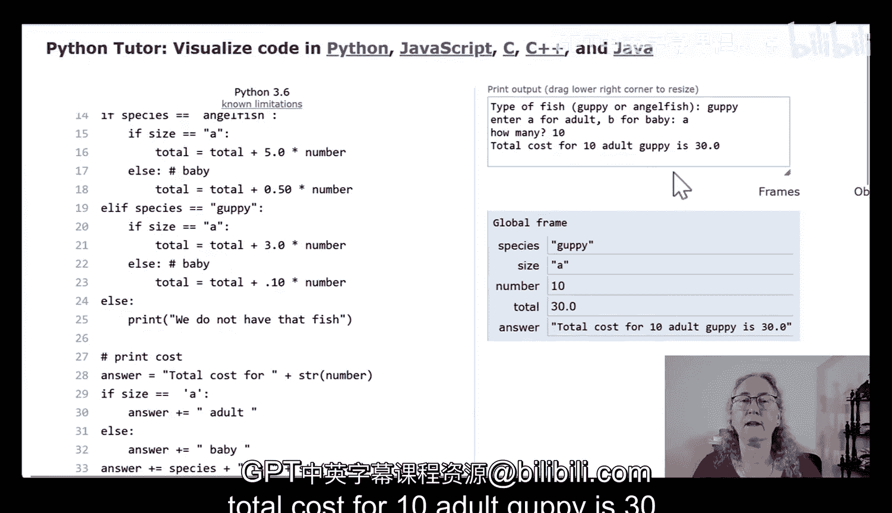

# Python编程实践：26：嵌套if与elif及布尔变量演示 🐟


在本节课中，我们将学习如何编写一个程序来计算在鱼店购买鱼类的总费用。我们将使用嵌套的`if`语句和`elif`来处理多种条件，例如鱼的种类（天使鱼或孔雀鱼）和大小（成年或幼年）。通过这个例子，你将理解如何通过组合条件判断来构建更复杂的程序逻辑。

---

## 程序概述

假设我们有一个鱼缸，需要购买更多的鱼，因此我们将前往鱼店。我们将编写一个程序来计算购买鱼类的总费用。通常，购买鱼时不会只买一条，因此我们需要进行一些计算来确定总成本。为简化问题，我们只关注两种鱼：孔雀鱼和天使鱼。

请注意，孔雀鱼的复数是“guppies”，而天使鱼的复数仍是“angelfish”。每种鱼，成年鱼和幼鱼的价格不同。

## 设置价格

首先，我们在代码顶部添加注释，说明每种鱼的价格。这里使用美元作为货币单位，但你可以根据所在地调整货币和价格。

```python
# 鱼店
# 成年天使鱼：每条5美元
# 幼年天使鱼：每条0.5美元
# 成年孔雀鱼：每条3美元
# 幼年孔雀鱼：每条0.1美元
```

## 规划程序步骤

由于程序较为复杂，我们先规划主要步骤，并为每个步骤编写注释，然后再填充具体代码。我们识别出三个主要步骤：

1.  获取用户输入：确定要购买的鱼种类、大小和数量。
2.  计算总费用：根据输入信息进行计算。
3.  打印结果：向用户显示详细的总费用信息。

## 第一步：获取用户输入

首先，我们需要询问用户想要购买的鱼种类。我们将使用`input()`函数获取输入，并将其存储在变量中。

```python
# 获取鱼种类
species = input("Type of fish (guppy or angelfish): ")
```

接下来，询问鱼的大小是成年还是幼年。为了简化用户输入，我们要求用户输入‘a’代表成年，‘b’代表幼年。

```python
# 获取鱼的大小
size = input("Enter a for adult, b for baby: ")
```

最后，询问用户想要购买的数量，并将输入转换为整数类型，以便后续计算。

```python
# 获取购买数量
number = int(input("How many? "))
```

## 第二步：计算总费用

在获取所有必要信息后，我们开始计算总费用。首先，初始化一个变量`total`为0.0。

```python
# 初始化总费用
total = 0.0
```

现在，我们需要根据鱼的种类和大小来决定单价。这需要使用嵌套的`if`语句。首先检查种类是否为“angelfish”。

```python
if species == "angelfish":
    # 嵌套if判断大小
    if size == "a":
        # 成年天使鱼：5美元/条
        total = total + 5.0 * number
    else:
        # 幼年天使鱼：0.5美元/条
        total = total + 0.50 * number
```

如果种类不是“angelfish”，则使用`elif`检查是否为“guppy”。

```python
elif species == "guppy":
    # 嵌套if判断大小
    if size == "a":
        # 成年孔雀鱼：3美元/条
        total = total + 3.0 * number
    else:
        # 幼年孔雀鱼：0.1美元/条
        total = total + 0.10 * number
```

如果用户输入了其他鱼种类，我们使用`else`分支来告知用户我们没有这种鱼。

```python
else:
    print("We do not have that type of fish.")
```

## 第三步：构建并打印结果

计算完成后，我们需要向用户打印一个包含详细信息的字符串，而不是仅仅一个数字。我们将构建一个字符串`answer`，逐步添加数量、大小、种类和总费用。

```python
# 开始构建结果字符串
answer = "Total cost for " + str(number)

# 根据大小添加“adult”或“baby”
if size == "a":
    answer = answer + " adult "
else:
    answer = answer + " baby "

# 添加鱼种类和总费用
answer = answer + species + " is " + str(total)

# 打印最终结果
print(answer)
```

## 程序测试

让我们通过几个例子来测试程序。

**测试用例 1：购买7条幼年天使鱼**
*   输入：种类=`angelfish`， 大小=`b`， 数量=`7`
*   计算：`0.50 * 7 = 3.5`
*   输出：`Total cost for 7 baby angelfish is 3.5`

**测试用例 2：购买10条成年孔雀鱼**
*   输入：种类=`guppy`， 大小=`a`， 数量=`10`
*   计算：`3.0 * 10 = 30`
*   输出：`Total cost for 10 adult guppy is 30`

如果输入了不支持的鱼种类，程序会输出：`We do not have that type of fish.`

---

## 总结



本节课中，我们一起学习了一个综合性的编程示例。我们通过使用嵌套的`if`语句和`elif`分支，处理了基于多个条件（鱼的种类和大小）的程序逻辑。我们还练习了如何从用户获取输入、进行数值计算以及构建和打印格式化的输出字符串。这个例子展示了如何将复杂问题分解为多个简单步骤，并组合使用基本编程结构来解决实际问题。