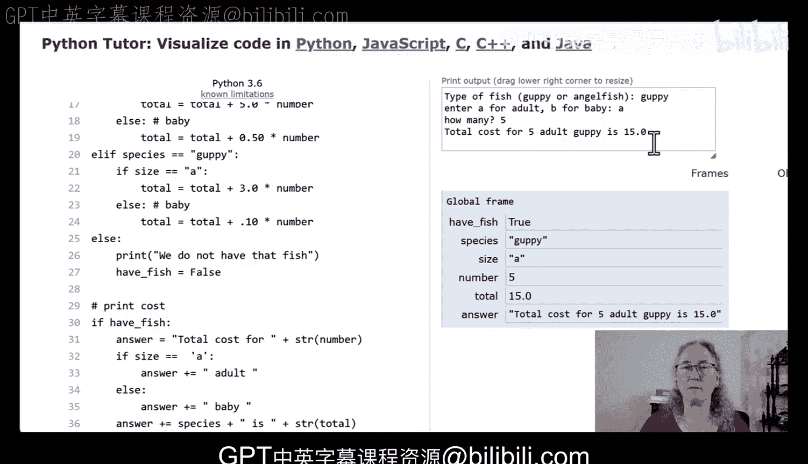

# 杜克大学《Python编程实践｜Practical Python： Start Your Programming Journey》中英字幕 p27 27_03_04_Python Tutor-嵌套if与elif及布尔变量第二部分演示.zh_en -BV1tTmCBWEQD_p27-

。So what happens if someone really wants to buy three adult clownfish？Well。

 let's see what happens when our program runs。Again， we have to go edit this code。

And then try to visualize it again just to reset it so we can type new input。

So we're going to come down here and where it says type the fish， this time let's write clownfish。

And then we'll click submitit。And then we'll come down here。We will say adult or babies。

 let's say adults。Ay for adults。And then let's just say we have three of these。😔，So how many， three？

😔，And then we can just keep going。Let's see what happens if we say next。We see， is it an angel fish。

 no？Else is it a guppy， no， it's just going to go to print， we do not have that fish。

 so if we click next。That should have been printed， it says we do not have that fish。

 so that looks good。And it's not done yet， so if we keep clicking next。

 you can see it's building the answer total cost for three adults。Cownownfish is and it prints 0。0。

So the output here is going to say we don't have that fish and the total cost for three adult clown fish is 0。

0。So the output that we do not have that fish is good。

 but it also says total cost for three adult clownfish is zero， and that's not good。

We shouldn't print that so we can fix that， we can use a  Booan variable to indicate whether or not the store has the fish the person wants to buy。

So let's call the variable have fish， have_ fish。And set it to true at the top of the program。

 that is， we'll assume the store has the fish to start with。

So we'll type it in as the first line of code。So we're going to have to go back to edit the code。

And then we'll go up to the top。Let's put it。Let's see we'll put it right up here。

Let's say have underscore fish。Equals true， so we'll assume we have the fish to start with。Now。

 whenever we realize that the store does not have the fish the person wants。

 then we need to change the value of have fish defaults。

So you should think about where would that be in the code？

That's going to be in the big if in the else part where we say we do not have that fish。

We can also add this line to make it clear the store does not have that fish。

And so down here in the alts where we say print， we do not have that fish。

 will also change have fish at that point。Have fish。

 we're going to change it to fault Now do you notice the elses part on line 25 now has two lines of code to run whenever the else is executed。

Both lines are indentted the same amount to indicate they are code for the AlLts。

Let's run the program again to make sure it works for a fish the store doesn't have。So。

We're going to go to visualize， here we go， visualize execution。嗯。And。

Let's see we need to come down here， we'll do next。It says what type of fish do we want？

Let's type in clownfish again。And then the next thing we have to do is let's see try。

 is it adult or baby， let's say it's adult？And then let's see what one more we have to type in how many。

And let's type in three。And then now we can actually just go to the end to see if it worked or not。

 we can just say last and we can see what had happened。It said it printed。

 we do not have that fish and it's still printed total cost for three adult clownfish is 0。0。Hm。

The codes still printing out that extra line， so how do we stop that？That's right。

 we have to add code to stop printing that extra line。

 we need to check before we print whether we have a value to print or not。

 in fact we don't need to build the string if we don't have a value to print。

 so let's check that before we even build the string and print the answer。

So our question is just do we have the fish so we can just ask if have fish， and if that's true。

 then we build the string and we print it。So let's todent all that code， let's come down here。

First of all， we have to go back to edit this code。And。Here。

 all of this print costs we only want to do if we have the fish， so we're going to say if。Have。Fish。

If have fish。And then we need to indent。All this code。

 because it's part of the if so we can add four lines。Everything has to be indented。

This one is part of the else。For the if the size， this is part of the else。For the size， let's see。

 okay， so we have all that indented and then we build the answer。

And then we print the answer so everything here is going to be inside if half fish。

 if half fish is true， then we want to print how much it costs。But if it's not the right fish。

 we don't want to do that。Okay， so let's run it again just to see if it works。Up， we have an error。

 it says scroll down to see error message near the visualized execution button。So we have。

If half fish answer equals this， so this should not be indented yet。

 we indented a little bit too much。So this can come back。And this should come back here。

 so we didn't or if too much。Okay， so now we have answer is and then we just if an if statement here and here。

 I think this is good， let me try to visualize that yeah。

 that works Oh it still oh it said we just fixed the following error， that's fine。

Let me get rid of that。Okay。So let's try to run this code now。We have to come all the way down here。

Next。It's asking for guy or angel fish， and I'm going to put clownfish。And now， it's asking for。

Is it adult or baby and I'm going to put？Adults。And then we have how many fish。And I'm going to put。

3 fish。And then we're just going to keep， we can just run it to the end and see what happened at this point。

Let's see here we go， so we can just say last it runs all the steps and we can see how many。

 three and we just say we do not have that fish， perfect， that's what we wanted to do。

 We don't have the extra message that tells you how much it costs。

Now we should still check to see if it works for a valid fish， so let's check one of those。

 we'll have to go back to edit this code。And then we have to come back here and say visualize execution and let's try it for a fish that we know we have。

So we'll start here and say guppy or angel fish。Let's say it's a guppy。

And then it's asking us what type of fish？Let's say it's an adult guppy。And I want to point out here。

 notice have fish on line 8 is set to true and you can check here and you can see half fish has the value true okay。

Let's keep going。 We need to say how many fish we want to buy this time。

 let's say we're going to buy。Fi fish。And then we can go ahead and run this to the end now。

All the way to the end， and it says how many five total cost for five adult guuppies is 15。

 so it seemed to work fine。For fish that we actually do have。

