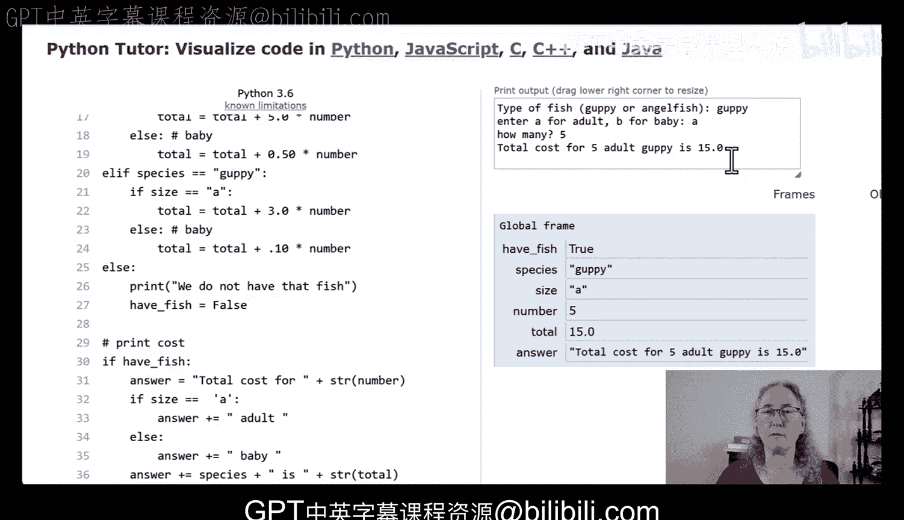

# Python编程实践：嵌套if与elif及布尔变量


## 概述

在本节课中，我们将学习如何使用嵌套if语句和elif语句，以及布尔变量来处理更复杂的逻辑判断。

## 嵌套if与elif语句

### 嵌套if语句

嵌套if语句是指在if语句内部再嵌套一个if语句。以下是一个示例：

```python
if 条件1:
    if 条件2:
        # 执行代码
```

### elif语句

elif语句是else if的缩写，用于在多个条件判断中添加更多的条件。以下是一个示例：

```python
if 条件1:
    # 执行代码
elif 条件2:
    # 执行代码
else:
    # 执行代码
```

## 布尔变量

布尔变量用于存储布尔值（True或False）。以下是一个示例：

```python
have_fish = True
```

## 示例

假设我们要编写一个程序，根据用户输入的鱼种类、数量和大小来计算总价。以下是一个示例代码：

```python
# 定义鱼的价格
price = {
    'clownfish': 10,
    'guppy': 5,
    'angelfish': 20
}

# 定义鱼的大小
size = {
    'adult': 1,
    'baby': 0.5
}

# 获取用户输入
fish_type = input('请输入鱼种类：')
quantity = int(input('请输入数量：'))
size_type = input('请输入大小：')

# 计算总价
total_price = 0
if fish_type in price:
    total_price = price[fish_type] * size[size_type] * quantity
    print(f'总价为：{total_price}')
else:
    print('抱歉，我们没有这种鱼。')
```

## 总结



本节课中，我们学习了如何使用嵌套if语句和elif语句，以及布尔变量来处理更复杂的逻辑判断。通过示例代码，我们了解了如何根据用户输入计算总价。