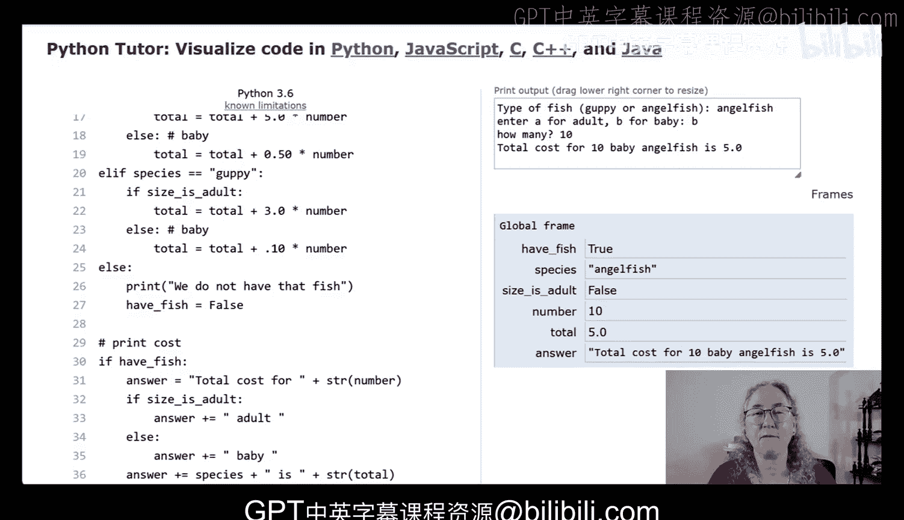

# 杜克大学《Python编程实践｜Practical Python： Start Your Programming Journey》中英字幕 p28 28_03_05_Python Tutor-嵌套if与elif及布尔变量第三部分演示.zh_en -BV1tTmCBWEQD_p28-

I now want to show you one additional way to write a part of this code with a Booolean variable。

 so what I'm going to do is I'm going to make a copy of the code and you can do that too。

I'm going to go in to edit this code， and I'm going to grab all the code here。

All the way down to the bottom。Let's see if I got it all。 Oh， I got it all， but the print cost。

I'm just going to copy this part first。Copy。I'll come back and get the rest of it。

And what I'm going to do is I'm going to put it in a different Python tutor。Right here。

Scroll down to the bottom here。And let me go back and get the rest of the code。

Here I need the print cost。😔，There， and let me copy that。And we'll put that here at the bottom。Okay。

 so we have a copy of the code。And what I want to do。

 the change I want to make is use a bulloleion variable to indicate whether the fish is an adult fish or not。

 so remember we have the user type in A for adult fish and B for baby fish and they'll still going to do that。

 but instead of saving the letter A or B， instead we're going to use a bullolean variable and save true if it's an adult fish and false if it is not an adult fish。

And then we have to figure out well， where in the code would we make all the changes that are going to apply。

 so think about that。So we're going to come in here。Where it says。Line 10。

 size equals input enter A for adult and B for baby。So they're still going to do that。

 but then we're going to change this variable and we're going to first of all。

We're going to call it size is adult。So size underscore is underscore adult to make it sound like a question like size is adult。

 is that true or false？And then what we're going to do is we're going to put around this input。

 we're going to say， did they type in the letter A， so we're going to say does a。It doubleub equals。

The input that they type in， I need to put a。Pin all the way at the end。So the idea here is。

When the user types in A， their input's going to be compared to see if it equals a， and if it does。

 the variable size is adult， is set to true。If the user types in B or anything else。

 then that value is not equal to A， so sizes at is set to faults。

Now the advantage of changing the name of the variable from size to size as adult is that now the name is more meaningful and as a question indicates this variable must be abuo in value。

Changing it also means that now all occurrences of the variable size need to be updated。

Updated doesn't necessarily mean just change the variable's name。

 we may also have to change the way the variables is being used。So for example。

 right after we check if the species is an angel fish， we now want to ask a different question。

 we want to know if sizes adult is true， so we can just ask what value， what's its value。

 or rather if size is adult。So let's fix that right here if right here。Size。😔，Is。Adults。

And we don't even need the rest of this， we can get rid of all this。

Because now we're using size as adult and that's a bu and it's either true or false， so we just ask。

 is it true？If it is， we know it's an adult。We also have to fix it here。

If size underscore is underscore adult。Then that should work too。

So we have to update this variable after checking if the fish is a guppy。And after checking if it's。

A。Angelfish after both of those， so we did that。Is there anywhere else we need to fix it。

 Let's look down in our code。Over here， we check if it's an adult here。So let's do that if size is。

Adult。Then we know it's an adult。Okay。I think that's all the places。

 so let's run our code and see if that works， that is， did we update it in all the correct places？

So let's run it。And we'll have to scroll down here。And run next and says。

 what type of fish do we have， let's assume we have an angel fish。

And then we've got an angel fish for species and now we want to ask。Is it a baby or an adult。

 so let's try be for baby？And it has sizes adult is set to fault。

 which is correct because it's not an adult。Then let's try the input how many we're going to buy。

 let's say we're going to buy 10。And submit that。And then。It looks like everything's good so far。

 and let's just go to the end and see what happened。

Total cost for 10 baby angel fish is 5 theyre 50 cents each。

 so that sounds good so it looks like it worked fine so in summary we just wrote a program that had to make multiple decisions。

Is it an angel fish is it an adult， we used nested if statements to make those multiple decisions。

 We also used a buooleyan variable to determine whether we had any information to print and we used a buoolean variable to keep track of the size of the fish whether it was an adult or a baby so maybe you've been inspired to go fish shopping and set up a fish tank I have 17 fish tanks in my house that is a lot of fish but they are very relaxing to watch。

