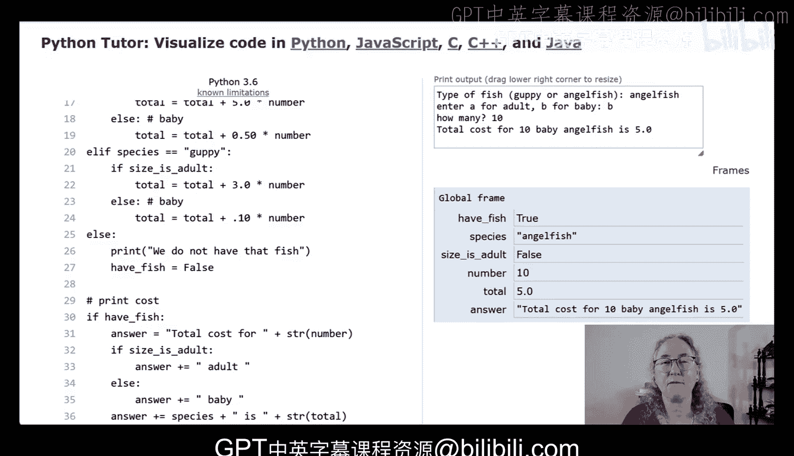

# Python编程实践：28：嵌套if、elif与布尔变量第三部分演示 🐠


在本节课中，我们将学习如何使用布尔变量来优化代码逻辑，特别是结合嵌套的 `if` 语句和 `elif` 语句。我们将通过一个鱼类商店的计价程序来演示如何将用户输入转换为更易读、更易维护的布尔值。

---

上一节我们介绍了嵌套 `if` 和 `elif` 的基本用法，本节中我们来看看如何引入布尔变量来简化条件判断。

现在，我想展示另一种编写部分代码的方法，即使用布尔变量。我将复制现有代码，并对其进行修改。

以下是修改前的原始代码片段：

```python
size = input("Enter A for adult and B for baby: ")
```

我将创建一个新的变量 `size_is_adult`，其名称像一个提问：“尺寸是成年鱼吗？”，这表示该变量将存储一个布尔值（`True` 或 `False`）。

修改后的代码如下：

```python
size_is_adult = (input("Enter A for adult and B for baby: ") == 'A')
```

当用户输入 `'A'` 时，表达式 `input(...) == 'A'` 的结果为 `True`，变量 `size_is_adult` 被设置为 `True`。如果用户输入 `'B'` 或其他任何内容，该表达式结果为 `False`，变量 `size_is_adult` 被设置为 `False`。

将变量名从 `size` 改为 `size_is_adult` 的优势在于，名称更具描述性，并且明确提示这是一个布尔值。

更改变量名也意味着所有使用 `size` 变量的地方都需要更新。更新不一定只是更改变量名，我们可能还需要改变变量的使用方式。

例如，在检查鱼类是否为天使鱼之后，我们现在要问一个不同的问题：我们想知道 `size_is_adult` 是否为 `True`。我们可以直接检查它的值。

以下是需要更新的代码位置：

1.  在检查是否为天使鱼后，我们询问尺寸：

    ```python
    if size_is_adult:
        # 处理成年鱼逻辑
    ```

2.  同样，在检查是否为孔雀鱼后，也需要更新：

    ```python
    if size_is_adult:
        # 处理成年鱼逻辑
    ```

3.  在代码后部计算成本时，也需要根据 `size_is_adult` 进行判断：

    ```python
    if size_is_adult:
        # 应用成年鱼价格
    else:
        # 应用幼鱼价格
    ```

让我们运行修改后的代码，看看是否在所有正确的位置都进行了更新。

假设我们输入天使鱼，然后输入 `B` 代表幼鱼，再输入购买数量 10。程序应正确计算总成本：10 条幼年天使鱼，每条 0.5 元，总计 5 元。

运行结果表明程序工作正常。

---



本节课中我们一起学习了如何利用布尔变量来优化条件判断逻辑。我们通过一个实例，将用户输入的字符（如 `'A'` 或 `'B'`）转换为更具语义的布尔值（`True` 或 `False`），从而让代码更清晰、更易于维护。我们还回顾了如何将这种布尔变量与嵌套的 `if` 和 `elif` 语句结合使用，以处理复杂的多条件决策场景。