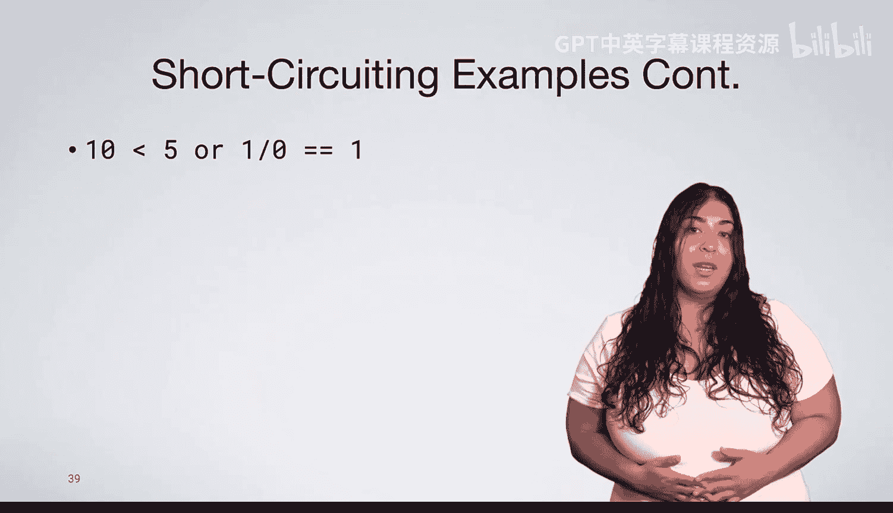
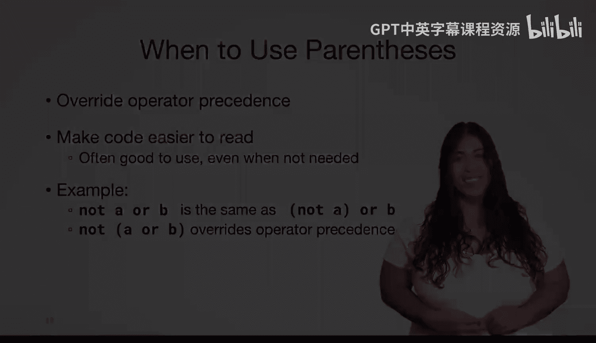

# 杜克大学《Python编程实践｜Practical Python： Start Your Programming Journey》中英字幕 p30 30_03_02_复杂布尔表达式与短路求值.zh_en -BV1tTmCBWEQD_p30-

Now that we have the opportunity to learn about many different operators。

 let's revisit the operator president's roles of Python。Presented from highest to lowest。

 the exponentiation operator has the highest precedes above all other operators we have seen thus far。

After all， mathematical operators， we have comparison operators like equals less than greater than in Z on。

And after that， we have the knot operator followed by the end。 And lastly。

 we have the orar operator as the one with the lowest presidents。

Let's look at an example of these rules in action。Suppose we want to check if a number is both odd and outside of the range from 0 to 100 inclusively。

But what does that mean， We're actually checking for two different things here。 First。

 that the number is odd。 Second， that the number is outside the range from 0 to 100。

But how do we know if a number is odd。We check if it is not evenly divisible by two。Oh。

 what about the second condition to see if a number is outside the specified range。

 We need to check if the number is less than the smallest number in that range， in this case，0。

 or if the number is larger than the biggest number in that range， in this case，100。So for example。

 consider the number 351。Looking at the first criteria that is the number must meet is 351 in odd number。

Oh， yes， it is。Now we need to check if 351 is outside the range from 0 to 100。

Looking at the smallest number in this range of numbers， we can check if 351 is less than 0。

It is not。 What about the largest number in that range is 351 greater than 100。 Yes。

 so351 is outside of the specified range， since it is greater than 100。

 That is 351 is both an odd number， and it is outside the specified range of numbers。

How would you write code that checks for this condition， Well。

 there are ways that you can write this code， Quite a few of them。

But let's look at one specific attempt at solving this problem。Now。

 I will let you know ahead of time that I was feeling a bit mischievous。

 So I included a sneaky little error inside the coat。Your challenge， should you choose to accept it。

 is to find the error before I reveal its location。

So go ahead and pause the video now if you want to take。

 if you want to look for the error without any hints。Okay， let's go over the code。

Consider an example where the variable nu is assigned the value to 100 using the input function。

Which is then converted to an integer。In line two， you have an if statement that will execute line 3。

 if the if condition evaluates the true， line 3 prints。

 the number is a and outside of the range to the console。In summary。

 the condition in line 2 should evaluate to true only if none is an odd number and outside of the range of 0 and 100。

 Now， let's take a closer look at the condition in line 2。

You may notice that line 2 contains both the and， as well as the ore operator。

 While this expression may appear complicated， we can break it down step by step to better understand it。

To make it easier to focus on just the complex bulloleing expression。

 we'll go ahead and gray out the rest of the coat。That's better。Now， recall from earlier。

 we mentioned that the and operator has higher precedes than the ore operator。

 hence we will evaluate the and operator first。The end operator combines two sub expressionions。

 A and B。Recall that both A and B need to be true for the compound expression to be true。

In this example， a is nu modulus 2， not equal to0。Since none was assigned the value to 00 in line 1。

 the Boolean expression a is really 200 modulus 2， not equal to 0。

Modullo has a higher precede than logical operators， so we will solve that first。

 what does 200 modo2 evaluate to？0。😊，This is because the number 200 can be divided evenly by two。

 resulting in 100 whole divisions with no remainder。Now。

 we can get to the root of what expression he is really asking。Is it the case that0 is not equal to0？

Well， that is not true。 Therefore， the expression evaluates to false。Great。

So we've solved expression A。 How about expression B， expression B is asking。

 is it true that nu is less than 0， Well， nu is 200，200 is not less than 0。

 So expression B evaluates two false。Now that we know that A and B evaluate two。

What we now just need to evaluate is false and false。Since both sub expressions are false。

 the compound expression evaluates too false as well。

So now we can replace this expression with a single value of false。嗯。Let's pause for a second。

At this point， behind the scenes， Python will replace the and portion of the whole complex bullolean expression with its final value of false。

And after that replacement， we are left with false or numb greater than 100。

This means that we can now move on to the orar operator。And just like before。

 we have the expression A as well as B for the ore operator。For now。

 we know that A evaluates the false， so all we really have left to evaluate is the expression B。Now。

 B is asking， is it true that numb is greater than 100？Well。

 none was assigned the value 20 line 1 via user input。Thus。

 the expression 200 greater than 100 is true。So what we have left is the expression false or true。

The or operator only requires one sub expressionpression to be true。

 for the whole expression to be true。Thus， the final value of this whole complex expression is true。

Great。😊，Let's run through this whole code。Line1 executes， assigning 200 to none。

Line2 executes the value of the complex Boolean expression evaluates to true。

That means the if block will execute。So we will execute line three next。The string。

 the number is odd and outside the range， is printed to the console。But is that logically correct？

Although 200 is indeed outside the specified range。It is an even number， not an odd one。

 That means there is a bug in our code， illogical error of some kind。Now。

 I'm about to reveal the bug in the code。 So pause this video if you want to give yourself a chance to find it before I reveal the answer。

The bullolean expression should have evaluated to false when them is 200。

But why did it evaluate to true？Let's go back to inspecting what we are really looking for。

 We are looking to determine if numb is an odd number and that numb is outside the specified range。

 however。In the buggy code， because of the and operator， only the first half of B is evaluated。

With the and operator， essentially， B is broken up incorrectly。In this code。

 A is checked along with the expression nu less than0， which is part of B。

The result is then ord with the check that the number is greater than 100。

 which is not the intended behavior。 These do not match。

It seems that the root of the issue is that the order in which these conditions are being evaluated。

So how do we fix this code？ Well， one way is to enforce a specific order of operations。

 and we can do that with parentheses。By adding parentheses around expression B。

 we fix the problem of B being incorrectly broken apart to the standard order of operations。喂hy。Well。

 parenthesesis changes the order of operations。 Now。

 expression A should no longer be checking for more conditions than necessary。

 Let's take a look at line2 once more， with the fixed code。

Brenheses take precedence above all operators， meaning that this complex bulloleing expression is broken up into the following sub expressionions。

 A is nu modulus 2 not equal to 0， which evaluate to false since nu is 200。

Instead of sub expressionpression B being none less than0。

 B is now a compound expression using the ore operator due to the parentheses。So let's solve me。

Noome less than 0 is false since 200 is less than 0。N greater than 100 is true。

 since 200 is greater than 100。This gives us false or true。Which evaluate is to true？

So now we have false and true。The end operator needs both A and B to be true for the compound expression to be true。

Since AS falls， the whole expression will evaluate to false。

This means that the print statement is never executed。Is this the outcome we were hoping for。Yes。

200 is not an odd number， and we are looking for both conditions to be met， not just one。Although。

This does bring up yet another question。The moment we realized 200 was not an odd number。

 That is sub expression， A evaluated to false。Did we really need to check the results of expression B。

H， what do you think？Regardless of whether B is true or false。

 the outcome would have been the same since a was not true。

Python also leverages this fact to save time and will not calculate B。

 thus making your program run just a tiny little bit faster。

This process of skipping the later portion of a boolean expression is also known as short circuiting。

Essential， there are times when knowing the result of the first part is enough to determine the result of the whole compound expression。

And to better visualize this， let's consider the compound expression A and B。

We know that the and operator will only ever evaluate a true if both A and B are true。

And will evaluate to faults otherwise。Therefore， the moment we know A is false。

 we immediately know that the whole expression is false， regardless of the value of B。

But what if A is true？Then we cannot determine the overall result of the compound expression without checking B。

This is because if B is false， then the expression true and false evaluates to false。Likewise。

 the expression true and true evaluates the true。So when A is true。

 Python will not use short circuiting when evaluating the and operator since the value of B is vital。

But then what about the ore operator？Recall that the or operator will evaluate to true if either A or B are true。

Really， only one sub expressionion needs to be true for the compound expression to be true。Therefore。

 the oral operator will only ever evaluate two falses if both A and B are false。

But we can leverage this behavior if a evaluates the true。

 then we can say what certainty that the compound expression evaluates the true。

 regardless of the value of B。This is short circuiting at play。 If A is false。

 then the result of the compound expression relies on the value of B。

 So Python will not use short circuiting and will then evaluate B。False or true evaluates a true。

 Likewise， false or false evaluates to false。The value of B is key here。

Let's look at some additional examples of short circuiting。Here we have 10， less than5。

 or one divided by0 equals one。With this compound expression， a is 10 less than5。

 and B is1 divided by0 equals 1。Notice how B will result in an error since you count divide by zero。

And to be more specific， evaluating B will give us a divide by zero error。

But if you were to execute this line of code， you would actually get the value false， not an error。

And this is because a evaluates to false 10 is not less than5。

 Python will use short circuiting to skip B entirely， evaluating the whole expression as false。Thus。

 the part of the coat that would have thrown in error never gets executed。It is entirely skipped。

What if we change the compound expression slightly so that the first part of the compound expression evaluates you true？

10 is indeed greater than 5。 of That means Python will then be forced to evaluate the second part of the expression。

Python will attempt to calculate one divided by0， which would result in an error。

So when writing code with the and operator， it is considered best practice to put the sub expression that is most likely to be false first。

And the reason for this is that you want to take advantage of short circuiting as often as possible。

 Doing so will make your program run to subtd bit faster。Whether short circuiting is used。

You most likely will not notice a time difference as it's usually under a second。

 but as you write more and more advanced code， there can be cases where your bulloleing expressions will require much more time to calculate and the time differences will become much more apparent。

Now let's look at the ore operator。Here we have 10 less than5 or one divided by0 equals1。

The first party evaluates to fall since 10 is not less than 5。

That means that we need to check the second part of thee。The expression。

 since we are using the ore operator， which will throw an error。Looking at a similar example。

 this time， the first party of Valist to true，10 is indeed greater than5。

Since the first part is true， Python will not check the second part。

So this expression will result in true and the error is skipped。When using the ore operator。

 it is considered best practice to put the sub expressionion that is most likely to be true first。

Thus allowing Python to leverage short circuiting more frequently。And that is short circuiting。

Now I know this topic can be a bit confusing， more。

 a lot of the examples require you to remember the current order of operations。And to add to that。

 you may have noticed that while a computer can read code with no problems。

It takes us humans much longer to read and understand code。

 and that's understandably can be a bit frustrating。

Is there a way to make it so that you can read code a bit easier Well， yeah， there is。

And the answer is to use parentheses。 Now， by now， you know that parentheses can be used to override operator precedes。

 but they can also be used to make your code easier to read。 In fact。

 I encourage you to use parentheses， even when you know the standard order of operations will handle it correctly。

Here is a small example that might help visualize the importance of using parentheses。Not A or B。

We know from operator precede's rules that the not operator will execute first。

 but it's hard to remember that， and as a result， it's hard to read this line of code with confidence that you know what it's doing。

So let's add some parentheses that will not change how this code is executed。

These two pieces of code behave the exact same way when executed。

 The only difference is that the parentheses helps to make the code a lot easier to read。

All parentheses。Might not make it easier to write the code。

 you will be glad you use them every time you have to go back and read your previously written code。

Well not only that， but because you use parentheses。

 you will have a clear understanding of what your code is doing。

 and thus it will be easier to find bugs。But do be careful。

 Remember that parentheses can also override operator precedence， which is good。

 but only if that was your intention。Consider this new piece of coat that has parentheses around the ore operator。

This is not logically equivalent to the above example。In this case。

 parentheses was forced the ore operator to execute first and then the knot operator second。

 And if that was not your intention， then this code would be buggy。Now armed with this knowledge。

 go forth and craft some amazing code programming is not just about logic。

 it's also about embracing your creativity as you watch your digital creations come to life in spectacular ways。

