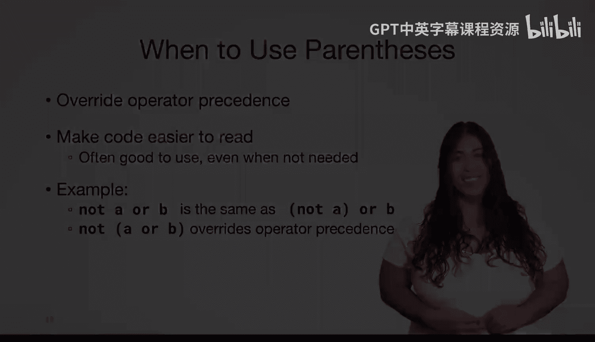

# Python编程实践：复杂布尔表达式与短路求值


## 概述

在本节课中，我们将学习Python中的复杂布尔表达式和短路求值的概念。我们将探讨不同运算符的优先级，并了解如何使用短路求值来优化代码性能。

## 运算符优先级

Python中的运算符优先级决定了表达式求值的顺序。以下是Python中运算符的优先级，从高到低：

* **指数运算符**：`**`
* **数学运算符**：`+`，`-`，`*`，`/`，`%`，`//`
* **比较运算符**：`==`，`!=`，`>`，`>=`，`<`，`<=`
* **身份运算符**：`is`，`is not`
* **位运算符**：`&`，`|`，`^`，`~`
* **布尔运算符**：`and`，`or`

## 复杂布尔表达式

复杂布尔表达式由多个布尔运算符和操作数组成。以下是一个复杂布尔表达式的示例：

```python
number % 2 != 0 and number > 100
```

这个表达式检查一个数字是否为奇数且大于100。

## 短路求值

短路求值是一种优化技术，它允许Python在确定整个表达式的结果后停止计算。以下是短路求值的两种情况：

* **`and`运算符**：如果第一个操作数为`False`，则整个表达式为`False`，Python将不会计算第二个操作数。
* **`or`运算符**：如果第一个操作数为`True`，则整个表达式为`True`，Python将不会计算第二个操作数。

## 示例

以下是一个使用短路求值的示例：

```python
number = 351
result = (number % 2 != 0) and (number > 100)
```

在这个示例中，Python首先计算`(number % 2 != 0)`，结果为`True`。由于`and`运算符的第一个操作数为`True`，Python将不会计算第二个操作数`(number > 100)`。

## 使用括号

为了提高代码的可读性和避免错误，建议在复杂布尔表达式中使用括号。以下是一个使用括号的示例：


```python
number = 351
result = (number % 2 != 0) and (number > 100)
```

在这个示例中，括号确保了`number % 2 != 0`和`number > 100`这两个条件都满足。

## 总结

在本节课中，我们学习了Python中的复杂布尔表达式和短路求值的概念。我们了解了不同运算符的优先级，并学习了如何使用短路求值来优化代码性能。我们还学习了如何使用括号来提高代码的可读性和避免错误。




希望您对本节课的内容有所收获！