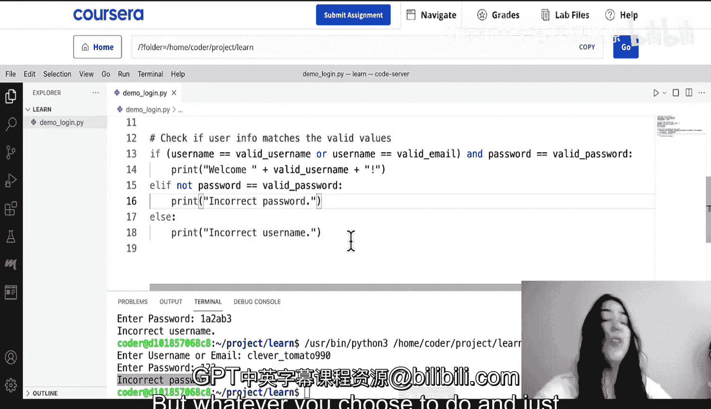

# 杜克大学《Python编程实践｜Practical Python： Start Your Programming Journey》中英字幕 p31 31_03_03_逻辑运算符与短路求值演示.zh_en -BV1tTmCBWEQD_p31-

Let's create a simple login screen Now this can get complicated pretty quickly。

 so to help organize our thoughts， I went ahead and already wrote down some comments for us just to help us tackle this problem。

For the first comment set values we will check for。

 this is where we will write the correct username and correct password that we will be expecting the user to enter if they want to log in into our program。

The second comment get user input for their info Under this comment。

 we will ask a user to enter their personal username and password that we will use to compare to our correct values。

Now， up to this point in the program， we already know what values we're looking for that's done under the first comment。

 and we already know the user's password and username that's done under the second comment。

So what do we need to do at this point in time to verify if this is the person who should be logging in into our program？

Well， you got to compare the values and you can do that under the third comment check of the user info matches the valid values。

Essentially。We will need to verify that the user input does indeed match our expectations and if it does。

 then the user is allowed to log into our program and if it doesn't， then they're not， and that's it。

That's the plan we're going to go ahead and execute。 So let's go ahead and write this code。

 So going back to the first comment， I'm going to go ahead and write our expected user name。

 so valid。User username and this can be whatever you want it to be。

 I'm going to go ahead and write clever tomatomato 990。😊，If I can get over the typos。

And we're going to say valid password。And again， this could be whatever you want。

 I'll go ahead and say1 A2， A， B3 as the valid password。All right。Under the second comment。

 we're going to have to gather the user's information to know whether or not they're a valid user。

What function that we have already looked at can help us do that？Well， the input function。

So we're going to ask for user input and。For example， the username。

We can store in the variable username， and this could be done using the input function where we can enter something like enter。

Username。Notice here how I'm adding a white space between the colon and the ending quotes。

 The reason for this is because I want there to be a space in the console in the terminal between where this colon ends and where the user input begins。

 You'll see that once we run this program。And then the user's password。

 I'm going to go ahead and use the input function for that as well。Enter password。Awesome， okay。

So we have both。Collected the username and the password， oh， I almost forgot mine。My ending quote。

 Okay， so how do I know if it's correctly capturing the user data as I intended it to do what if what I intended this program to do isn't what it's actually doing。

 So how can I verify that my code works up to this point in time。What can we use？Well。

 we can try printing the variables。Printing is very powerful way of checking if your program is doing what you expect it to do。

 and here I'm just printing the variable values for username and password。

Let's go ahead and run our program and see if the code works。All right。

 So it's asking me for my user name。 That's good。 That's what's doing on line 6。

So I'm going to go ahead and enter。Clever。Tomato toe。If like tomato 99，0。

And now is asking me for my password so。B3， all right，1 A to A B3。

And it looks like lines 9 and 10 were indeed able to print out exactly what I typed in。

 so it is doing what I expected it to do Heck， we can even run it one more time and just just to make sure so let me put in hello 990。

And one， two， three。And that is indeed what it printed。 So I have confidence now。

 because of these print statements that my code does work up to this point in time。

So I'm going to go ahead and comment out these print statements。

 just leave them as comments so that it won't execute because you never know you need to go back to them in the you know later on。

 I think it's usually a bit surprising how often you have to go back and double check the values of old variables every time you make major changes to your code。

But once you know that your code is done， you're not going to be making any changes to it。

 then I would recommend that you delete these commented out code bits like these two print statements here。

 because it's best practice to not leave unused code in your program as it can make things harder to read and harder to understand generally。

But we might come back to it。 You never know。 So for now， I'll just leave it。 comment it out。Alright。

 so I captured the user information， we know that part works。

 so how do I know if this user is actually a valid user to log it into our program we're going to need to use an if statement。

😊，So let's go ahead and do that now。So I can do something like if username。

Is equal to our valid user name。Is this enough to verify that this person should be allowed to log it into our program？

Can we verify the user's identity just based off of this alone？No。

It looks like we'll need to check their password as well。So and。

Their password is equal to our valid password。By using the and operator。

 we made it so that both the username and the password must match in order for the if statement to execute the if block to execute the username entered by the user must match the valid username and the password must match the valid password。

And only when both match will this whole bullolean expression evaluate to true and the。

If block will execute。So what exactly do we want that block to be Well we can make it into a print statement welcoming the user into our program basically saying hi welcome it could be whatever you want it to be honestly so I'm just going to use string concatenation you're welcome to do whatever you like at this point and I'll use string concatenation to welcome the user into our program so here I'm saying welcome the user name plus the exclamation mark because we're excited to welcome them。

😊，Okay。We just needed to use an L statement at this point to account for the situation where the user was not able to successfully log in。

 essentially let them know， I'm sorry， not at this time。嗯。So I'll go ahead and write print and。

And I can say， incorrect。Incorrect username。Or password。All right。

So let's go ahead and run this code。😊，And see if it works。Let me clear this up Okay。

 just I just cleared the terminal via by right clicking and selecting clear just to clear things up a little bit。

Alright， so enter username。 So I'm going to go ahead and type in。嗯。Hello 990。

 I know that's an incorrect username。And for the password。

 I'll go ahead and type in the correct password， 1 A 2 A， B3。

And it looks like they did not let me log in。 It says incorrect username or password so the if blocked did not execute。

And that's actually what I wanted to happen。 I did not want to be able to be logged in。

 So in this case， the user name。Was incorrect。But because I'm using the and condition。

Do you think that the password was ever checked。Think about it。

 Feel free to pause this video if you need time to think。

Was the password ever checked when we ran this code and used this user input？No。

The reason being is that short circuiting was at play here。

 The moment the user name was not valid because I entered Ho 9，9，0。

 The and operator can immediately evaluate to false。

 thus never bothering to check the second condition。 This is just Python's way of saving us time。😔。

But if the reverse is true， if the username was indeed correct。

 only then would the password be checked， and this is the case for the end operator。

 so let's go ahead and type in a correct username so clever tomatomato 990 and we'll type in an incorrect password。

And you can see once again， I was not allowed to be logged in。Which is great。呵。😊。

Let's try entering a correct username and password just to make sure that this code actually does work。

 so we'll type in clever tomatomato980 and 1A2 IAB3 as a password。It it welcomed us。

 It says welcome Cl tomato 9，9，0。 You can see that on line 13 as well that that's our string concatenation here。

 Oh， and I did mention earlier about that white space between the colon and the ending quotes。

 And that basically created some white space between my input as a user and what was shown inside。😊。

This this string here。Of course， this is completely optional。All right。

So then the next question here is。😊，What if I wanted to make this fancier？See。

 some websites let you log in either using the username or your email。

 so what if we wanted to add that feature into this program we just want to step it up a bit and definitely you can let's go ahead and write down a valid email。

This could be anything you want I'm going to use。An na mouse。At email dot com。

 a nonny mouse being a play on words between anonymous and mouse。So then I can tell the user enter。

 username or email because they can enter either all right。So then。

The only thing that really needs changing。Is the if statement here。Because as of now。

 we're only allowing a check for the username and password。

 but we're not really accounting for an email anymore。So let's go ahead and do that。

Or so either the username is correct。Or the email is correct。

So username because that's what's getting stored here on line seven。

Is that equal to our valid email that we're searching for？Now。

 this if statement can be really complicated when you first look at it。

But take it one step at a time。 remember that Python。

 you execute what's inside the parentheses first。So just look at what's inside the parentheses here。

 we have the orR operator。Either the username is correct。Or。The username matches our valid email。

 If any of them are true， then this expression inside the parentheses is true。

 and then you can tackle the end operator。All right。

 so let's go ahead and run this code and check if it works。😊。

So let me go ahead and clear it as it tends to get a little messy， okay？

So enter the username or email， so let me go ahead and enter ani via my Smithpellings Ananymails@ email。

com。And I'll enter the correct password。Let's see。1， A2， A， B3。

And it welcomed us notice how it says welcomele Cl Tomato 990。

 that is because that is the valid username I am using in this print statement On 14。

 you can feel free to change that。Awesome， so it does work if I enter incorrect information。

Let's try writing it that way， so anonymous。At email。t com。And let's enter an incorrect password。

And it says incorrect username or password， so this code does work up to this point。

Suppose that we don't want to。Just say incorrect use your name or password。

What if we wanted to be more specific， what if we wanted to tell the user if their password specifically was wrong or maybe if their username specifically was wrong？

I should mention， though， in the real world， you don't really want to do that for security purposes。

 you don't really want to give hackers。More information as to whether it's just the username or the password that's incorrect because it makes it easier for them to hack into your profile。

But for the purposes of this demo， we're going to assume we do not need to worry about hackers。

 so we don't need to worry about that， so it should be safe。

Just for this demo to let the user know if their password or username specifically is incorrect。

How would we do that using code， using Python？Well， we know that line 13。

 the if condition will evaluate to false， if either the username， email， password is incorrect。

 essentially， if their log and information is incorrect， this will evaluate to false。

That means the if block would not execute， so let's capture the rest using an ali。So Elive。Password。

Does not equal our valid password。So assuming in line 13， their login credentials were incorrect。

The if block would not execute， so it would jump on over to line 15， which is checking the LF。

LF is basically saying， is it the case or is it true that the password is not equal to the correct password？

If it is true that the password does not equal the correct password， then execute the LF block。

 which is what we want in which case we're going to tell the user。Incorrect password。So。

If they were not able to log in， then I will check if their password is incorrect。

 in which case I will tell them incorrect password。Otherwise。

 I'll just tell them your username is incorrect。Granted。

 it is possible for both the username and the password to both be incorrect。

 but we'll just try to keep it thing simple and always assume that only one of them will be incorrect。

All right。Let's go ahead and execute this code and see if it works。

 let me go ahead right click here on the terminal and clear it just to keep things a little bit clean and easier to read。

All right， enter username or email， let's enter clever Tomemato 990。

So that would be a correct username， but I'm going to enter an incorrect password， 1， two，3。

And lo and behold， it says incorrect password。 Allright， that's what we want。

 Let's try running that warm more time。 I can use onni Mills。At email。com。

 you can make it whatever you'd like and。We make it 1，2，3 as a password says incorrect password。

 Alright， so this so it works with the password。 let's check if it works with an incorrect username。

 so let's give it the incorrect username of Ho 3。And the password， let's make it correct1 a。2 a B3。

And here it says incorrect username， because it was incorrect， I entered Hello 3。

So this code does seem to work。I also want to mention how it is possible to change the code on line 15 rec the same code。

 but when that is written differently in this case， we're using the not operator。

 changing the quality operator to just equals。 So in this case。

 we are saying is it the case that the password is indeed equal to the valid password。

 If this is evaluate to true， the not operator will flip it making it false。

So to test out that this is indeed the same code logically as what we had before。

 let's run this code one more time。So I can say clever。Tomatomato990。

 and I'll give it an incorrect password，1，2，3。You can see incorrect password is printed。

 so in this case， one to three did not match up with our valid password， so this evaluated to false。

 but the non operator flipped it to true making it so that thisLF block executes。

 and that is why we saw what was printed on line 16 incorrect password was shown。

And of course you can feel free to play around with this code， enhance it， add some features to it。

 just have fun with it， you can account for the situation where both the username and the password is incorrect or maybe you want to add a special administrative password that will allow you to log in even if the username is incorrect there's a lot of things you can do with this program that just you know just to have fun and help master and practice all the concepts you've been learning so far。

But whatever you choose to do and just enjoy the journey， have fun programming。

