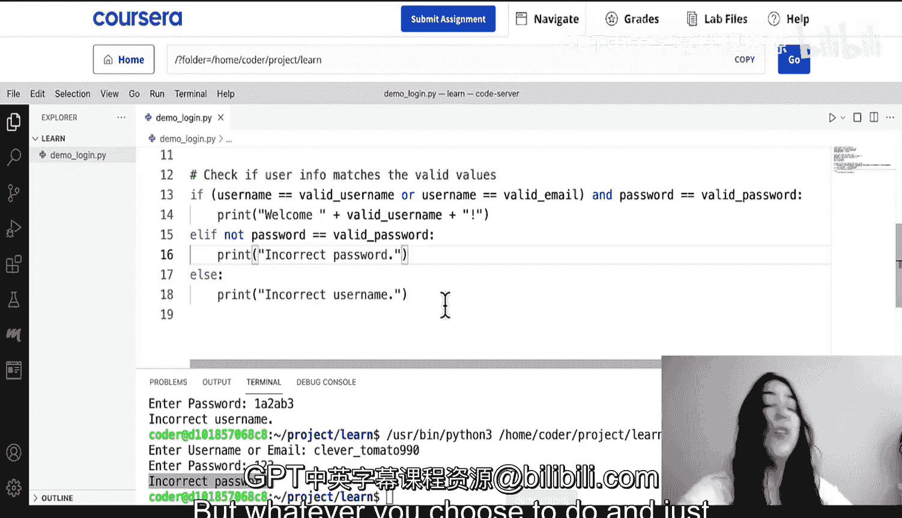

# Python编程实践：登录界面实现


## 概述

在本节课中，我们将学习如何使用Python实现一个简单的登录界面。我们将学习如何获取用户输入、验证用户信息以及使用逻辑运算符进行短路求值。

## 获取用户信息

首先，我们需要获取用户输入的用户名和密码。我们可以使用`input()`函数来实现：

```python
username = input("Enter username: ")
password = input("Enter password: ")
```

这里，我们使用`input()`函数提示用户输入用户名和密码，并将输入存储在变量`username`和`password`中。

## 验证用户信息

接下来，我们需要验证用户输入的用户名和密码是否与预设的正确用户名和密码匹配。我们可以使用`if`语句和逻辑运算符来实现：

```python
valid_username = "clever_tomato_990"
valid_password = "1A2AB3"

if username == valid_username and password == valid_password:
    print("Welcome, " + username + "!")
else:
    print("Incorrect username or password.")
```

这里，我们使用`if`语句检查用户输入的用户名和密码是否与预设的正确用户名和密码匹配。如果匹配，则打印欢迎信息；否则，打印错误信息。

## 短路求值

在上面的代码中，我们使用了逻辑运算符`and`。Python中的逻辑运算符具有短路求值特性，这意味着如果第一个条件为假，则不会执行第二个条件。

例如，在上面的代码中，如果用户输入的用户名不正确，则不会检查密码是否正确。这是因为`and`运算符会立即判断整个表达式为假，从而避免不必要的计算。

## 代码示例

以下是完整的代码示例：

```python
valid_username = "clever_tomato_990"
valid_password = "1A2AB3"

username = input("Enter username: ")
password = input("Enter password: ")

if username == valid_username and password == valid_password:
    print("Welcome, " + username + "!")
else:
    print("Incorrect username or password.")
```

## 总结




在本节课中，我们学习了如何使用Python实现一个简单的登录界面。我们学习了如何获取用户输入、验证用户信息以及使用逻辑运算符进行短路求值。通过本节课的学习，我们可以将所学知识应用到实际项目中，实现更复杂的登录功能。