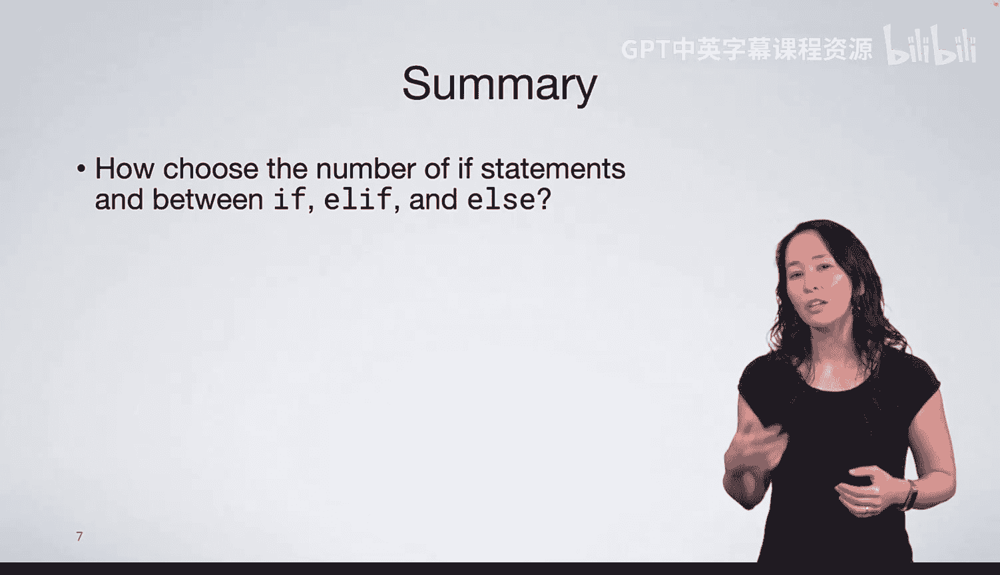

# 杜克大学《Python编程实践｜Practical Python： Start Your Programming Journey》中英字幕 p32 32_03_01_if-if-elif-else-何时使用何种结构.zh_en -BV1tTmCBWEQD_p32-

So you know of if statements and you know that if statements can have if， E and else clauses。

And you know that you can write one or many if statements to get the program to behave the same way。

But when do you use which， How do you choose？ Well。

 one way to decide is to use whichever is the most intuitive to you。

When you think or write out a description of what you want to happen。

 what kind of conditional sentences do you write， Do they rely on whether the prior。

 if conditions were true or false， or can each stand on their own。However。

 if you don't have a good sense of what is intuitive to you， what do you do？Well。

 one way to think about it is to ask yourself， how many things do you want to happen。

 And I use the word thing here on purpose， because I don't know what you want your program to do。

For the purpose of this video， a thing is either a line or block of code。

 You want to only execute some of the time。 That's why that code is inside of an I statement， Aro。

If you only want one thing to happen， then you are likely going to want to use a single if statement with as many L of clauses as needed and maybe an else clause。

This is because as soon as the true condition is found in the if statement。

 only that condition's code block is executed， and the rest of this if statement is skipped。

If there are no true conditions and there is an else clause， the else clause's code is executed。

On the other hand， if you want potentially more than one thing to happen。

 then you are likely going to need multiple if statements。

 and each if statement could have all if clauses and or an else clause。 Let's look at some examples。

 a scenario where you only want one thing to happen is figuring out the price of a ticket based on the age of the person。

 Clearly， everyone needs to buy a ticket and the price for a given person is fixed based on age。

 So to ensure this， you could have a single if statement。

Here' is a single if statement where the variable age has already been assigned a value before the computer gets to this if statement。

If the value of age is greater than 65， the person gets a senior discount。

If age is not greater than 65， then execution moves on， and the computer checks if age is over 18。

 on line 3。If yes， they get the adult price。 An execution would skip the rest of the is statement。

 If no， the computer moves on to the next LF clause on line 5 and so on and so forth。

Notice that since this is a single if statement， only one thing can be printed because as soon as a true condition is reached。

 the rest of the code is skipped。Moreover， since there is an else clause。

 one and only one thing will happen because if all of the F or L of conditions are false。

 the else clause about the infant price would execute。 Now。

 let's do an example of when you want maybe more than one thing to happen。

 or basically some things should happen。For example。

 creating a grocery list when you were in your kitchen。

 you could have the program ask you different questions。

 So here is some example code for the grocery list making program with multiple if statements。😊。

On line  one， the computer starts with an empty grocery list represented as the variable groceries。

 And then on line 2， it has the first， if statement that asks a question via input。

 Is there enough fruit。Why for yes and and for no。If the user answered n for no。

 fruit gets added to the list。Then， regardless of whether the if statement condition on line 2 evaluates to true or false。

 execution goes to line 4 to check the next if statement on whether the last jug of milk is open。

If the user answers why for yes， milk gets added to the variable groceries and so on for the rest of the code。

 And here are different examples of how to handle user input。

 like the if statement On line 8 as onions to the list if there are two or fewer。And on line 10。

 the coat adds ice cream if there are0 unopened carts。

Notice that whether or not a particular item is on the grocery list is not relevant when deciding to add the current item。

Each if statement stands on alone。That means if all of the iftes were true。

 all the items would be on the list。 And if all were false， the list would be empty。

And if it is somewhere in between， the grossy list would be as long as， however。

 many if statements were evaluated to true。So now that you've seen some examples。

 what is the main question you should be asking yourself if you aren't sure what to use？

You should ask yourself， how many things do you want to happen。If you only want one thing to happen。

 you probably are going to use only a single if statement with potentially a bunch of Ls clauses and maybe an else clause。

If you want two or more things to happen and they aren't really necessarily related to each other。

 you are likely going to need multiple if statements。

 This is a flow chart to help you more visually see what you need to do。

 The diamond represents a choice you need to make。 In this case， by answering a question。

If your answer is one， you would follow the arrow to the one， if statement block。

 If your answer was sum， you would go to the multiple if statement block。

 The rectangle block represents a thing you do。These flow charts can also come in handy if you ever want to draw out your own if statements visually。

So let's summarize how do you choose when to use what？How many if statements to use。

 Which kind of clauses to use。

One question to ask yourself is what result are you trying to achieve？And more specifically。

 how many things do you want to happen。If you only want a single thing to happen。

 like figuring out a customer's ticket price based on age， you likely only want one is statement。

If you potentially want multiple things to happen， like adding to a grocery list。

 you likely want multiple if statements。 And with that， we hope this video was helpful。

 And if you can think of other questions to ask yourself when deciding when to use what。

 please share them with others in the discussion forum。😊。

