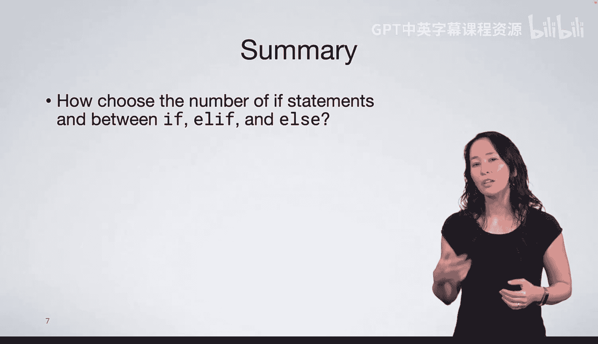

# Python编程实践：如何选择if语句和elif-else结构


在本节课中，我们将学习如何根据需求选择合适的if语句和elif-else结构。

## if语句和elif-else结构简介

if语句和elif-else结构是Python中用于条件判断的基本语句。它们允许程序根据条件执行不同的代码块。

**公式**：
```python
if 条件1:
    代码块1
elif 条件2:
    代码块2
else:
    代码块3
```

## 选择if语句和elif-else结构的依据

以下是选择if语句和elif-else结构的几个依据：

### 1. 需要执行的操作数量

- **单个操作**：如果只需要执行一个操作，则使用单个if语句。
- **多个操作**：如果需要执行多个操作，则使用多个if语句或elif-else结构。

**公式**：
```python
# 单个操作
if 条件:
    代码块

# 多个操作
if 条件1:
    代码块1
elif 条件2:
    代码块2
else:
    代码块3
```

### 2. 条件之间的关系

- **相互独立**：如果条件之间相互独立，则使用多个if语句。
- **相互依赖**：如果条件之间相互依赖，则使用elif-else结构。

**公式**：
```python
# 条件独立
if 条件1:
    代码块1
if 条件2:
    代码块2

# 条件依赖
if 条件1:
    代码块1
elif 条件2:
    代码块2
else:
    代码块3
```

## 实例分析

### 单个操作

以下是一个根据年龄计算票价的单个if语句示例：

```python
age = 70
if age > 65:
    price = 50
else:
    price = 100
```

### 多个操作

以下是一个创建购物清单的多个if语句示例：



```python
groceries = []
if input("Is there enough fruit? (yes/no): ") == "no":
    groceries.append("fruit")
if input("Is the last jug of milk open? (yes/no): ") == "yes":
    groceries.append("milk")
# ... 其他条件判断
```

## 总结

本节课中，我们学习了如何根据需求选择合适的if语句和elif-else结构。通过分析需要执行的操作数量和条件之间的关系，我们可以更好地组织代码，提高程序的可读性和可维护性。