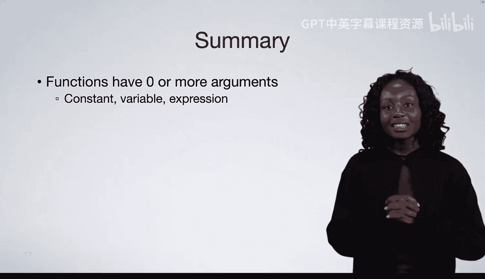

# 杜克大学《Python编程实践｜Practical Python： Start Your Programming Journey》中英字幕 p34 34_03_02_生成随机选择示例-步行与选择衬衫.zh_en -BV1tTmCBWEQD_p34-

Here is an example of a program that randomly picks the number one or two。And if one is generated。

You go for a walk。And if two is generated， you do not go for a walk。Let's go over each line。First。

 the code imports random so the code can use functions from the random module。Next。

 the code calls a random in function and asks it to generate a random number from one to2。

Suppose it generates too。Then walk gets the value， too。The code checks if walk is equal to one。

It is not。The condition is false。Execution goes to line 5 and executes the else。

 meaning the walk must be2， since it can only be one or two。Next。

 the body of the else executes on prints。No walk today。

The next code executed is whatever follows the if statement。

This code randomly generates number one or2。And tells you to go on a walk if it generates one and tells you not to go on a walk if it generates 2。

You have no idea until you run the program。 what the outcome would be。Let's look at another example。

Suppose you have three shirts。1 is red。1 is yellow， and one is blue。

You can decide which shirt to wear today。 So you want to write a program to randomly pick one of them。

How do you do that。Well， you have three shirts， and you know how to generate a random number。

So generate one of three numbers between one and3。And then associate each number to a different chart。

Associate one of the numbers。 say one with the red shirt。And two with the yellow shirt。

 and three with the blue shirt。Then your program will generate a random number。

 and that number tells you which shirt to wear。Let's look at code to do this。

In the first line of code， the variable shirt is assigned to a question mark。

After the code generates a random number， it will reset this variable to the shirt you wear。In line2。

 the code generates a random number from one to3。Suppose it generates the integer 3。

The variable choice gets 3。The if statement is to determine the association of the number to the shirt。

In length 3， choice is not one。Execution moves line 5 here。Choice is not true。So execution moves s 7。

 the else。 That means choice must be 3。Execution moves to line 8， and shirt is a sign blue。

Fly 9 prints。 We blue shirt。I now know which shirt to wear。Now， I like to know my program is working。

How do I know which number was generated if I don't look at its value。On line 10。

 I print out the value of choice to verify the program is working。

 and I see the integer 3 is printed。Now I'm confident that my program works correctly for one case。

I would need to run it several times to make sure each of the random values generated。

 work as intended。Let's change the problem。 just a little。Suppose red is my favorite shirt。

 so I want to be selected more often than the other two shirts。

I want the red shirt to be twice as likely as the other two shirts。Here's one way I could do that。

I could generate one of four numbers and assign two of the numbers to read。

And just one number to each of the other shirts。Let's see how we modify the code to do that。

The first change we make is in line， too。To generate one of four numbers instead of one of three numbers。

What other changes do we need to make。We need to associate both one and two with threat。Thus。

 the code checks to see the value of choices， either one or two。If it is。

 shirt is assigned to the value of red。Then we associate one number for yellow。In this case。

 the code checks if choice is 3。And if it is， the variable shirt is the sign the value yellow。

Finally， we let the last number4 be associated with blue。If the code executes the else。

 then the variable shirt is to sign the value blue。There is another way to do this。

Instead of using integers， we could generate a random float from 0。0 to 1。0。

Then imagine a number line from 0 to1。This includes a lot of numbers。

We divide the numbers into three groups and assign each color to one of the groups。

We want red to be twice as likely as the other colors。 So we assign it to half of the numbers。

 That is， we divide the number line in half。And we assigned red to the first half of the numbers from 0。

0 to 0。5。 That is， if we generate a random number that is in that range， say 0347。

Then we will wear the red shirt。We divide the rest of the numbers in have。

And we assign yellow to one4 of the numbers。 That is from 0。5 to 0。75。

And we assign blue to the remaining numbers， which is one quarter of the numbers from 0。75 to 1。0。

This should work the same as using integers。Red is still twice as likely as blue or yellow。

Let's see what the changes would be in our code。The first change we need to make。

And the code is to call the random function instead of the random end function to generate a random float from 0。

0 to 1。0。Every time we run the program， we will get a different float value in that range。Next。

 we need to modify the conditions。In the if statements to compare flow values instead of integers。

Lines 3 and 4， handle the red shirt。We need to check if the variable choice is less than 0。5。

If it is， the variable shirt is assigned the value read。

Note that we don't need to check if choice is also greater than or equal to 0。0。

 so the random function generates a number between 0。0 and 1。0。Ls 5 and 6， handle the yellow shirt。

We changed line 5 to check if choice is less than 0。75。At this point。

 we have already eliminated all the numbers less than 0。5。So by asking if choice is less than 0。75。

We're really asking if the number is between 0。5 and 0。75。 That is。

 this is the same as asking if choice is greater than or equal to 0。5 and choice is less than 0。75。

Because of line 3， we don't need to ask if choice is greater than or equal to 0。5。

 We already know it is because line 3 was false。We have one more shirt。

The code doesn't change because it was an o。But the meaning changes。If Python executes line 7。

Then that means that the variable choice must be in the range from 0。75 to 1。0。

That also means that in this case， we will wear the blue shirt。Notice， we did not make many changes。

We call a different random function in line 2。And we changed the conditions in line 3 and 5 to ask about a float value instead of an integer value。

Let's summarize what we have just learned。

First， functions have zero or more arguments。These are the values you pass to the function。

The function uses those values in calculating or processing。The arguments can be a constant variable。

 or an expression。Next， we can borrow codes like you borrow a book from a library。

We borrow code from modules。In order to do that。We must import the module at the top of our file。

To use the function for a module， we must include the module name followed by a dot。And then。

 followed by the functioning。We learned about the random module and two of its functions that generate random numbers。

 The random in function generates a random integer。In this example， with integers A and B。

 the function generates an integer A to B， including A and B。

The random function generates a random float from 0。0 to 1。0， including 0。0， but not including 1。0。

There are a lot of numbers between 0。0 and 1。0。That it could generate。Finally。

 whenever you generate a random number， we strongly advise to always catch the random value in a variable。

Then you can use the variable to compare the number and you can print out the value to see if your program is working correctly。

You find that being able to generate randomness in your programs would make them much more interesting。

How you programming。

