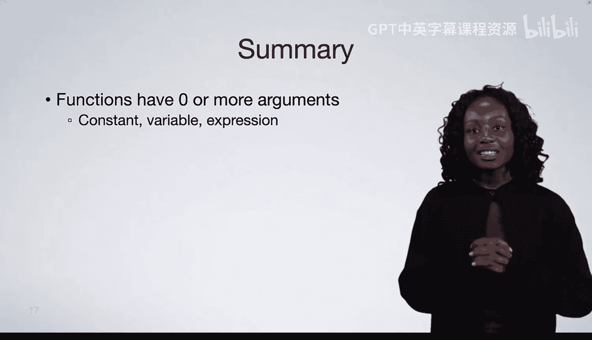

# Python编程实践：随机选择示例


在本节课中，我们将学习如何使用Python生成随机数，并应用这些随机数来做出选择。

## 生成随机选择示例 - 步行与选择衬衫

以下是生成随机选择的一个示例程序，它随机选择数字1或2。如果生成1，则去散步；如果生成2，则不去散步。让我们逐行分析代码。

### 导入random模块

```python
import random
```

代码首先导入random模块，以便可以使用该模块中的函数。

### 生成随机数

```python
walk = random.randint(1, 2)
```

代码调用`random.randint`函数并请求生成一个介于1到2之间的随机数。假设生成了2，则`walk`变量将获得2的值。

### 检查walk的值

```python
if walk == 1:
    pass
else:
    print("No walk today.")
```

代码检查`walk`是否等于1。如果不是，条件为假，执行跳转到第5行并执行`else`部分。这意味着`walk`必须是2，因为它只能为1或2。

### 打印结果

```python
print("No walk today.")
```

`else`部分的主体执行`print`语句，输出"No walk today."。

### 另一个示例 - 选择衬衫

假设你有三件衬衫。1是红色，1是黄色，1是蓝色。你可以决定今天穿哪一件。因此，你想编写一个程序来随机选择其中一件。

### 生成随机数并关联衬衫

```python
choice = random.randint(1, 3)
```

在第一行代码中，变量`shirt`被分配为一个问号。在代码生成一个随机数后，它将重置此变量为你穿的衬衫。在第二行中，代码生成一个介于1到3之间的随机数。假设生成了整数3，则`choice`变量获得3。

### 关联数字与衬衫

```python
if choice == 1:
    shirt = "red"
elif choice == 2:
    shirt = "yellow"
else:
    shirt = "blue"
```

`if`语句用于确定数字与衬衫的关联。如果`choice`是1，则`shirt`被分配为"red"。如果`choice`是2，则`shirt`被分配为"yellow"。如果`choice`是3，则`shirt`被分配为"blue"。

### 打印选择的衬衫

```python
print("We are wearing a", shirt, "shirt.")
```

最后，打印出选择的衬衫。

### 改变问题 - 红色衬衫更受欢迎

假设红色是我的最爱衬衫，所以我希望它比其他两件衬衫被选中的概率更高。我想让红色衬衫被选中的概率是其他两件衬衫的两倍。

### 修改代码

```python
choice = random.randint(1, 4)
if choice == 1 or choice == 2:
    shirt = "red"
elif choice == 3:
    shirt = "yellow"
else:
    shirt = "blue"
```



在第二行中，我们将随机数的范围从1到3更改为1到4。然后，我们将1和2与红色衬衫关联，将3与黄色衬衫关联，将4与蓝色衬衫关联。

### 使用浮点数生成随机数

另一种方法是使用浮点数生成随机数。我们可以生成一个介于0.0到1.0之间的随机浮点数，然后想象一个从0到1的数轴。我们将这些数字分成三个组，并将每种颜色分配给一个组。

### 修改代码

```python
choice = random.random()
if choice < 0.5:
    shirt = "red"
elif choice < 0.75:
    shirt = "yellow"
else:
    shirt = "blue"
```

在第二行中，我们调用`random.random`函数而不是`random.randint`函数来生成一个介于0.0到1.0之间的随机浮点数。然后，我们修改条件，在`if`语句中比较浮点值而不是整数。

## 总结


本节课中，我们一起学习了如何使用Python生成随机数，并应用这些随机数来做出选择。我们学习了如何使用`random.randint`和`random.random`函数生成随机数，以及如何将这些随机数与不同的选项关联起来。我们还学习了如何修改代码以改变不同选项被选中的概率。