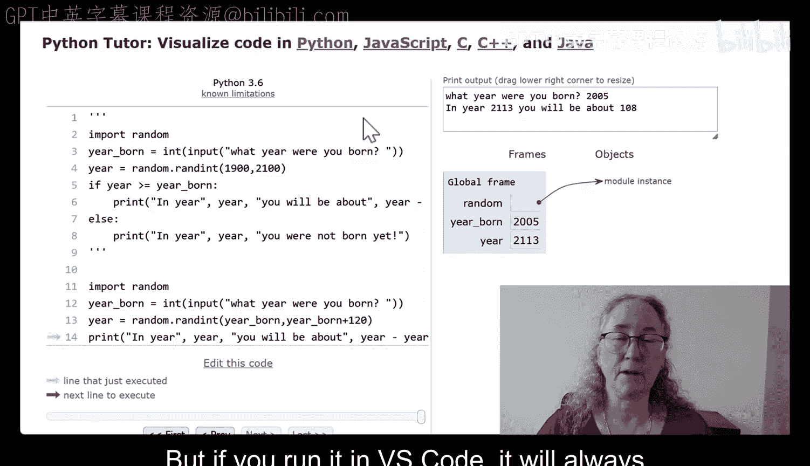
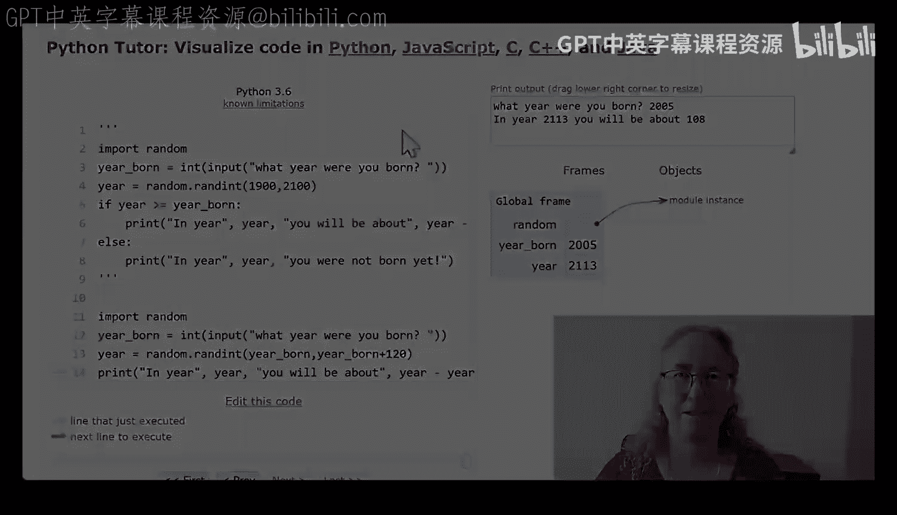

# 杜克大学《Python编程实践｜Practical Python： Start Your Programming Journey》中英字幕 p35 35_03_03_生成随机选择示例-未来年龄演示.zh_en -BV1tTmCBWEQD_p35-

嗯。Hello there， today we will write code to experiment with generating random numbers。

We're going to write our code in Python Tutor so we can see what's happening with our variables。

So first， let's ask a user what year they were born。

Then we're going to generate a random year and tell them how old they will be in that year。

So we need to ask the user what year they were born。

We'll assign the result to the variable year underscore born。Year underscore。Born。

sNow remember all input comes in as a string， so we'll need to convert the result to an int。

 so we'll go ahead and type int。And then we'll get the input。And we need a prompt。

 so we'll say what year were you born？We have to close the other one， okay， so that looks good。

Let's generate a random year between the year 1900 and the year 2100。

 so we're going to need to use the randomant function that's in the random module。

We'll use the variable name year gets。And we'll assign it to random do R it。

And we're going to use the yearss 1900 to 2100。Okay。

Let's run the program to see which year is randomly generated。So visualize execution。And it says。

 what year were you born？Let's say， just suppose I was born in 1940。That's not my real birth year。

Submit。So it says， what year were you born and when we click next？Oh， we have an error。

 it says the error。Is。Name random is not defined， and it looks like the error is on。

Line two or right before line two。So random is not defined。Ah，We forgot to import the random module。

 so let's do that。We'll edit the code。And say import random。And let's try and run it again。

Usual as execution， what year were you born， 1940？Submit。And then we'll go next oh。

We have the same error。That's because。All import statements have to be at the top of the file。

So let's do that。We have to cut and paste this。And put it up here。O。Let's try that now。

Visualize execution。And let's step through。So we'll click next， what year were you born， 1940？Submit。

And then you can see year born is 1940， you can also see over here random is the module instance。

 so we know that's a module。And we click here and it randomly generated the year。1998。

So let's run it again and see what happens remember to run again in Python Tutor you have to go to edit this code and then visualize execution that resets it and if we run it again。

1940 was the year we were born and let's generate a random year。Oh。

 the year generated is the same year。1998。That's kind of strange， isn't it？

Let's try it one more time。Edit code。Let's run it again。Next。Our year born is 1940。

Then we click next。It generated 1998 again now。It turns out when you run a program with random numbers in Python Tutor for a particular range。

 you'll always get the same number to start， and if you call the function more than once。

 you'll always get the same sequence of numbers Python Tutor does that so it makes it easier for you to remove errors from your program。

If you run your program in VS code， you'll get a different number for the first number each time and a different sequence of numbers each time you run it。

Let's copy the last line so we generate two different random numbers。

So we're going to come over here。And we'll generate one number。Copy this。😔。

And then we're going to say yeah， random map， we'll just do it twice and let's see what happens。

 We'll click on visualize execution。And we're going to step through and。

We have to admit what year we were born 1940。And then we generate 1998。And we generate 2094。

 1998 and 2094， let's run it again。Again， edit code。Visualize execution to start it over。We run it。

 we type in 1940。Submit。And the first random number we generate is 1998。The next one is 2094。

So we're getting the same two numbers every single time。

 let's copy this code and show you the code in VS code。

So I'm going to come back over here to the edit and I'm just going to copy and。Copy it there。

 let's go to VS code。And I'm going to copy it here with a control fee is what I'm typing。

Now since we're in VS code。We're going to have to add print statements to see what the values are。

 So I'm going to add right after line 3， a print statement， print。Y is。卡吗？Yeah。

And I'm going to have to add the same ones， so I'm just at it right after line five。Ps。Here is。Comma。

Here。Because we can't see the boxes like we can see them in Python Tutor。Let me run this now。

We're going to click on the arrow here。And it says， what year were you born？1940。Y is 2083 and 1983。

Now let's run it again， we should get different values。Run it again。What year were you born， 1940？😔。

We get 1909 and 1964。 so in VS code， every time you run it， you should get。Different years。

 Now we're back in Python Tutor， and let's delete that extra line where we're generating a random year。

And let's add code to tell the user how old they would be in the random year that's generated。

That's assuming they were born yet。If they weren't born yet， we could note that。

So what we're going to do is we're going to say if。The year。

Is greater than or equal to the year born， that means they've been born yet。

We can print about how old they'll be， so we can say print。In year。Comea year。You were not Oh sorry。

 you will be。 you will be。About。And then we have to calculate their age。

 so that would be year minus year born。Okay， so that looks good and then otherwise we'll put an alt here。

That means they haven't been born yet， so we better tell them that print。In。Year。Ye。

You were not born yet。You were not born yet。Okay， so that looks good， let's run that。

So we'll click through and this year I'll say， let's suppose I was born in 1920。We'll submit that。

What year were you born 1920 and if we clicked through？1998 was a year that was randomly generated。

And it says。In year 1998， you will be about 78。Okay， so let me。I want to fix this。

Let's put an extra blank here， what year were you born wanted a question mark and a blank so we keep we're running up against that。

嗯。Okay。All right， so let's run it one more time just to get different data。So if we run this。

 this time， let's suppose we were born in 2100。And if we submit this。

Let's see what year is randomly generated， we get 1998 again。

And then so that's that same random number every time can help us see how it can help us we can test the if before and after that year。

Let's click next and it says in year 1998， you were not born yet。

 so that's why Python Tutor makes that random number the same every time when you run it。

For that particular range that we've put， which is 1900 to 2100。

Now we can make sure the user is alive in the year that's randomly generated。

We could generate our random number based on their birthday and forward 120 years。So let's do that。

And so you can see your code that we had before， what I'm going to do is I'm going to make a copy of the code。

Just make a copy of it。We'll click here and say copy， that was a right click。

 and then I'm going to come over here and make a copy of the code so you can see the copy。

And then we'll just comment out the code at the top。

This is one way to like while you're experimenting and you want to try some different code or slightly different code。

 you just want to modify it but keep the old code， so what I've done is the code we've done is now commented outline one through nine or just a big comment。

And we can modify the code that's exactly the same， so let's modify the code。

We're going to leave the first two lines the same。 and then for the year。

 we're going to say start with here。The year you were born。

And the second year in the range is going to be the year you were born。Plus 120。

So it'll be somewhere in the future。And then we can say if here is greater than equal to year born。

 it'll tell you how old you are， and we know that you're already going to be born because of the range we pick so we can delete the al part。

Okay。And it actually turns out we don't need the ifF statement anymore because we're already starting with yearborn every time。

 and so we know that it's going to be valid so we could also get rid of the if statement。

And then we can just move this print over。An up one line， So we're asking for a year you were born。

 we're going to generate a random number from that year on through 120 years somewhere in there。

 and then we can tell you about how old you'll be in that random year。So let's run the program。

There we go， we're going to click next。And import random， what year were you born， let's say， 1920？

And we'll submit that。And then we'll keep going， so we're going to say next， we generated 2028。

 and it tells us here in the comment。That you would be about 108 years old in 2028。

Now let's run it again。We go to editit code。Visualize execution。Okay。

 and we're going to run it again。And import random， what year were you born this year， let's put 20。

2005。Submit that， so the year born is 2005， let's generate a random number。

And this year we get a different year and that's because our range was different so whatever year you put it builds a range and since the range is different。

 Python Tutor gives us a different random number every time。And let's finish this off。

 let me put it down here so you can read that。If I clickNext button。

It says in year 2013 you will be about 108。 so that's it for that random example。

 and what we saw is that you can generate random numbers， and in Python Tutor。

 it's always going to give you the same sequence of random numbers for a particular range。

 but if you run it in VS code， it will always generate different random numbers。

 Hope you enjoyed that。

