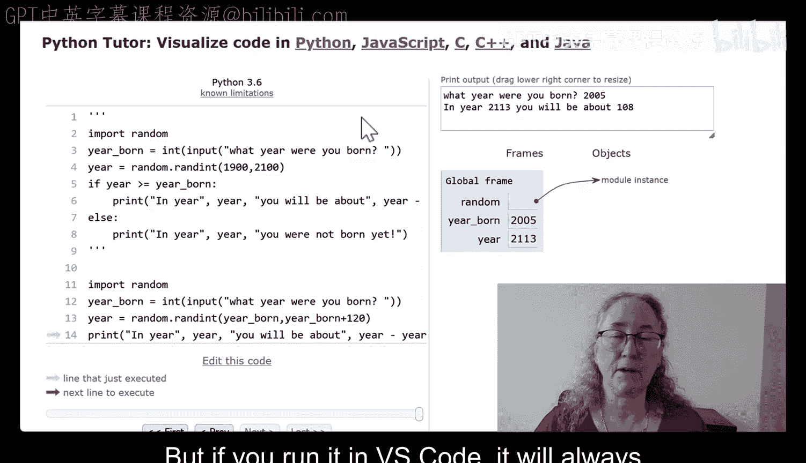
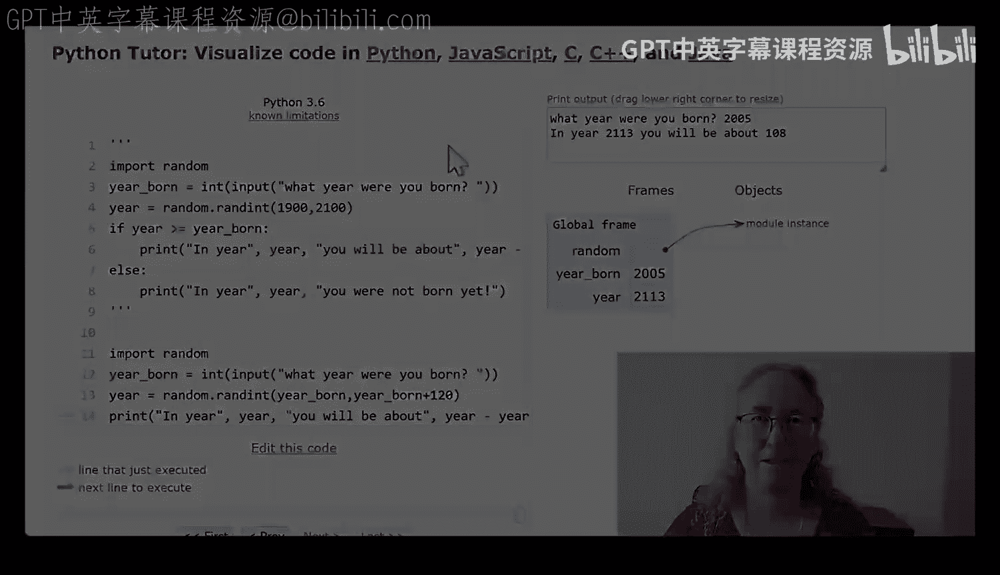

# Python编程实践：生成随机选择示例


## 概述

在本节课中，我们将学习如何使用Python生成随机数，并探索其在计算中的应用。

## 1. 用户输入出生年份

首先，我们需要从用户那里获取出生年份。

```python
year_born = int(input("What year were you born? "))
```

**公式**：`year_born = int(input(prompt))`

## 2. 生成随机年份

接下来，我们将生成一个介于1900年至2100年之间的随机年份。

```python
import random

year_generated = random.randint(1900, 2100)
```

**公式**：`year_generated = random.randint(a, b)`

## 3. 运行程序并处理错误

尝试运行程序，可能会遇到错误，例如未定义的`random`模块。

```python
# 错误示例
year_generated = random.doRit()
```

**错误处理**：确保在代码顶部导入`random`模块。

```python
import random
```

## 4. 使用Python Tutor可视化执行

在Python Tutor中运行程序，可以更直观地看到变量的变化。

```python
# Python Tutor可视化执行
```

## 5. 生成多个随机数

复制并修改代码，生成两个不同的随机数。

```python
# 生成两个随机数
year_generated1 = random.randint(1900, 2100)
year_generated2 = random.randint(1900, 2100)
```

## 6. 在VS Code中运行程序

在VS Code中运行程序，每次运行都会得到不同的随机数。

```python
# VS Code运行程序
print(year_generated1)
print(year_generated2)
```

## 7. 计算用户在随机年份的年龄

添加代码，计算用户在随机年份的年龄。

```python
if year_generated >= year_born:
    age = year_generated - year_born
    print(f"In year {year_generated}, you will be about {age}.")
else:
    print(f"In year {year_generated}, you were not born yet.")
```

## 总结





本节课中，我们一起学习了如何使用Python生成随机数，并探索其在计算中的应用。希望您喜欢这个示例！