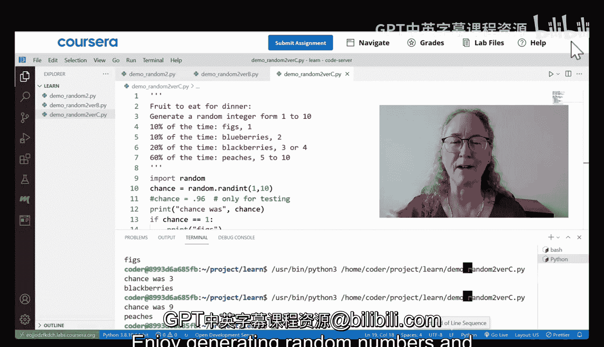

# 杜克大学《Python编程实践｜Practical Python： Start Your Programming Journey》中英字幕 p36 36_03_04_生成随机选择示例-选择水果演示.zh_en -BV1tTmCBWEQD_p36-

Let's now look at another example using random numbers。

We'll start a new file in Python Tutor and I want to write a program to tell me which fruit to eat with my dinner。

Now as I describe the fruit， I'm going to add a comet in Python tutor and for a big comet。

 what we'll use is we'll use three single quotes twice and put the comet inside that。

So we'll say this is fruit to eat for dinner。I really like peaches。

 so 60% of the time I want peaches， 60% of the time。Paches。Then less often。

 but about 10% of the time， I want blueberries。10% of the time。Blueberries。

20% of the time I want Blackberries。And about 10% of the time I want figs。So that is one big comment。

We could generate a random float number from 0。0 to 1。

0 and then break that down to these percentages。So before we do that。

 let's write down which numbers will be associated with each fruit。So for peaches。

 let's associate from 0。0 to 0。6， we'll just add it right here in the comments， so 0。0 to 0。6。

 that's 60% of the time from 0 to1。So for blueberries， that's 10% of the time。

 we want to start from the 0。6 and go another 10%， so that'll go to 0。7， that's 10% of the time。

Blackberries are 20% of the time。So we're going to go from- we're basically associating 0。7。

 the numbers in that range to 0。9， that's 20% of the numbers are being associated with let's eat blackberries。

And then finally， let's associate with Figs， that's the last 10%， so that's going to go from 0。

9 to 1。0。That is about 10% of the numbers will be associated with figs。

So let's start conning this up。The first thing we need to do for the code。

 which is after the comment。Is we need to generate a random number， so let's enter in import random。

Just to import the module， and then we can call the random function and print the number generated。

So we need a variable， let's say chance is going to be the random number we generate。

 we just say random dot random。You have to remember the parentheses。

 that will generate a random number between 0 and 1。0， and then we can print it out print。

Chance is or was。Chance that way we can see what the number is。

Now I need to add one if statement to consider all these cases。

 so we have all these cases of which fruits， we have a random number。And so we'll say if。

Chance is less than 0。6 now that's 60% of the numbers because the numbers are from 0 to 1。

 and so if chance is less than 0。6， we know that we want peaches so we can just print peaches。

Now we can say LF。Chance is less than 0。7。Now remember， if the number was less than 0。6。

 the if statement was true and were done。But if we get to line 13， that means line 11 was not true。

 So we could just say if it's less than 07 because。Everything from 0 to00。0 to 0。

6 was sort of already taken care of that is。It wasn't that if we're actually on line 13 and checking line 13。

So we can go ahead and say if chance is less than 0。7。Print blueberries。LF chance is less than 0。9。

That would be essentially numbers from 0。7 to 0。9， then we can print blackberries。And otherwise。

 we know that it would have to be fix， but we could also write LF。Chance is less than or equal to。1。

0。Then we know to print figs。And then we could always just say。呃。For this line here。😔，Else。

We could just say， hey， we' never supposed to get here。

So we'll say should never get here because we know the number that we generate is between 0。0 and 1。

0。 So one of these cases should happen。Before we get to the elsets。 So we don't really need the alts。

 But I like to put it there in case I messed up somehow。 So instead。

 we could get rid of theelts and make the last elephant andels to take care of the last 10%。

 That would also be fine。I'm going to go ahead and run this and let's see what fruit we get。

So if we do visualize execution。We have to scroll down here and we get import random。

We get our variable here， random。Our module this is just showing that random is our module。

 We have the module， so now we can generate random numbers。

And then we need to scroll here and we say next， we get chance， so we got a number， it's 0。844422。

And if we step through here， we say， hey， is Ch lesson 0。6。 No， is it lesson 0。7。 No。

 is it less than 0。9， Yes， so we're going to print blackberries and you can see up here that we picked blackberries。

 and this is nice that we printed out the random number so we can verify that yes。

 this is what the number was and we got the right thing。 We got blackberries because the number。

That was randomly generated is between 0。7 and 0。9。Now。

Let's run the code again so we click Edit this code and then visualize execution to reset it。

And if we run it again。😊，We'll click next， next， import random， generated random number。

 we get the same random number because Python tutor。

Its just an environment to test things and see what's happening。

 and so it generates the same random number for each range every single time。So。

We could keep running this， but we know what we're going to get。

 we're going to get blackberries because 0。84 is the range for blackberries so what we could do instead so that we can actually test all the cases in our if statement。

Is we can edit the code for now。And we could put after we generate the random number。

 we could instead say。Chance equals。053 and just put a little note here that this is only for testing。

So the reason I'm doing that is I just want to be able to check peaches to see if peaches works right so if I can get to that。

Case in my if statement， which will generate peaches。

So if I visualize execution and I come down here and run it。

 I need to get all the way down here next。Next。Generate random。Next。All right，Let's see。

We have chances 0。84， but we're going to do line 10 now and change it to 0。53 and you can see。

Now chance is 0。53 and then we check it and we get 0。6 and we're going to print peaches this time。

So that's just a way we could go back and change it to a number to check。

We'll just do that let's see S we want to check。Sa。96。And at this code。

 we could just go here and force the chance to be 0。96 and then when we run it。

We'll just come through here。And we'll just we can actually just go all the way through and run it and we can see chance 0。

96 was generated and Figs works so that again this line 10 is just for testing and then eventually we would take it out of our program。

We could also run this code in VS code， so let's do that。

I'm going to go to edit this code to copy the code。So that we can put it in VS code。

And we'll go here。And we'll just I'm doing C V to get the code to appear。

And let's actually just run it to make sure it works here。

So we'll just run it and we get chance was 0。96， we got figs。

 let's run it again and we got chance was 0。96 now that's because we have this line 10 that says chance is always 0。

96 even though we generated random number on line 9 we reset it we can get rid of this line because we don't need it so much here or we can just comment it out so it's still there we'll just put a pound sign in front of it and now this line is a comment。

Now let's run it and see what happens。We get 0。19， that's peaches， we run it again， we get 0。32。

 that's peaches。We get 0。75， that's Blackberries。We get 0。092， which is peaches， 0。027 is peaches， 0。

98 is fake， so you can see every time you run it in VS code。

 it's going to generate a different random number for you。Now。

I also want to look at other solutions because this is not the only solution that we could do for one thing we could put the code in a different order。

 we just have to be careful to make sure we have the correct number ranges for each fruit so let's try that。

And I think what we'll do is。Let's just make a different copy of it。That would be easiest。

 so I'm going to come over here and just say copy demoandum2， make a copy of this。

And then I'm just going to come back over here and say paste。And it's called copy。

I'm going to rename it。Renamee it。How about we'll say demo2？version。B。

Is it just another version of it？Okay。Let's change the comment first。

 So we're going to do figs 10% of the time first。 So I'm just going to。Copy this and put it up here。

And then we'll do blueberries and blackberries， so I'm going to copy the peaches and remove that and get rid of that line and I'll move that down here。

Okay， so now we just need to fix these numbers， so 10% of the time is figs。

 so that's going to be from 0。0。To 0。1。That's still 10% of the numbers。

Blueberries are also 10% of the numbers， so that would be now from 0。1。To 0。2。

And then blackberries are going to be from02， this is 20% of the time up to 0。4。

And then peaches would be the rest of the numbers， so 0。4 to 1。0。This is again。

 just to show you that the order doesn't really matter。

 you just have to decide what order you want to put them in。

 and then the code has to match that order。We have to have the correct number ranges like blueberries gets 10%。

 so we have to make sure they only have 10% of the numbers that are random and peaches get 60%。

 so we just have to make sure that number range is going to cover 60%。

So how would we fix the code for this， we'd say if chance is less than 0。1， it would now be figs。

If it's less than 02。It would still be blueberries。If it's less than 0。4， it would be 0。4。

 it would be blackberries， and if it's less than one， it would now be peaches。Okay。

 so the code is slightly different， but it should still work。And we'll just run it to double check。

Let's run the code。We get。Peachaches， the chance is 0。

99 so we get peaches because it's in the range from 0。4 to 1。0。 let's run it again and we get。嗯。

56 is still peaches， that's good， anything above  point。4 peaches。We run at 0。7 his peaches。

54 is peaches a finally we get 0。12 and that is the correct range for blueberries。

So that seems to work well。Now I want to run it one more time in and show you one more way to solve the problem。

 I want to show you we could use integers to generate。A number from 1 to 10。

 and then use the integers， the range of the integers to break it down， so let's do that。

I'm going to copy this again， just copy this code we just did。Copy the code。

And we're going to paste it in here。And we'll call this version 3 or version C。Let's see。

We're going to rename the code。To hear。Click in here and we'll change the word copy。

 it always adds the word copy。I'll get rid of the word copy and changes this di version C。嗯。

That should be good。So now we're working notice we have three tabs， random2， random two version B。

 and random two version C， so make sure you're in the right tab when you modify it。

So let's modify the comment first， so we have fruit to eat。 we want 10% of the time for figs。

 and this time we're generating number from1 to 10。Okay， so。The figs would be。Numbers from1。To2。

 sorry， zero， let's start at  zero。From oh no， wait， we're starting at one。 That's right。

 We're starting at one。Maybe we should add a note up here also that would be helpful that we are just going to say fruit to dinner。

 we could just say generate a random integer。From one to 10。

So now 10% of time we have fix and so if it's just the number one。It's good。

10% of the time it's blueber， so that would just be the integer too。

And 20% of the time it's Blackberries， so that would be the number three or four。

And then 60% of the time it would be peaches， so that would be the numbers five2 10。

So this is just another way of thinking instead of using。Random。Numbers that are decimals。

 We're going to use。Integers。Nowao。That's the idea。60% of the time from  five to 1。

 that's 60% of the integers so that works。We have to modify the code now。

So here we're just going to say figs is when it's the number one。

 so we generate oh we also have changed the random int right。

 so this is now going to be random dot R int。From one to 10。

We're still going to print Ch out so we know what integer it is。

And then figs is just going to be hey if chance equals one。Chance equals one。

 then we know it's fixed。And for blueberries， it's just one number， it's two。

 so let's change this to two equals2。For blackberries， it's either two。 It's3 or 4。

We could do that a couple of different ways， we could just say if chance equals three。

Or chance equals four， that would be fine。We'd print blackberries and otherwise。

We're going to say it has to be peaches， right， it has to be peaches。We could just say LF chance is。

We could just say less than or equal to 10 would be one way we could say that we'd print peaches。

So we're either going to be one， two， three， four， or less than equal to 10。

Let's try the code to see if it works。We'll run it。And we get chance was three， that's blackberries。

 that's good。Chance was two。That's blueberries， that's good。Chance was six， that's peaches。

Chance was one， that's figs。 that works good。 when at one more time we get three is blackberries。

Nine is peaches， so this looks like it's running well。So again， what did we do here？

We just changed the number from instead of generating decimal numbers from 0 to1。

 we decided we would generate a random integer from  one to 10。

 and then we just converted it to adjust just。How each one would be appropriated。In summary。

 be sure to import random， be sure to save the random number generated in a variable so it can be printed and compared。

And be aware that if you run your code in Python Tutor。

 you'll get the same sequence of random numbers for a particular range Python Tutor is an environment designed to help you trace through your code。

 it's easier to trace through your code if it generates the same random number for a particular range。

 but Python Tutor is not really meant to be a place to write all your programs。

Enjoy generating random numbers and having more interesting programs。

