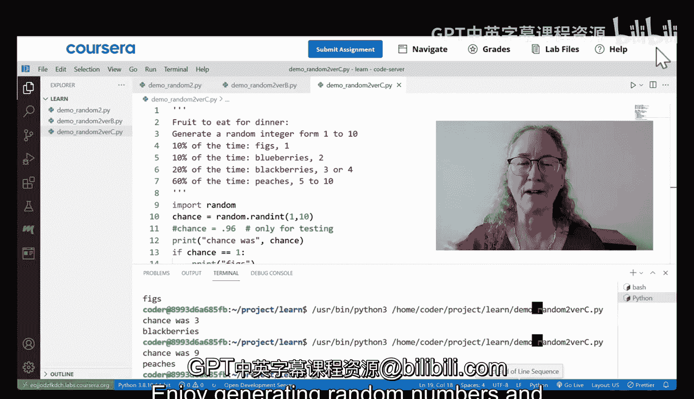

# Python编程实践：使用随机数选择水果


在本节课中，我们将学习如何使用Python中的随机数模块来选择晚餐时应该吃的水果。

## 1. 问题背景

假设我们想要根据概率选择晚餐时应该吃的水果。例如，我们可能想要60%的时间吃桃子，10%的时间吃蓝莓，20%的时间吃黑莓，以及10%的时间吃无花果。

## 2. 解决方案

为了实现这个功能，我们可以使用Python的`random`模块来生成一个随机浮点数，并根据这个随机数选择相应的水果。

### 2.1 使用浮点数

1. **定义概率范围**：首先，我们需要定义每个水果的概率范围。例如，桃子的概率范围是0.0到0.6，蓝莓的概率范围是0.6到0.7，黑莓的概率范围是0.7到0.9，无花果的概率范围是0.9到1.0。

2. **生成随机浮点数**：使用`random.random()`函数生成一个0.0到1.0之间的随机浮点数。

3. **判断水果**：根据生成的随机浮点数，判断应该选择哪种水果。

### 2.2 使用整数

除了使用浮点数，我们还可以使用整数来生成随机数，并根据这个整数选择水果。

1. **定义概率范围**：与浮点数方法类似，我们需要定义每个水果的概率范围。例如，无花果的概率范围是1到2，蓝莓的概率范围是2到3，黑莓的概率范围是3到4，桃子的概率范围是5到10。

2. **生成随机整数**：使用`random.randint(a, b)`函数生成一个a到b之间的随机整数。

3. **判断水果**：根据生成的随机整数，判断应该选择哪种水果。

## 3. 代码示例

以下是一个使用浮点数方法的代码示例：

```python
import random

# 定义概率范围
peach_range = (0.0, 0.6)
blueberry_range = (0.6, 0.7)
blackberry_range = (0.7, 0.9)
fig_range = (0.9, 1.0)

# 生成随机浮点数
chance = random.random()

# 判断水果
if chance < peach_range[0]:
    fruit = "桃子"
elif chance < peach_range[1]:
    fruit = "蓝莓"
elif chance < blueberry_range[1]:
    fruit = "黑莓"
else:
    fruit = "无花果"

print(f"晚餐时应该吃{fruit}")
```

以下是一个使用整数方法的代码示例：

```python
import random

# 定义概率范围
fig_range = (1, 2)
blueberry_range = (2, 3)
blackberry_range = (3, 4)
peach_range = (5, 10)

# 生成随机整数
chance = random.randint(1, 10)

# 判断水果
if chance <= fig_range[1]:
    fruit = "无花果"
elif chance <= blueberry_range[1]:
    fruit = "蓝莓"
elif chance <= blackberry_range[1]:
    fruit = "黑莓"
else:
    fruit = "桃子"

print(f"晚餐时应该吃{fruit}")
```

## 4. 总结



本节课中，我们学习了如何使用Python中的随机数模块来选择晚餐时应该吃的水果。我们介绍了两种方法：使用浮点数和使用整数。通过学习这些方法，你可以更好地理解Python中的随机数生成和概率计算。