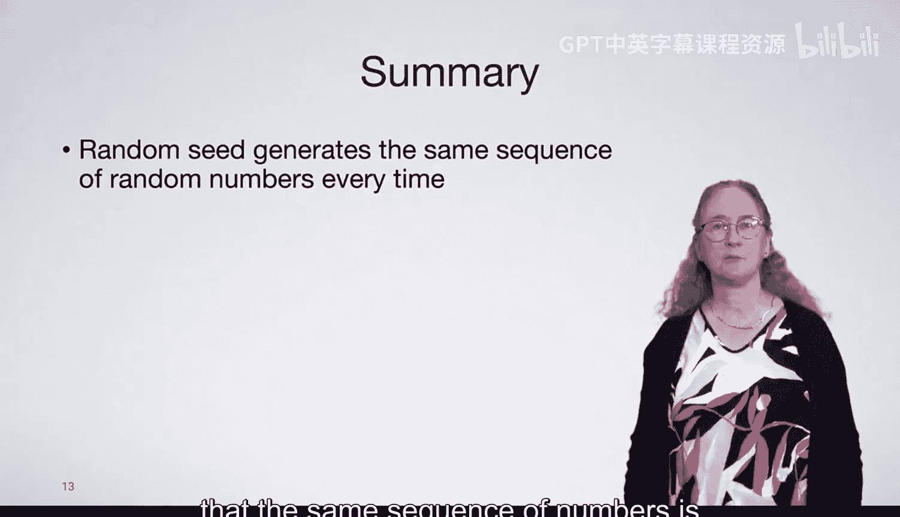

# 杜克大学《Python编程实践｜Practical Python： Start Your Programming Journey》中英字幕 p37 37_03_05_随机数是如何生成的.zh_en -BV1tTmCBWEQD_p37-

Now that you have seen how you can generate random numbers to use in Python。

 let's talk about how Python actually generates them。 First。

 it is not possible for a computer to generate truly random numbers。Instead。

 Python generates pseudorandom numbers。That means they look like they are random。

 but they actually aren't。We get random numbers by following a series of steps。

 These steps generate a sequence of numbers， that look random。Now， before we go on。

 I want to introduce an important term。When we want to solve a problem like this one。

 we describe the steps in solving the problem。The series of steps in solving a problem is called an algorithm。

An algorithm is like a recipe。 You typically have to follow the steps exactly。

 or the algorithm may not work correctly。 For example， Sose I want to make a blackberry pie。

I need to know the following。What are all the ingredients。

What are the measurements for each ingredient。Getting the right measurements is important。

Heres a blackberry pie I assembled， and baked。If I put too much of a liquid ingredient in。

 the blackberry pie may be too runny。I' love to eat blackberries and tend to put too many blackberries in。

In this baked pie， you can see the pie overran on one side。Regardless。

 the pie still tasted pretty good。The order of the steps in an algorithm or recipe can also be important。

 If I put the ingredients into the pie in the wrong order， the flour could be really lumpy。

 and some one might get a bite of a big chunk of flour。 That wouldn't taste good。😊，Fun fact。

 Where does the name algorithm come from， It comes from a 9th century Persian mathematician named Mohammed In Muza Al Wrazami。

He was born a long time ago in the year 780 and is known as the founder of algebra。

He also wrote a book called Book of Indian Computation， which is about arithmetic， and in particular。

 focuses on algorithms using decimal numbers。 Now， you may be wondering。

 how did the name algorithms come from him？ Well， it turns out his Latinized name is Algritme。

 And from there we get algorithm。😊，Now， let's go back to how random numbers are generated when a program runs。

 Let's see a possible algorithm for how a series of random numbers might be generated。

Our goal is to generate a random number that lies within a specific range of numbers。

 like picking a random number from 0 through 10。The algorithm will take the starting number called the seed and transform it to make sure it stays within that specified range。

 You can choose any number for the starting number or seed。

Your algorithm will let you decide on three other numbers。 We will call these number variables， A。

 B and C。Then the algorithm will apply arithmetic operations， such as multiplication。

 addition and modulus to these four numbers， resulting in the first generated random number。

 For example， the algorithm might be the arithmetic expression that the new number is the variable A times the starting number plus the variable B and then modulus。

 that whole expression with the variable C。😊，That would result in the first random number。

We just want to note that the starting number is the seed the first time the algorithm is run to generate the first random number。

To generate the second random number， you use the first random number generated as the starting number and use the same variables and arithmetic expression。

 That results in the second random number。You can continue to repeat this algorithm to generate as many random numbers as you like。

You always use the last random number generated as the starting number。

 applying the same algorithm to produce the next random number。

So to generate a sequence of random numbers， generate the first random number using the seed as the starting number。

 then generate the second random number using the first random number as the starting number。

Generate the third random number using the second random number as the starting number and so on。

Let's see an example with numbers。Let's generate a sequence of random numbers that are in the range from 1 to 25。

First， you pick values for your variables。 I chose 13 for a and 7 for B。

Since C is used with a modulus or mod operator， we will use C equal to 25。

 So our final number will be in the range from 0 to 24。That is how mod works。

 We can then add one to the final number to force the range of the final number to be from 1 to 25。

We also pick a number for the seed or starting number。 I picked 93。Note that A。

 B And C could be any number， but some numbers might work better than others for the algorithm。

Here's the arithmetic expression。 Again。 Our random number is formed by multiplying a times the starting number。

 adding B and modding everything by C。In addition， we will add one to shift the final number to be between 1 and 25。

Here， I have plugged in the values of the variables and the starting number。

 Let's calculate the value now。We multiply 13 times 93 and get 1，209。Next。

 we add 1209 with 7 and get 1216。Next， we mod 1216 with 25， and we get 16。

 Our last step is to add one， and we get 17，17 is our first generated random number。😊，Now。

 let's use the same algorithm to generate a second random number。

 We will use the same values for variables。 Instead of using the seed。

 we will use the random number we generated，17 as the starting number in the expression。

Here's the arithmetic expression again。 And I've already placed 17 where the starting number was。

Here， I have filled in the values of the variables。Let's go ahead and calculate 13 times 17 is 221。

Then 221 plus 7 is 228。Then 228， modd 25 is 3。We add one to3 to shift the final number。

 and the second random number generated is 4。If we apply this algorithm again。

 using4 in place with the seed。The third random number generated is 10。

And the fourth random number generated is 13。That is one algorithm that could possibly be used to generate pseudoran numbers。

 Now， Python probably uses a slightly different algorithm。

But you now know the idea of how pseudorandom numbers are generated by a computer。

There is a way in Python that you can set a random seed so that the sequence of random numbers generated is always the same。

That might be useful for you to do while you are developing your program。To set a random seed。

 you of course， need to use the random module and import random at the top of your program。

The random module has a function named seed that takes one argument that is a number I'm calling numb。

The number you put in the parentheses will determine the sequence of numbers。

The number argument can be either an integer or a float。

Your program calls random seed with a number in the parentheses that will set the starting seed。

This function is a little different than what you have seen before。

 as the function does not evaluate to any value。 So there is no value you can assign to a variable。

 Your program just calls the function， random dot seed。

And when your program starts generating random numbers。

 the random module will use the seed your program told it to use。

If your program doesn't call random dot seed， then Python uses something like the current date and time to automatically build a number to use as the seed。

That way， the seatd is always different since every time you run your program。

 the date and time have changed。Let's look at some sample code that uses a random scened。

Here we are deciding if we should take a walk or not。We will generate the random number one or two。

If we generate the random number one， we will take a walk， and if we generate the number two。

 we will not take a walk today。On line one， we import the random module。On line，2。

 we set the seed in random to be 6734。Noe， we just call random dot seed。

 We do not try to set the result of calling random dot seed to a variable because there is no value。

On line 3， the code calls random dot Rand int to generate the number one or two。

And places the number generated in the variable walk。

Suppose the random seed 6734 results in the number one being randomly generated。On line4。

 we see that walk equal to one is true。So the code next executes line 5 and prints go for a walk。

The if statement is finished， so the next line of code executed would be the line of code after line 7。

Now， note， because we have set the seed to the number 6734。

The random number that is generated will always be one， meaning that this code will always prep。

 Go for a walk。No matter how many times we run this code， it will always pret。

 go for a walk because setting the seed to that number leads to Rand in always generating one。

So why should you use a random seat？While you are developing your code。

 the random seed will allow you to control the sequence of numbers that is generated so that they are always the same。

 That can make it easier to debug your code。Once you have your program working。

 you can remove or comment out the line for random dot seed。

 and then your program will have different random numbers every time it is run。One note， though。

Python Tutor is a tool to help you learn Python。The developers of Python Tudtor decided it would be easier for people trying to understand their code if Python tudtorors set a seed automatically。

 so the code would generate the same sequence of random numbers every time the code is executed。

So you don't get different random numbers every time you run code in Python Tutor。

But when you run code and V S code， you will get different random numbers every time you run your code。

 unless you set a seat， let's learn about someone who has done work related to random numbers。

 I want to highlight Dana Moskoitz。 She is a computer scientist and mathematician from Israel。

 who's currently a professor of computer science at the University of Texas in the United States。😊。

She does research on pseudo random numbers， creating algorithms to try to make the numbers that are generated more random like her algorithms work a lot better than the simple algorithm we looked at to generate random numbers。

😊，Dana Moskoitz has won lots of awards for her research。

 including the 2009 Hyim Nash Prize for the best theoretical Comp Science dissertation in Israel。

 She is amazing。😊，Now， let me summarize what we have learned about random numbers and seats。

We learned how random numbers are generated and that a different sequence of random numbers is generated every time you run your program。

We also learn that you can set a random seed so that the same sequence of numbers is generated every time your program runs。

To set a seed， you call the function random dot seed and put a number in the parentheses。

That number can be either an integer or a float。The random dot seed function is a little different。

 and that the function does not evaluate to any value when you call this function。

Here is some sample code。First， call Im random to access the random module。On line，2。

 call random dot seed with some number Here。 I use 485。Noe。

 there is no assignment operator to the left of this function。

 as the function random dot seed does not evaluate to any value。On line 3。

 we generate a random integer from 5 to 10。 and on line 4。

 we generate a second random number from 0 to 1。0。Notice that lines 3 and 4 do have the assignment operator as X and Y both are assigned a random number。

Because we used a seed， both X and Y will be assigned the same numbers every time this code is run。

Now you know how to generate random numbers and how to make the sequence of random numbers the same if you choose to when you are debugging your program。

Happy programming。

