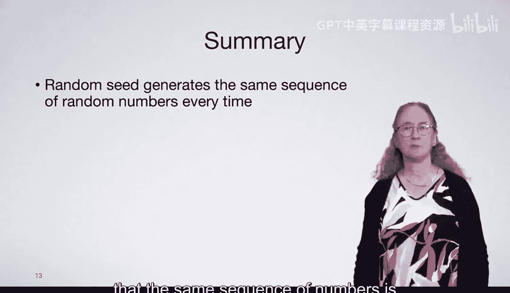

# Python编程实践：随机数生成方法


在本节课中，我们将学习如何在Python中生成随机数，并了解随机数生成的原理。

## 随机数生成原理

1. **随机数与伪随机数**：计算机无法生成真正的随机数，Python生成的是伪随机数。这些数看起来是随机的，但实际上是通过一系列步骤生成的。
2. **算法**：生成随机数的步骤称为算法，类似于食谱，需要严格按照步骤进行。
3. **算法示例**：一个简单的算法示例是将起始数（种子）与三个变量A、B、C进行算术运算，如乘法、加法和取模运算，以生成随机数。

## 伪随机数生成算法

以下是一个简单的伪随机数生成算法示例：

```python
def generate_random_number(seed, A, B, C):
    new_number = (A * seed + B) % C
    return new_number + 1
```

其中，`seed`是起始数，`A`、`B`、`C`是算法中的变量。

## 设置随机种子

在Python中，可以使用`random.seed()`函数设置随机种子，以控制随机数生成的序列。

```python
import random

random.seed(123)
print(random.randint(1, 10))
```

在上面的代码中，我们设置了随机种子为123，因此每次运行代码时都会生成相同的随机数序列。



## 总结


本节课中，我们学习了如何在Python中生成随机数，并了解了随机数生成的原理。我们还学习了如何设置随机种子，以控制随机数生成的序列。希望这些知识能帮助你在编程中更好地使用随机数。