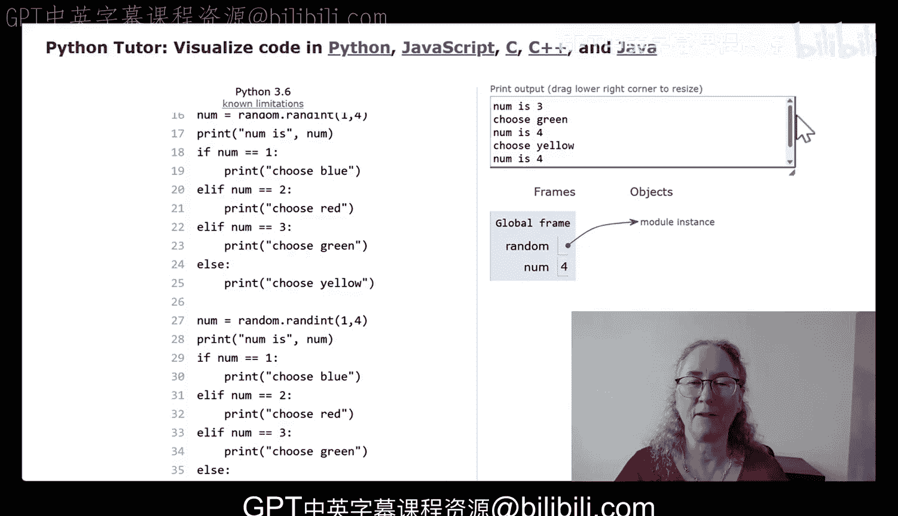

# 杜克大学《Python编程实践｜Practical Python： Start Your Programming Journey》中英字幕 p38 38_03_06_使用随机种子的随机数演示.zh_en -BV1tTmCBWEQD_p38-

Let's look at some example code to see how setting a random seed affects a program when we run it。

We'll write code to choose a random color from the colors， blue， red， green and yellow。

 each being equally likely， since we're picking one of four choices。

 we'll generate an integer from one to4 and associate each of the four colors with one of the numbers。

We're going to run this in VS code， and first we're going to need to import the random module。

Import random。So we can generate the random numbers。

 and then let's go ahead and generate a random number。 We'll just say nu gets。Random。Dt。Randantt。

And it's。And then we'll go ahead and print the number so we can see what it is。Noum is。No。

Then what we're going to do next is we need to look at the nus value and decide like which color is it going to be？

Which colors associated。 And we're just going to pick a different one。 So， for example。

 we can say if nu equals one， we can just associate that with blue。 So we'll just say prints。嗯。

Choose blue。And then we can say if the nu。Is equal to two， we'll just pick a different color。

Let's say we say choose。Red。😔，And then if the number is three， again， we'll pick another color。

The sun will put green。And then finally， we'll just say otherwise it has to be。The last color。

 and we'll just say that's yellow。Choose yellow now I forgot to do something。

In the Rand int part up here。I need to say what is my range for random integers and that's going to be from one to four。

 so let's put that in there and so we're going to generate one of the numbers from one to4 and then depending on which number we get we've associated each number with a different color。

Okay， so let's run the program and see what happens， I'm going to run it now。Numbs four。

 we choose yellow， that's good。Let's run it again， no2， we choose red。N as4， we choose yellow。

Numbers two， we choose red。We're getting two and four a lot。That's interesting。 there we go， N is 3。

 we choose green。Now you can see every time we run it， we get a different number and color。

Every time。So let's now change the program a little bit。

Let's make two copies of generating the random number and the if statement so that we'll do it three times。

 that is we'll generate three random numbers and thus three random colors。 so I'm going to grab。

All of this from line 2， all the way to line 11， I'm going to right click and copy it。

And then I'm going to make。Let's see it come over here and I'll control V is printing all of that again。

We'll do it one more time there。Okay， so let me just show you the code。We're going to import random。

 we're going to generate one random number and print what it is with its associated color。

 and then on lines 13 here， we just copy it again， we generate another random number and print its type and then generate a third random number and print its type。

So let's run it and see what happens。We click on this and we can see we generated the numbers one。

 two， and one， so we chose the colors blue， red and blue。We can run it again。We got numbers is3。

 numbers is4 and numbers three， so it seems to be working and it's generating different numbers each time we're at one more time just to see that we got two。

 two， and  three， so every time we run it it generates different numbers。

Let's see what happens now when we add a random seed。

 we're going to do that at the top of the file right after import random， so let's go back up there。

So right after line1， we're now going to say。Random do seed and we can put anything we want to inside the parenthees。

 I'm just going to put 872 it just needs some number to get started。

Let's run the code now and see what happens。If we run it， we get。4，2， four or yellow， red， yellow。

 let's run it again。We get42 four， yellow， red， yellow， let's run it one more time。

Do you see what's happening？We get 424， so what the random C does is it forces it to do the same sequence every time。

And that's going to be helpful if we're trying to debug our program。

Now we can change the random seed and let's do that。

 we'll come back up here to line 2 instead of 872。Let's use a different number。

 in fact I'm just going to copy this line so you can see what we used the first time。

And I'm just going to generate it again。 And we'll just come and outline too。

 That's what we use the first time。 Just so you can see it again。 We're going to change this number。

 We can put any number here。 How about we put。2023。

456 so that's a float and again it could be any number。

 so this time when we br it we should get a different sequence of random numbers and colors。

But if we run it multiple times， we should get the same ones。 So let's try that。

 I'm going to click here and we get 2，4，4， red， yellow， yellow。Again， we get 24，4， red yellow yellow。

So every time we run it， we just get a different sequence。Now。

 let's see what happens when we run this code in Python Tutor。

 it's going to be a little bit different， so I'm going to grab all the code here。From there。

 all the way to the end， I'm going to cut。Or copy this， copy it。

Go to an empty Python tutor I have right here， and I'm going to paste this here。

There's the same code。And let's run the code to see what happens。

We have to go all the way down here to visualize execution。And then we'll run the code。

And what I can do is I can just go all the way down here and just click last so it runs all the code and we'll see what happened up here。

It picked red。Yellow， yellow， so 2，4，4， red， yellow， yellow。Red， yellow， yellow。Let's try it again。

Would you come down here？If we click， oh we have to go back to edit this code。

And then we have to go to visualize execution to run it again。

And then we can just run it all the way if we click last。And we get the same thing。Red yellow。

 yellow。So it's the same thing every time you run it。Nowo。

You can see the program generates the same sequence of random numbers every time it runs and that's because Python Tutor automatically sets the seat。

But it does so behind the scenes。 So you can't see it。

 Python Tutor does that because its purpose is to help you learn code。

 Let's now come out the seed and run the program a few times。 So we'll go back to where the seed was。

We're just gonna。We have to go to。Edit the code。And we're just going to comment out so there's no random seed。

 there's okay， no random seed anymore， it's just import random。

 generate random numbers and print what they are。And let's run this。

And we can just run it fast to see what happens。You have to go down to the bottom and click last。

And let's see what we get we get。Yellow， yellow， blue。Okay， yellow， yellow blue， let's run it again。

So again， we come down here and we say editit this code。And then we pick visualized execution。

And if we run it again。Just click last。We get yellow， yellow blue。

And so you can run it as many times as you want， but you're always going to get yellow， yellow blue。

 which is the same as 441 for the numbers。So you can see the program generating the same sequence of random numbers every time the code runs。

 and that's because Python Tutor automatically sets a seed。

 but it does so behind the scenes so you can't see it。

And Python Tutor does that because its purpose is to help you learn code。

 and they thought it would be easier to learn if the random numbers were the same each time Now。

 was that a good idea maybe， but as the designers of the program， they got to choose。However。

 you can set a seed in Python tudtor and get different random numbers with each different seed。

 and we saw that a minute ago， but let's try it again。We can come back here。To edit this code。

And we can set a different seed。Let's set another seed。

 we'll just change let's create a new seed here。We can pick any seed we want。

So let's say 371 this time。And so now we should get a different set of values。Let's run this code。

Visualize execution， and then we'll come down here。And run it。

 go to last and now you can see what did we get， we got three， four， four。So green， yellow， yellow。

 we can run it again， we should get the same numbers because we set a seed， let's try that。

 edit this code。Visualize execution。And then if we run it。Again， we get。The same numbers。3，4，4 green。

 yellow yellow。 So with this seed， you get a different sequence of random numbers。

 but the same numbers every time it runs。 So now you know how to generate random numbers and how to force random numbers to be the same sequence by using a seed before generating the random numbers。

 You also know that Python Tutor is an exception and uses an automatic seed when it runs any code with random numbers。

This will likely be useful when you are debugging your code or checking to make sure it does what you want it to do。

 Have fun generating random numbers。

