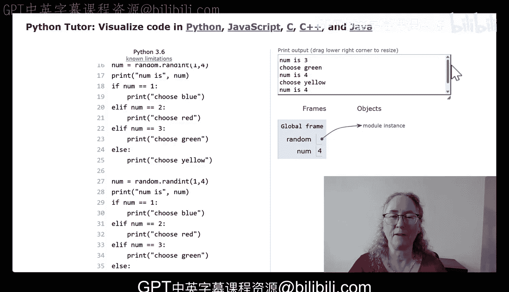

# Python编程实践：使用随机种子生成随机数


在本节课中，我们将学习如何使用随机种子来生成可预测的随机数序列。

## 1. 随机数生成

首先，我们需要导入Python的`random`模块，这是生成随机数的基础。

```python
import random
```

然后，我们可以使用`random.randint(a, b)`函数生成一个介于`a`和`b`之间的随机整数（包括`a`和`b`）。

```python
num = random.randint(1, 4)
```

## 2. 随机颜色选择

接下来，我们将使用随机数来选择颜色。假设我们有四种颜色：蓝色、红色、绿色和黄色。

```python
colors = ['blue', 'red', 'green', 'yellow']
color = colors[num - 1]
```

这里，我们首先生成一个1到4之间的随机数，然后将其用作索引来从颜色列表中选择一个颜色。

## 3. 设置随机种子

为了确保每次运行程序时都能得到相同的随机数序列，我们可以使用`random.seed(a=None)`函数设置随机种子。

```python
random.seed(872)
```

这里，我们使用了一个固定的数字872作为种子。每次使用相同的种子，随机数生成器都会产生相同的序列。

## 4. 运行程序

现在，我们可以运行程序并查看结果。

```python
num = random.randint(1, 4)
color = colors[num - 1]
print(f"Number: {num}, Color: {color}")
```

每次运行程序时，我们都会得到相同的随机数和颜色。

## 5. 使用Python Tutor可视化

我们还可以使用Python Tutor来可视化程序的执行过程。

```python
# 将以下代码复制到Python Tutor中
import random

colors = ['blue', 'red', 'green', 'yellow']
random.seed(872)

for _ in range(3):
    num = random.randint(1, 4)
    color = colors[num - 1]
    print(f"Number: {num}, Color: {color}")
```

在Python Tutor中运行此代码，我们可以看到每次运行程序时都会得到相同的随机数和颜色。

## 总结




本节课中，我们学习了如何使用随机种子来生成可预测的随机数序列。通过设置随机种子，我们可以确保每次运行程序时都能得到相同的随机数序列，这对于调试程序和测试代码非常有用。