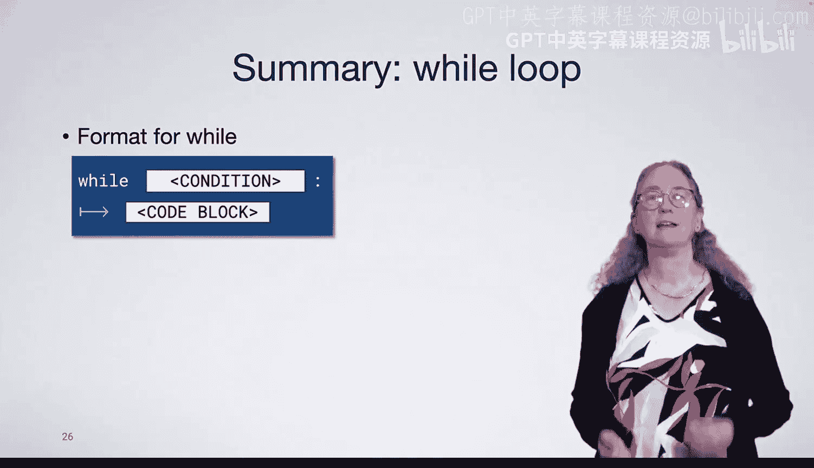

# 杜克大学《Python编程实践｜Practical Python： Start Your Programming Journey》中英字幕 p39 39_04_01_重新执行代码-while循环与添加收据.zh_en -BV1tTmCBWEQD_p39-

Imagine being Barbara Liskoff。 She was one of the first women to get a PhD in computer science back in the 1960s。

 She is amazing。😊，She works in the area of programming languages。 Back in the 60s。

 She created certain features of programming languages that we use today day。

The programming languages C plus plus Java and Python used the features she created for that and many other accomplishments。

 she received the ACM Turing Award the highest honor in computer science。😊，Well。

 let's go back to the 60s when she was a PhD student in computer science at Stanford。At that time。

 she wrote computer programme to play chess。 How would she do that。

Her code would need to make decisions。 For example。

 supposeuppose her program is playing against a player that is a real person。

If that player moves their game piece to some position on the board。

 then her programme should now figure out the next best move for the computer programme to make。

And then move a specific game piece to a specific position。

There would be a lot of decisions to make by seeing where all the chess pieces are on the board and all the different moves where they could go。

We know how to make decisions with if statements。In fact。

 there are so many decisions in playing chess that for her Ph D thesis。

 she focused on chess in games。Instead of writing a computer program to play a whole game of chess。

Her program found solutions for scenarios where there are just a few pieces on the board。

 In other words， close to the end of a game。Even for a few chess pieces。

 there can still be a lot of decisions to make。What else would her program need to do？

The players take turns moving their chess pieces， so her code would need to repeat or re execute the code for each round。

Every time the other player makes a move， her programme would then need to decide what move to make。

How many times will that repeat？😮，Well， how long is it until the end of a chess game。

That depends on which moves are made。 It might be just a few rounds， or it could be many rounds。

 Either way， we need to learn how to write Python code that re executes a block of code over and over again。

 until we need to stop repeating like when the game of chess is over。

Python uses a while loop for re executingcuting code。Here is the format for a while loop。

It is the key word， while followed by a condition that evaluates to truer faults。

 followed by a colon。This is followed on the next line with a code block that is indented。

The code block is at least one line， but it could be many lines of code。

 all indented to indicate they are the body part of the while loop。Does this format look familiar。

 It should。 It looks just like a simple， if statement。

The only difference is the first keyword of each， while versus if。They look so similar。

 just one word different， but these two structures have quite different meaning。

The wild statement represents a loop where once the end of the code inside is reached。

 execution goes back to the beginning of the loop。The code in the while loops code block can re execute many times。

 Let's compare that to the meaning of the if statement。The if statement only occurs one time。

 That's it only once it is not a loop。Here is the idea of how a while loop works。

 We start at the top of the diagram and go down until we need to evaluate the wild condition。

If the condition evaluates the true， then the code block and the body of the while is executed once。

Then we follow the arrows and come back to the diamond and evaluate the condition again。

If the condition evaluates the true， then the code block in the body of the while is executed again。

Then back up and around to check the condition again。

As long as the condition keeps evaluating to true， this cycle repeats over and over again。

 each time executing the code block and then evaluating the condition。At some point。

 the condition is checked again。 and this time， the condition evaluates to falses。

That means you are done executing the while loop。Execution continues with whatever code follows the while loop。

Let's look at an example。Maybe you have a bunch of receipts for eating out。

 and you want to write a program to enter in all the receipt amounts and find out how much you have spent on eating out。

If you only eat out a little bit， you could find out how much you spent eating out for one month。

 If you eat out a lot， that total could be just for one week。Let's plan the program。

Your programme repeatedly reads in a receipt amount and adds it to a total until all the receipts have been entered。

Then your program tells you how much you have spent。How do we do that？First， the user inputs a value。

As long as a value is a receipt， we do the following。Add the receipt to the total， so far。Wait。

 we need a variable to hold the total value。 Let's go back to the top of our program。

We need to create a variable。 We will call the variable total and initialize total to 0 before the loop starts。

 Now， back to the loop。After we add the receipt to the total， we should try to read in another value。

We re execute these three lines over and over。Addd receipt to total， get the next value。

 Make sure it's a valid receipt。 repeatat， repeat， repeat。Finally。

 once we have entered in all the receipts， we can print the total sum of all the receipts。😊。

Notice how I indented things in my plan to help me remember what belongs to the loop and what does not。

Now。You might be wondering about something。When does the while loop stop， That is。

 when do we know when we have entered in the last receipt。We still have to enter into something。

 Our program is expecting a number。 So what is not a valid receipt。

How about a negative number to indicate we are done entering receipts。

 It's unlikely we would get a receipt with a negative number。

Let's enter in negative one when there are no more receipts。

Then our while loop can be set up to just process numbers that are not negative and stop when we enter a negative one。

Let's look at an example of code with a while loop that adds up a bunch of receipts or values until negative1 is entered。

On line 1， the code creates the variable total and sets total to 0。0。On line 2。

 the code asks the user to enter in numbers and lets them know that they need to type in -1 to stop processing values。

On line 3， the code askeds the user to enter in a number。Suppose the user types in 10。25。

The variable nu is created and 10。25 is assigned to nu。On line 4。

 the while loop is evaluated to see if the number is valid。

 That is if the number is greater than or equal to 0。0。10。25 is greater than 0。

 so the condition evaluates to true。Lines5 and6 are the body of the loop。L 5 executes next。

 and the value of none is added to total。 So total is now 10。25。Next， on line 6。

 the user enters in another number。Let's assume they enter in 20。

Then the variable nu is updated to 20。What happens next。

The code has just reached the last line in the body of the while loop。 That means we go back up。

 and the next line to execute is line 4。The code needs to check the condition of the while to see if the while loop should continue executing。

The value of num20 is greater than 0。0。This condition evaluates a true。

The while it will execute again。On line 5， the value of nu 20 is added to total。Total is now 30。25。

Line 6 is next。 Let's assume the user enters in5。Notice that the variable nu is updated to 5。

What happens next。The code has just reached the last line in the body of the while loop。

The next line to execute is line 4。 The code needs to check the condition of the while to see if the while loop should continue executing。

The value of num5 is greater than 0。0。This condition evaluates the true。

 The while loop will execute again。On line 5， the value of nu5 is added to total。Total is now 35。25。

Line6 is next， let's assume the user enters in negative one。The variable nu is updated to negative 1。

 Again， the code is at the bottom of the while loop， So the next line of code to execute is line 4。

The wild condition is evaluated， and this time。Is negative 1 greater than or equal to 0。0 is false。

The while loop is now over。 Line 7 is the first line of code after the while loop。

 So line 7 executes next， and the value of total is printed。

Let's go over some of the ideas from this code that has a while loop。First。

 there has to be a way to stop the while loop。 One way is to have a special number or range of numbers to type that will force the loop to stop。

 In our example， we used-1， a negative number。In the condition。

 as long as the number was not negative， the while loop continued。 So actually。

 any negative number would work。 But we just specified negative one to make things easier。That is。

 the loop continues as long as the condition evaluates to truth。

Another idea was we needed to get an initial number before the loop so the wild loop could compare it to see if it was valid。

Then at the bottom of the while loop， we needed to ask for the next number。

Here is another way we could structure this code。We force the while loop to be true the first time。

 So the execution starts executing the loop。We do it in such a way that the total is not affected until we read in a number。

Here is how we could do this。 On line 3， we could initialize numb to 0。

That looks like the only difference， but there is another difference。 We only ask for input once。

 on line 6， instead of twice。How does this code work？

The first time line 5 executes No is added to total， but NA is 0， so this does not change total。

Then on line 6， the first number is entered in， followed by checking it on line 4。

 and if it is valid， it is added to total on line 5。In structuring the code this way。

 we get the same result， and we only have to ask for input once inside the body of the while loop。

This code still adds up all the receipts in the variable total。

Let's summarize what you have learned about the while loop。 First。

 here is the syntax or format for a while loop in Python。The format is the keyword while。

 followed by a condition and then followed on the next line with an indented code block。

Use a while loop when you need to reexec a section of code。

A wer repeats its code body over and over again until the condition for the while evaluates defaults。

Make sure you understand the difference between a while loop and an if statement。

They both have a condition to evaluate， but the while loop code can re execute the if code can only happen once。

The final thing to remember is you can force a while loop to be true the first time so that you ask for input only once in your code。

 simplifying your code。I hope you have fun writing code with while loops。

